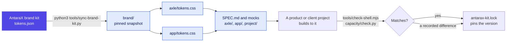
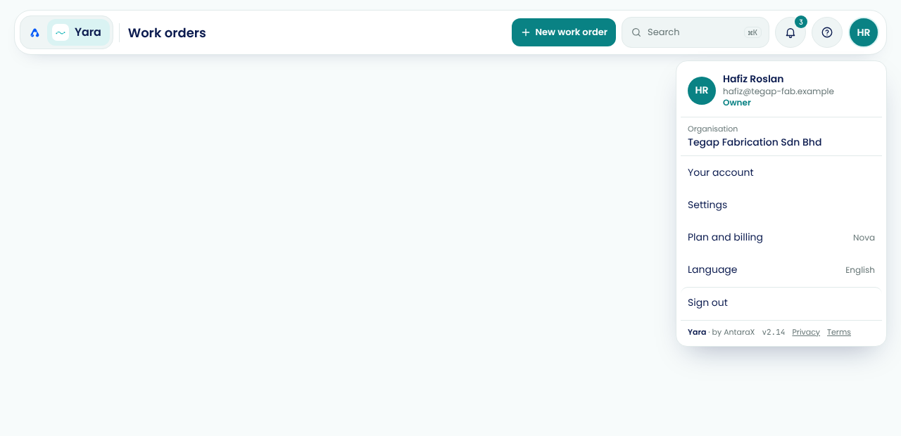
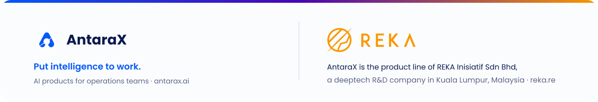

<p align="center"></p>

<p align="center">


</p>

<p align="center"><b>The shared rules for how every AntaraX app and staff console is laid out, so people find Help, their account and settings in the same place in every product.</b><br>For the people building AntaraX products, REKA's client projects and AXLE, REKA's staff console.</p>

<p align="center"><a href="BRIEF.md">Start here (AXLE)</a> · <a href="app/README.md">Customer apps</a> · <a href="axle/README.md">AXLE</a> · <a href="project/README.md">Client projects</a> · <a href="CHANGELOG.md">Changelog</a> · <a href="https://github.com/haziqfaris/AntaraX-brand-kit">Brand kit</a></p>

> [!NOTE]
> **A reference, not an app.** Nothing here is deployed; products copy from it and check themselves against it. This is version **1.12.0** ([CHANGELOG](CHANGELOG.md)). Products pin the version they built against in `antarax-kit.lock` ([how](app/README.md#pin-the-kit)). Tickets and feedback through YaraOne are agreed but not built yet ([yaraone/EMBEDS.md](yaraone/EMBEDS.md)).

## What it is

The standard dashboards for everything REKA builds: AntaraX products, REKA's client projects, and the AXLE console both share. It sits beside the [AntaraX brand kit](https://github.com/haziqfaris/AntaraX-brand-kit), which stays the source of truth for names, colour, type and the AntaraX layer.

Each AntaraX product looks like itself: its own colours, shape and navigation. Without a shared standard, a customer who uses two products would find Help, their account and their settings somewhere different in each, and REKA's staff would learn a different console for every product. This kit fixes the few things that must be the same everywhere, draws them, and gives each product a check to prove it matches.

It is not a component library every product must install, and it does not decide a product's own look. Everything the standard does not name is the product's own.

## Who it is for

| You are | Start with | What you get |
|---|---|---|
| Building or changing a product's AXLE | [BRIEF.md](BRIEF.md), then [axle/README.md](axle/README.md) | The spec, the final mock of every page, and the only colours and sizes AXLE may use |
| Building a product's customer app | [app/README.md](app/README.md) | The AntaraX shell: the top bar, the account menu, standard pages, exact sizes, reference components and a check |
| Building a dashboard for a REKA client | [project/README.md](project/README.md) | The shell's places in the client's own brand, never AntaraX's look, with "Built by REKA" in the footer |
| Adding sign-in, or a button that does something | [getting-in/SPEC.md](getting-in/SPEC.md), [actions/SPEC.md](actions/SPEC.md) | One standard for signing in and passwords, and one for confirming, waiting and results. An action is always a button, and no label ends in "…" |
| Setting up what a product runs on | [capacity/README.md](capacity/README.md) | `capacity.json`: every plan and limit, so AXLE can warn before a limit is reached |
| A coding agent in a product repository | [AGENTS.md](AGENTS.md) | Short rules: what to read first, what never to invent |

## What it does

| Step | What | State |
|---|---|---|
| 1 | Inventory of every product's navigation and dashboards, with screenshots | Done: [inventory/](inventory/README.md), browsable in [inventory/gallery.html](inventory/gallery.html) |
| 2 | The AntaraX shell for customer apps | **The standard, v1.7 (26 Oct 2026).** Start with [app/README.md](app/README.md); spec [app/SPEC.md](app/SPEC.md), tokens [app/tokens.css](app/tokens.css), mock and PNG renders [app/mock/](app/mock/README.md), reference components [app/reference/](app/reference/README.md), conformance check `tools/check-shell.mjs`. Each product's app is its own; only the shell is shared: names, the top bar (account at the far right, Help its own button), the account menu, standard pages, getting in, banners, notifications, Assist, feedback, dialogs and errors |
| 2a | REKA client projects | **The standard, v1.2 (26 Oct 2026).** Start with [project/README.md](project/README.md); spec [project/SPEC.md](project/SPEC.md), mock [project/mock/](project/mock/README.md). The client's brand on a neutral base, never AntaraX's look; the shell's places; "Built by REKA" in the footer; one stack (Next.js, shadcn/ui, Supabase) |
| 2b | Tickets and feedback | In YaraOne, for products and projects alike: [yaraone/EMBEDS.md](yaraone/EMBEDS.md). Embed contract v1.0, settled with YaraOne (its docs/19); YaraOne is building it |
| 2c | Capacity | Every product and project lists what it runs on, every limit and how it is measured in `capacity.json`; AXLE → R8 → Capacity shows how close each is and when it runs out. Any provider, any kind of infrastructure: [capacity/README.md](capacity/README.md), check with `python3 capacity/check.py` |
| 2d | Getting in | **The standard, v1.0 (18 Oct 2026).** Signing in, passwords, sign-in links, two-step sign-in, sessions and account changes for every customer app and AXLE: [getting-in/SPEC.md](getting-in/SPEC.md). Its §1 is the bare minimum (GI-01 to GI-20), §14 what each product has today; `PasswordField` in [app/reference/](app/reference/README.md); check with `node tools/check-signin.mjs` |
| 2e | Acting | **The standard, v1.1 (26 Oct 2026).** Confirming, waiting and results for every customer app and AXLE: [actions/SPEC.md](actions/SPEC.md). Three levels of confirmation (undoable, consequential, irreversible with the name typed), what a person sees by how long an action takes, and how results and errors are told; §10 what each product does today. `ConfirmDialog`, `ProgressDialog` and `useAction` in [app/reference/](app/reference/README.md); check with `node tools/check-actions.mjs`; every state per product in `app/mock/Actions*.dc.html` |
| 3 | Standard AXLE console and AXLE Central | **The standard, v1.5 (26 Oct 2026).** Build every AXLE from [axle/README.md](axle/README.md): the spec, the final mock of every page, and the tokens. Its AI pages show the product's own share of AwanGan, AntaraX's AI control plane ([AGENTS.md](AGENTS.md#ai-apis-and-data)) |

**Building or changing any product's AXLE? Start with [BRIEF.md](BRIEF.md)**, then [axle/README.md](axle/README.md). Agents: see [AGENTS.md](AGENTS.md).

## How it works



Colours and sizes start in the brand kit. This kit copies them, draws the standard with them, and gives products the files and checks to build it. A product that differs on purpose records why in its own `antarax-kit.lock`.

**How it fits with the rest of AntaraX.** The [brand kit](https://github.com/haziqfaris/AntaraX-brand-kit) owns names, colour, type and every decision; decisions are recorded in its `guide/10-decisions-log.md`. AXLE is REKA's staff console for each product, built from [axle/](axle/README.md). Tickets and feedback live in YaraOne ([yaraone/EMBEDS.md](yaraone/EMBEDS.md)). AI follows the [AntaraX AI framework, Heuristiks](https://github.com/haziqfaris/ai-framework-heuristiks); its keys, models and routing are [AwanGan](https://github.com/haziqfaris/AntaraX-AwanGan)'s, and API keys and usage rows are [Lapisan](https://github.com/haziqfaris/antarax-api)'s, so each AXLE's AI pages show the product's own share of them ([AGENTS.md](AGENTS.md#ai-apis-and-data)). Later, an API through Lapisan may replace or sit beside the YaraOne embeds.

## Connected to the brand kit

The [AntaraX brand kit](https://github.com/haziqfaris/AntaraX-brand-kit) owns every colour and size; this kit consumes them.

- **The snapshot:** `brand/tokens.json` and `brand/product-palettes.json` are pinned copies of the brand kit's tokens and each product's own palette, and `brand/brand-kit.lock` records the version and commit they came from. A mock may use a product's palette only where it shows that product's own side.
- **Generated, never edited:** `axle/tokens.css` is generated from the snapshot's `axle` section.
- **Sync:** `python3 tools/sync-brand-kit.py` refreshes both from a brand kit checkout beside this repo (or `--brand-kit PATH`).
- **The check:** `python3 tools/sync-brand-kit.py --check` fails on drift. That means a hand-edited token file, a mock colour that is not a brand token, or a brand kit that has changed since the snapshot. GitHub Actions runs it on every push and every Monday (`.github/workflows/brand-kit-sync.yml`). If the brand kit is private, add a read-only token as the `BRAND_KIT_TOKEN` secret so the check can compare against it; without one it checks the snapshot only.
- **Client projects:** `python3 tools/sync-brand-kit.py --project PATH` fails if any AntaraX colour appears in a client project's code; `--check` applies the same rule to `project/mock/`.
- **Decisions are recorded in the brand kit** (`guide/10-decisions-log.md`), in the same piece of work as the change here.

## What's inside this repository

| Path | What it holds | Open it when |
|---|---|---|
| [`BRIEF.md`](BRIEF.md) | What is decided for AXLE, where everything is, and each product's starting point | Before any AXLE work |
| [`axle/`](axle/README.md) | The AXLE standard: [SPEC.md](axle/SPEC.md), the final mock of every page, `tokens.css`, and the source standards in `reference/` | You build or change a product's AXLE |
| [`app/`](app/README.md) | The AntaraX shell for customer apps: [SPEC.md](app/SPEC.md), `tokens.css`, the mock with PNG renders, and React reference components | You build or change a customer app |
| [`project/`](project/README.md) | REKA client projects: [SPEC.md](project/SPEC.md), [BRANDING.md](project/BRANDING.md) and the mock for a fictional client | You build a dashboard for a REKA client |
| [`getting-in/`](getting-in/SPEC.md) | Signing in, passwords, sign-in links, two-step sign-in and sessions, for every customer app and AXLE | You build or change how people get in |
| [`actions/`](actions/SPEC.md) | Confirming, waiting and results: what happens when a person presses a button | You build a button that does something |
| [`capacity/`](capacity/README.md) | The `capacity.json` schema, its check and two examples | You list what a product runs on |
| [`yaraone/`](yaraone/EMBEDS.md) | How products embed YaraOne's tickets and feedback | You wire Help or AXLE → Tickets |
| [`inventory/`](inventory/README.md) | What every product shipped on 15 Oct 2026, with screenshots made with fictional data, and a [gallery](inventory/gallery.html) | You want the background |
| [`brand/`](brand) | The pinned snapshot of the brand kit's tokens and palettes. Never edited by hand | You check which brand kit version is in use |
| [`tools/`](tools) | The brand kit sync, the shell, sign-in and actions checks, the mock renderer and the gallery builder | You sync, check or re-render |
| [`antarax-kit.lock.example`](antarax-kit.lock.example) | The lock file a product keeps at its root | You pin the kit in a product |
| [`AGENTS.md`](AGENTS.md), [`CLAUDE.md`](CLAUDE.md) | Rules for coding agents | Before any change |
| [`VERSION`](VERSION), [`CHANGELOG.md`](CHANGELOG.md) | The kit's one version and what changed in each | You move a product to a newer kit |

## How to use it

### Just look

The shell's top bar and account menu, drawn in Yara's colours:

<p align="center"></p>
<p align="center"><sub>Mock data: every person and organisation is fictional.</sub></p>

Every board is rendered in [app/mock/renders/](app/mock/renders/), and every product's current screens are in the [inventory gallery](inventory/gallery.html).

### Run it on your computer

Nothing needs installing to read the kit. To run its checks you need Python 3 and Node.js.

1. Clone this repository, with the [AntaraX brand kit](https://github.com/haziqfaris/AntaraX-brand-kit) cloned beside it.
2. Check the kit against the brand kit:

   ```sh
   python3 tools/sync-brand-kit.py --check
   ```

3. Check the mock renders are current:

   ```sh
   node tools/render-mocks.mjs app/mock --check
   ```

4. To see the reference components running, follow [app/reference/README.md](app/reference/README.md).

### Everyday tasks

| Command | What it does |
|---|---|
| `python3 tools/sync-brand-kit.py` | Refreshes `brand/` and the generated tokens from a brand kit checkout beside this repo (or `--brand-kit PATH`) |
| `python3 tools/sync-brand-kit.py --check` | Fails on drift: a hand-edited token file, a mock colour that is not a brand token, or a brand kit that has moved on. Run it before committing |
| `python3 tools/sync-brand-kit.py --project PATH` | Fails if any AntaraX colour appears in a client project's code |
| `node tools/check-shell.mjs URL --product KEY --lock antarax-kit.lock` | Measures a running product's top bar against the tokens, saves its screenshot beside the reference PNG, and reports labels ending in "…" and links that go nowhere |
| `node tools/check-signin.mjs SIGNIN_URL` | Checks a running product's sign-in, reset and sign-up screens against [getting-in/SPEC.md](getting-in/SPEC.md) |
| `node tools/check-actions.mjs PATH` | Scans a product's source for what [actions/SPEC.md](actions/SPEC.md) forbids: `alert(`, `confirm(`, `prompt(` and generic error words |
| `node tools/render-mocks.mjs app/mock` | Renders every shell mock to PNG (needs Playwright and Chromium) |
| `node tools/render-mocks.mjs app/mock --check` | Changes nothing; fails if a PNG or a values table is stale or missing |
| `node tools/render-mocks.mjs app/mock --stamp-values` | After re-reading each values table against its mock, records that it is current |
| `python3 capacity/check.py capacity.json` | Checks a product's `capacity.json` |
| `python3 tools/gallery/build.py` | Rebuilds `inventory/gallery.html` (needs Pillow) |

## Documentation map

**Start here**

| Doc | What it holds |
|---|---|
| [BRIEF.md](BRIEF.md) | The AXLE brief: what is decided, where everything is, how a product chat works |
| [app/README.md](app/README.md) | Building a customer app inside the AntaraX shell, before you plan, before you ship, pinning the kit |
| [axle/README.md](axle/README.md) | Building an AXLE from the template, step by step |
| [project/README.md](project/README.md) | Building a REKA client project |
| [FRAMEWORKS.md](FRAMEWORKS.md) | How Dashboard Kit fits with the other REKA frameworks, and who governs what |

**The standards**

| Doc | What it holds |
|---|---|
| [app/SPEC.md](app/SPEC.md) | The shell, v1.7, with buttons and links in §11b |
| [axle/SPEC.md](axle/SPEC.md) | AXLE, v1.5, with open questions in §20 |
| [getting-in/SPEC.md](getting-in/SPEC.md) | Getting in, v1.0 |
| [actions/SPEC.md](actions/SPEC.md) | Acting, v1.1 |
| [project/SPEC.md](project/SPEC.md), [project/BRANDING.md](project/BRANDING.md) | Client projects, v1.2, and adopting a client's brand |
| [capacity/README.md](capacity/README.md) | `capacity.json`, thresholds and decisions |
| [yaraone/EMBEDS.md](yaraone/EMBEDS.md) | YaraOne embeds, v1.0 |

**Mocks and reference code**

| Doc | What it holds |
|---|---|
| [app/mock/README.md](app/mock/README.md) | The shell mock, its boards, renders and values tables |
| [axle/mock/README.md](axle/mock/README.md) | Every standard AXLE page, drawn for AXLE · Janka |
| [project/mock/README.md](project/mock/README.md) | The client project mock, for a fictional client |
| [app/reference/README.md](app/reference/README.md) | The bar, its menus, the list toolbar, `PasswordField`, `ConfirmDialog`, `ProgressDialog` and `useAction` in plain React |

**Background and history**

| Doc | What it holds |
|---|---|
| [inventory/README.md](inventory/README.md) | What every product shipped on 15 Oct 2026, and the suggested next steps |
| [CHANGELOG.md](CHANGELOG.md) | Every release, and what major, minor and patch mean here |

For the background, start with [inventory/README.md](inventory/README.md). It has the cross-product matrices, what has already converged, and the suggested next steps.

## For developers and agents

- **Rules:** [AGENTS.md](AGENTS.md) and [CLAUDE.md](CLAUDE.md).
- **How changes land:** `main` is this repository's main branch. Work on a branch and open a pull request into `main`.
- **The spec and the mock move together**, in the same commit; a changed shell mock also gets its PNGs re-rendered and its values table corrected.
- **One kit version:** every change to a standard bumps `VERSION` and adds to [CHANGELOG.md](CHANGELOG.md), and needs an owner decision recorded in the brand kit.
- **Before committing:** `python3 tools/sync-brand-kit.py --check`. CI also runs `node tools/render-mocks.mjs app/mock --check` and checks the capacity examples ([.github/workflows/brand-kit-sync.yml](.github/workflows/brand-kit-sync.yml)).
- **Never edit** `axle/tokens.css`, `app/tokens.css` or `brand/` by hand.

## Help and contact

- **The standard does not cover what you need:** stop and raise it with the owner; do not invent a menu group, colour or page pattern in the product ([AGENTS.md](AGENTS.md)).
- **A change to the standard:** a pull request into `main`, with the owner's decision recorded in the brand kit.
- **Help with an AntaraX product you use:** email `support@go.antarax.ai` and the team will reply.

<p align="center"></p>
<p align="center"><sub>AntaraX is the product line of REKA Inisiatif Sdn Bhd · <a href="https://antarax.ai">antarax.ai</a> · <a href="https://reka.re">reka.re</a><br>Private and proprietary. © 2026 REKA Inisiatif Sdn Bhd. All rights reserved. · Last updated 26 October 2026</sub></p>
