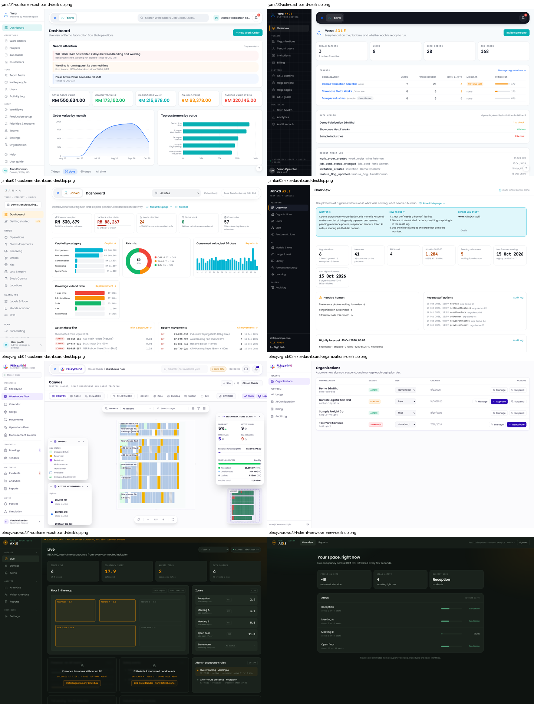
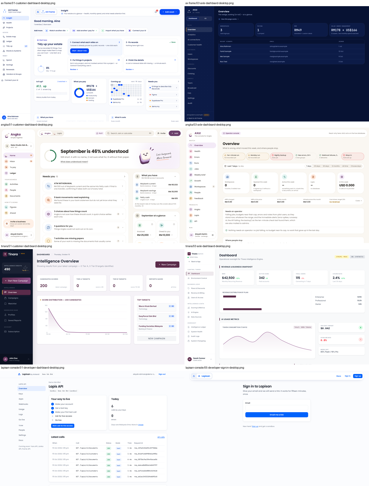

# Dashboard and navigation inventory

**Status:** step 1 of the standard dashboard and AXLE design. This is what every AntaraX product ships today, read from each repository and captured on screen on 15 Oct 2026. Nothing here is a decision yet.

Every screenshot was made with fictional data. In order of preference, they came from:

- each product's own demo mode,
- a local fake backend,
- the repository's own guide images, marked `repo-`.

No production or staging system was signed in to.

## What was covered

| Product | Repository @ commit | Surfaces inventoried | Shots | Folder |
|---|---|---|---|---|
| Yara | `haziqfaris/yara` @ `e70cb3b` | Management app · Yara AXLE · worker PWA | 25 | [yara/](yara/README.md) |
| Janka (with PLExyz Trace) | `haziqfaris/janka-inventory-intelligence` @ `7cc4b93` | Web app · phone scanner `/m` · Janka AXLE | 22 | [janka/](janka/README.md) |
| PLExyz Grid | `haziqfaris/plexyz-grid` @ `6a2b570` | Staff app · tenant portal · Grid AXLE | 31 | [plexyz-grid/](plexyz-grid/README.md) |
| PLExyz Crowd | `haziqfaris/plexyz-crowd` @ `ed08e96` | Facilities app (branded AXLE) · client view | 8 | [plexyz-crowd/](plexyz-crowd/README.md) |
| AX Frame | `haziqfaris/axframe` @ `a0ae746` | Ledger (desktop) · Insight (phone) · AXLE (Dashboard and R8 modes) | 18 | [ax-frame/](ax-frame/README.md) |
| Angka (with Lapis) | `haziqfaris/angka` @ `58f3adf` | Customer app (light and dark) · AXLE · Lapis shell (from source) | 28 | [angka/](angka/README.md) |
| Tinara | `haziqfaris/tinara` @ `02d53b7` | Partner app · Tinara Admin | 23 | [tinara/](tinara/README.md) |
| Lapisan Console | `haziqfaris/antarax-api` @ `05ea388` | Developer console · AXLE Central (planned, not built) | 14 | [lapisan-console/](lapisan-console/README.md) |
| ISO Generator (REKA, added 15 Oct) | `haziqfaris/iso-generator` @ `8dbf32e` | Workspace app · REKA Admin (its AXLE) | 34 | [iso-generator/](iso-generator/README.md) |

Each folder has:

- `README.md`: written for a designer, with nav tables, controls, dashboard widgets and embedded shots.
- `nav.json`: the same data, structured, for building the matrices below.
- `screenshots/`

The full AXLE Central requirements from the antarax-api docs are in [lapisan-console/axle-central-requirements.md](lapisan-console/axle-central-requirements.md).

Not covered:

- **AX Loom and AX Motion:** no repository yet.
- **ISO Generator** is a REKA product for its client NexusTAC, on `*.nexustac.reka.tech`. It is not in the brand kit's product list or the Lapisan registry, and was added for its AXLE. Decide whether it joins the AntaraX standard.
- **YaraOne** (one word since 16 Oct 2026): in scope (owner, 16 Oct 2026). An AntaraX product, A-mark in the Ripple family with its own colour, jade `#087F5B`; the home of every product's tickets and feedback ([yaraone/EMBEDS.md](../yaraone/EMBEDS.md)). Its customer app and AXLE were rebuilt to this kit on 16 Oct (YaraOne docs/20). Its brand kit entry waits on the owner's go.

## Customer app: navigation matrix

✓ has it · ◐ partly or per page only · ✗ none

| | Yara | Janka | PLExyz Grid | PLExyz Crowd | AX Frame | Angka | Tinara | Lapisan |
|---|---|---|---|---|---|---|---|---|
| **Shell** | sidebar 240 + floating top bar | sidebar 248 + floating top bar | sidebar 240 + floating top bar | sidebar 224, no top bar | sidebar 240 + floating top bar | floating sidebar 264 + floating top bar | navy sidebar 256, no top bar | top bar + text sidebar 220 |
| **Nav items** | 17 | 23 | 16 | 8 | 12 | 10 (+4 in profile) | 7 | 11 |
| **Groups** | Operations · Team · Setup · (Help) | Stock · Scan & tag · Plan · Watch · Organisation | Operations · Commercial · Monitoring · System | Operate · Analyze · Configure | Estate · Money | Your business · How it's going | Intelligence · Knowledge Base · Account | ‹Product› API · Team |
| **Nav icons** | lucide | lucide | lucide | lucide | lucide | lucide in tinted tiles | inline Heroicons | none |
| **AntaraX A + product pill in top bar** | ✓ | ✓ | ✓ | ✗ | ✓ | ✗ (Angka / Lapis toggle) | ✗ | ✓ |
| **"by AntaraX" credit in chrome** | ✗ "Powered by AntaraX Ripple" | ✗ | ✗ | ✗ (branded AXLE) | ✗ | ✗ | ✗ "by REKA" | ✓ |
| **Global search** | ✓ | ✗ | ◐ disabled | ✗ | ◐ per page | ✓ | ✗ | ✗ |
| **Command palette** | ✗ | ✗ | ✗ | ✗ | ✗ | ✓ ⌘K | ✗ | ✗ |
| **Notifications bell** | ✓ | ✗ | ✓ | ✗ | ✓ | ◐ nav badges | ✗ | ✗ |
| **Global create button** | ◐ on page | ✗ | ✗ | ✗ | ✓ Add asset | ✓ Add | ✓ Start New Campaign | ✗ |
| **AI entry** | ✗ | ✗ | ◐ per page | ✗ | ✓ Connect your AI, sparkle | ✓ Ask panel | ✗ | ✗ |
| **Help** | ✓ nav item + `/help` | ◐ "About this page" | ✗ | ✗ | ◐ Support & FAQ in menu | ✓ in profile menu | ✗ | ✗ |
| **User guide** | ✓ `/guide` | ✓ `/guide` | ◐ modal | ✗ | ✗ | ◐ tour only | ✗ | ◐ external docs |
| **Per-page intro or tour** | ✓ | ✓ | ✗ | ✗ | ✓ | ✓ | ✗ | ✗ |
| **Organisation switcher** | ◐ read-only chip | ✓ sidebar | ✗ | ✗ | ◐ in profile menu | ✓ sidebar card | ✗ | ◐ static chip |
| **Plan gating shown in nav** | ✗ | ✓ badges | ✓ lock icon | ✗ | ✗ | ✗ | ◐ credits card | ✗ |
| **Nav counters** | ✗ | ✗ | ✓ | ✗ | ✓ | ✓ | ✗ | ✗ |
| **Demo, sample or environment badge** | ✗ | ✓ sync + Demo | ✓ MOCK DATA | ✓ SIMULATED | ◐ early access note | ✓ sample, PILOT | ✗ | ✗ |
| **Support view (REKA inside an organisation)** | ✗ | ✗ | ✗ | ✗ | ✗ | ✓ banner | ✗ | ✗ |
| **Theme** | light | light | light | dark only | light | light, dark, system | dark sidebar, light page | light |
| **User menu at** | sidebar foot | sidebar foot | sidebar foot | sidebar foot | sidebar foot | sidebar foot | sidebar foot | top bar |
| **Phone pattern** | drawer < 1024 | drawer < 1024; scanner bottom tabs | drawer < 768 | drawer < 1024 | own Insight shell, bottom tabs < 860 | drawer and bottom bar < 768 | ✗ none | pill rows < 860 |

## AXLE: console matrix

| | Yara | Janka | PLExyz Grid | AX Frame | Angka | Tinara | AXLE Central | ISO Generator |
|---|---|---|---|---|---|---|---|---|
| **Name on screen** | Yara AXLE | Janka AXLE | PLExyz Grid AXLE — Platform Admin | AXLE · AX Frame | AXLE · the console for Angka | Tinara Admin | (planned) | REKA Admin |
| **Where it lives** | same app `/axle`, own host | separate entry `axle.html` | separate app `apps/axle` | same app `/admin`, own host | same app `/axle`, own host | in-app `/#/admin` | `axle.antarax.ai` | same build, own host `axle.nexustac.reka.tech` |
| **Look** | dark sidebar `#0B0E14`, light page, orange | dark rail `#0B0E14`, light page, orange | light, violet | dark only `#071233`, orange (closest to kit 13 §6) | light plum, theme toggle | light, plum | dark `#071233`, REKA orange (kit 13 §6) | light `#F7F6F3`, navy, DM Sans |
| **Nav items** | 12 | 11 | 5 | 15 + 6 (two modes) | 28 | 12 | (see requirements) | 13 |
| **Groups** | Tenants · Platform · Monitoring | Platform · AI · System | Tenants · Platform | Pulse · Customers · Commerce · Console / Operations · Setup | Watch · Products · Run · Trail | Control Tower · Business Logic · Intelligence & Data · Oversight | Overview · Organisations · Keys · Switches · Calls · Lookup · Health · Audit · Access · Staff | Service · Workspaces & people · AI · Library · System |
| **Landing page** | Overview: counts, readiness table, data health, audit | Overview: 7 KPIs, needs a human, staff actions, forecast run | Organisations table (no dashboard) | Overview: 4 KPIs, recent signups | Overview: status strip, range, 5 tiles, cost, needs an operator, funnel, growth | Dashboard: hard-coded MRR, plans, tokens | every product on one screen | Overview: 4 KPIs, attention strip, 14-day charts, rollout table, audit |
| **Staff roles** | reka_admin only | admin, manager | one admin role | viewer < support < admin | viewer < support < operator < admin < owner | one admin role | viewer < support < operator < admin < owner | 8 independent rights, no ladder |
| **Search** | ✗ | ✗ | ✗ | ✗ | ✗ | ✗ | Lookup by request id | ◐ top bar search, not over AXLE pages |
| **Per-page explainer** | ✓ page guide | ✓ About this page | ✗ | ✓ How this page works | ◐ lead line | ✗ | | ✓ one line under every heading |
| **Environment or state banner** | ✗ | ✗ | ✗ | ✓ OPEN ACCESS | ✓ read-only | ✓ STRIPE MOCK chips | | ◐ in page text only |
| **Support view into an organisation** | drill-down only | ✗ | slide-over panel | drill-down | ✓ starts support view | ✗ | | ◐ audited view-as, no banner |
| **Phone** | drawer | drawer | top bar toggle | drawer | sideways chip row | ✗ none | | sideways pill strip |

## What the inventory says

### Customer apps

1. **The shell has nearly converged already.** Five of eight products use a left sidebar of about 240px, a floating rounded top bar, the user menu at the foot of the sidebar, and a hamburger drawer below roughly 1024px. Yara, Janka, Grid and AX Frame also share the AntaraX A + product pill in the top bar. This is the base to standardise on, not something to invent.
2. **Phones split three ways:**
   - a drawer only (Yara, Janka, Grid, Crowd);
   - a bottom tab bar with a centre Add (AX Frame Insight, Angka, Janka's scanner);
   - nothing at all (Tinara).

   The bottom bar is the stronger pattern for daily use, and three products have already built it independently.
3. **The global controls are where products differ most.** Search, the bell, Help, the guide, the organisation switcher, the create button and the AI entry are each present in only two to four products. Angka has the fullest set: search, ⌘K, Add, Ask, the theme choice, a support view and a PILOT chip. Yara is next, with search, the bell, Help, the guide and tours.
4. **Help is the most missing piece.** Brand kit 13 §8 asks for one Help item in every menu, plus `/guide` and `/help`. Only Yara meets it. Janka, AX Frame and Angka each half-meet it in a different way.
5. **The AntaraX layer is mostly absent from the chrome.** Only the Lapisan Console carries "by AntaraX". Yara says "Powered by", Tinara says "by REKA", and Crowd shows AXLE to customers. No product uses the intan eyebrow or the awan larat curl under the active item (kit 12, Elements).
6. **Nav vocabulary drifts:**
   - the account is called Organization, Organisation, Workspace or Team;
   - signing out is Log out, Sign out or Log Out;
   - spelling mixes "Analyze" and "Optimise";
   - group names range from verbs (Operate) to nouns (Stock) to phrases (How it's going).

   Kit 12 says each product names its parts either as lines or as areas; none of the groups follow that yet.
7. **Accessibility is uneven:**
   - Yara, Grid, AX Frame, Angka and Lapisan have a skip link, but only Angka, Lapisan and Grid's AXLE mark the current nav item with `aria-current`;
   - no product uses the AntaraX-blue focus ring on nav items;
   - Grid and Crowd remove input outlines;
   - Tinara has no focus styles and no reduced-motion handling.

### AXLE

1. **Seven consoles, seven looks.** (ISO Generator's REKA Admin, added later, is light navy.) Only AX Frame matches kit 13 §6 (dark `#071233`, orange accent). Yara and Janka are close: a dark `#0B0E14` sidebar with a light content area. Grid and Tinara are light. Angka is plum with a theme toggle.
2. **Six names.** Only AX Frame and Angka use the "AXLE · Product" form. Grid still says "Platform Admin" with an em dash, and Tinara says "Tinara Admin".
3. **The sections recur across consoles:**
   - Organisations (all)
   - People and staff (5)
   - Plans, features and billing (6)
   - AI models, usage and cost (5)
   - Health, jobs and errors (4)
   - Audit (all)
   - Help content (3)
   - Announcements or broadcast (2)
   - Analytics or growth (3)

   With the AXLE Central list from antarax-api (Keys, Switches, Calls, Lookup, Access requests, Connect apps, Accounts, Staff), this is enough to define one standard AXLE nav with optional product sections.
4. **The landing pages already agree on a shape:**
   - platform counts at the top,
   - a "needs a human" or "needs an operator" list,
   - recent staff actions or audit,
   - a health or run status.

   Grid has no landing page; its console opens on a table. Tinara's figures are hard-coded.
5. **Staff roles:** Angka's five rungs (viewer < support < operator < admin < owner) match the antarax-api AXLE Central ladder, and AX Frame uses three of them. The other consoles have one admin role. Kit 13 reserves "REKA support" as a customer-facing phrase, so the staff role "support" may need another name.
6. **No console has global search.** AXLE Central plans "Lookup" by request id. Cross-product search for organisations and people would be new.

### ISO Generator's AXLE (added 15 Oct)

It scores 4 of 8 on the AXLE scorecard (Angka and AX Frame score 6). It falls short on what the brand kit asks for:

- It is named "REKA Admin".
- It is light navy, not dark with REKA orange, and has no AntaraX A.
- Staff have 8 separate rights rather than a role ladder.
- On phones the nav is a strip of 13 pills.
- It has no AXLE Link.

It has the best operator behaviour of any console, and the standard AXLE should take these patterns from it:

- A gate that names the missing right and who can grant it.
- A dash with "needs the Usage & cost right" instead of a false "$0.00".
- Workspace scope kept in the address.
- A workspace page that opens with a readiness checklist.
- A live trace that leads with what to fix.
- An attention strip on the overview that links to each fix.

Fix first: "View workspace as" shows no banner and still offers "New project", even though the right is called read-only (`capabilities.ts:36-39`, screenshot 23).

### Issues found along the way (not fixed: each belongs to its own repo)

- **PLExyz Crowd:**
  - shows AXLE to customers everywhere, including the print report;
  - the locked tier panels show prices and name falls, vitals and through-wall sensing, which kit 03 forbids.
- **Grid:** the notifications dropdown is drawn under the Warehouse Floor's floating panels.
- **AX Frame AXLE:**
  - on phones the hamburger covers every page title (`admin.css:62` is overridden by `:106`);
  - the phone "+" tab has no accessible name.
- **Tinara:**
  - no responsive layout (content squeezed to about 134px at 390px wide);
  - an empty "Switch Identity" heading in pilot mode.
- **Lapisan Console:** the signed-in top bar overflows at 390px.
- **Brand kit drift:**
  - kit 13's audit quotes Janka's old AXLE title;
  - AX Frame's sheet and `AXF-AXLE-THEME.md` describe old colours;
  - Angka's `DESIGN.md` no longer matches its code.

## Suggested next steps

1. Agree the **customer shell anatomy** from what has converged:
   - sidebar, floating top bar with the product pill, user menu at the sidebar foot;
   - drawer below 1024px plus a bottom bar on phones;
   - one fixed set of global controls in fixed places: search and palette, bell, Add, Ask with the sparkle, Help, organisation switcher;
   - the AntaraX layer (credit line, intan eyebrow, awan larat active item, blue focus ring).
2. Agree the **standard customer dashboard**:
   - greeting and context;
   - a "needs you" list (Yara alerts, Janka "Act on these first", AX Frame "Needs you", Angka "Needs you" all already exist);
   - four KPI tiles;
   - charts in the product's colours;
   - recent activity;
   - optional AI insight with the sparkle.
3. Agree the **standard AXLE**:
   - one dark look (kit 13 §6) and one name form;
   - one nav skeleton: Overview · Organisations · People · Staff · Plans & features · AI & cost · Health · Audit · Help content, with product sections slotted in;
   - one landing page: counts, needs an operator, health, recent staff actions;
   - one staff role ladder;
   - an Overview that can roll up into AXLE Central.
4. Record the open choices in the brand kit's `11-open-questions.md`. Examples: bottom bar or drawer on phones; whether "Workspace" survives in AX Frame; what the "support" staff role should be called.
