# Angka: navigation and dashboard inventory

Repo `haziqfaris/angka` at `58f3adf` (14 October 2026). Next.js 16.3.8, React 19, Tailwind v4, shadcn on Radix, lucide icons, Supabase, deployed on Cloudflare (open-next). Angka includes Lapis, its document layer.

All screenshots come from a local dev server in the repo's own demo mode (no Supabase env, an in-memory store with the fictional "Reka Studio Sdn Bhd", date pinned to 8 September 2026). No secrets and no remote backend were used. The machine-readable version is [nav.json](nav.json).

Surfaces:

1. Customer app (Angka)
2. AXLE, the console for Angka
3. Lapis by Angka (signed-in shell, from source only)
4. Sign-in

---

## 1 Customer app

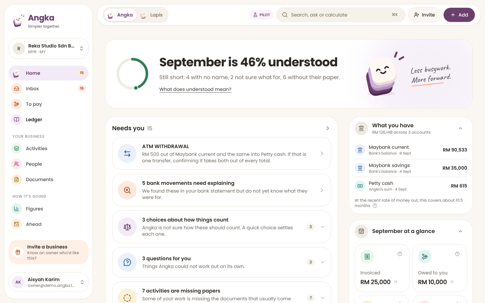

### Shell

- **Layout:** a floating white sidebar (264px, rounded 24px corners, sticky at viewport height, scrolls on its own with a fade) and a floating top bar (64px), both on a warm paper ground with a 12px gutter. Content is `max-w-6xl`.
- **Entry files:** `app/(app)/layout.tsx:47` (session and live counts), `components/shell/app-shell.tsx:121` (frame; sidebar at :208, top bar at :235, phone bar at :283), `components/shell/nav-items.ts:58` (the nav config), `components/shell/sidebar-nav.tsx:31`, `components/shell/bottom-nav.tsx:129`, `components/shell/more-sheet.tsx:20`, `components/shell/profile-menu.tsx:53`, `components/shell/org-switcher.tsx:13`, `components/shell/product-toggle.tsx:19`, `components/shell/command-palette.tsx:46` and `:267`, `components/shell/pilot-mark.tsx:21`, `components/shell/invite-button.tsx:22`.
- **Brand block:** the Angka sheet-stack mascot (inline SVG, `components/brand/angka-mark.tsx`), "Angka" in bold plum, tagline "Simpler together." No credit line in the chrome.

### Navigation

| Group | Label | Route | Icon (lucide) | Roles | Gating | Badge |
|---|---|---|---|---|---|---|
| (none) | Home | `/` | Angka mascot (House on the phone bar) | all | none | attention count |
| (none) | Inbox | `/inbox` | Inbox, orange tile | all | none | arrivals, unmatched, proposals |
| (none) | To pay | `/to-pay` | HandCoins, orange | all | approvals and stages inside are feature flags | overdue and awaiting my approval |
| (none) | Ledger | `/ledger` | BookOpen, plum, bold | all | none | none |
| Your business | Activities | `/activities` | Layers, green | all | none | none |
| Your business | People | `/people` | Users, rose | all | none | none |
| Your business | Documents | `/documents` | FileText, amber | all | none | none |
| How it's going | Figures | `/management` (+ `/flow`, `/map`, `/review`) | ChartColumn, teal | all | none | none |
| How it's going | Ahead | `/commitments` | CalendarClock, amber | all | none | none |
| How it's going | Reports | `/reports` (+ `/handoff`) | FileSpreadsheet, neutral | all | none | none |

Each item has a round tinted icon tile in a fixed identity hue. Badges are peach (`#FFE9DC` with `#A24A1E` text). Settings, the plan and the account live in the profile menu, not the list.

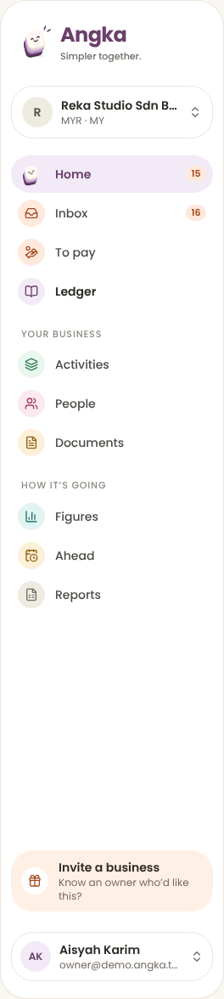

### Global controls

| Control | What it is today |
|---|---|
| Search | "Search, ask or calculate" field in the top bar (320px, 384px at xl) from 1024px; an icon below that |
| Command palette | Cmd+K / Ctrl+K. Groups: Try, Do, Go to, then results by kind; a sum is worked out; a question goes to Ask |
| AI entry | Ask: from the search box or palette (Sparkles row), opens a right-hand Ask panel |
| Create | Plum "Add" button in the top bar; raised round button in the phone bar. Opens the Add sheet (Files, Note, Voice, Bank; Start an activity). Hidden for viewers |
| Product switcher | Angka / Lapis segmented toggle with the two mascots, top left |
| Workspace switcher | Business card under the wordmark: businesses with role, Settings, Add another business |
| Plan badge | "PILOT" chip: feedback to AXLE, referral, "Show me around again" |
| Invite | Outline "Invite" button in the top bar and a peach "Invite a business" card in the sidebar |
| Notifications | No bell. Nav badges and a dismissible announcement banner at the top of the page |
| Help | Profile menu: "Show me around" (tour) and "Help and guides" (`/help`) |
| Theme | Profile menu: Light, Dark, Same as the device (cookie `angka_theme`) |
| Language | None (English only) |
| User menu | Your account, Emails and notifications, Settings, Plan & billing, Appearance, Show me around, Help and guides, About Angka, Privacy, Terms, Sign out |
| Environment | Sample banner when the workspace holds the sample business |
| Impersonation | Black support banner at the very top: "Support view of {business}, read only, ends at {time} · End now" |

| Profile menu | Business switcher | Command palette |
|---|---|---|
| 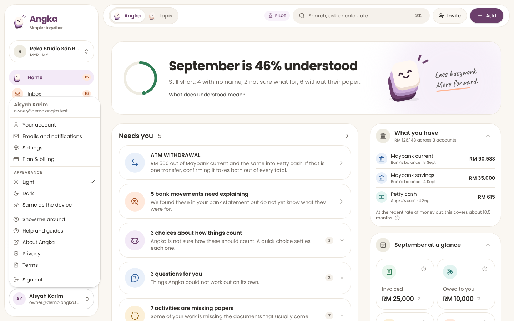 | 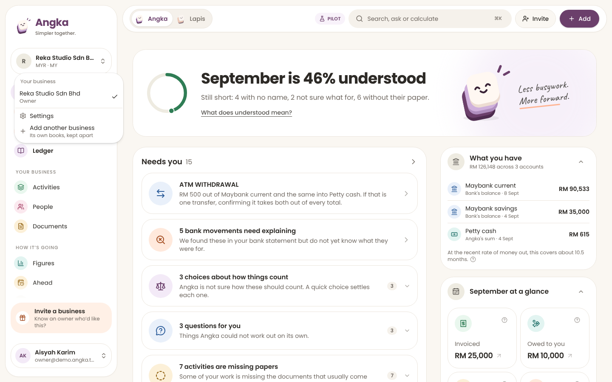 | 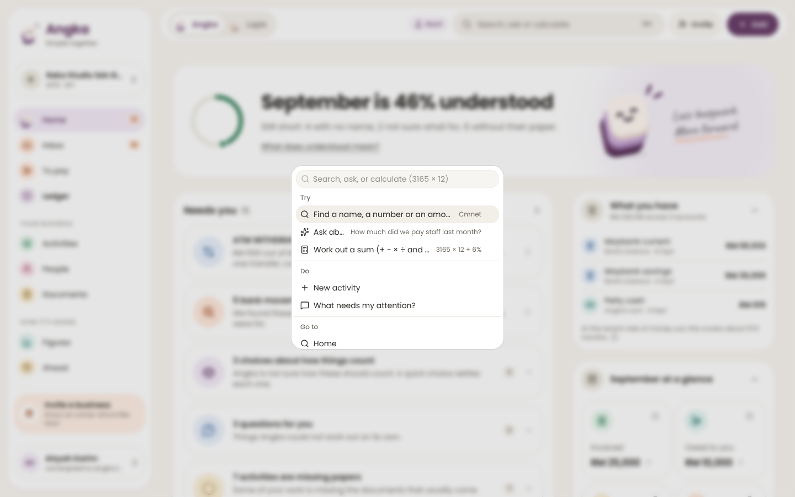 |

| Add sheet | Ask panel |
|---|---|
| 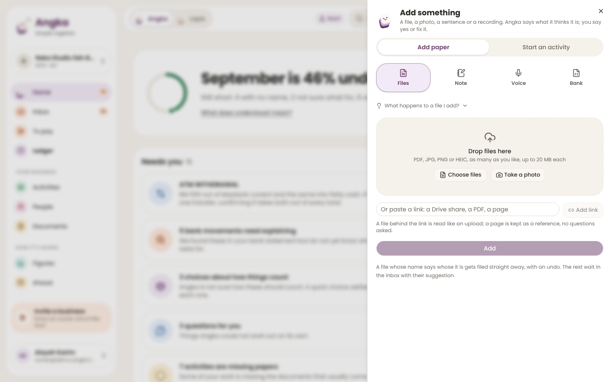 | 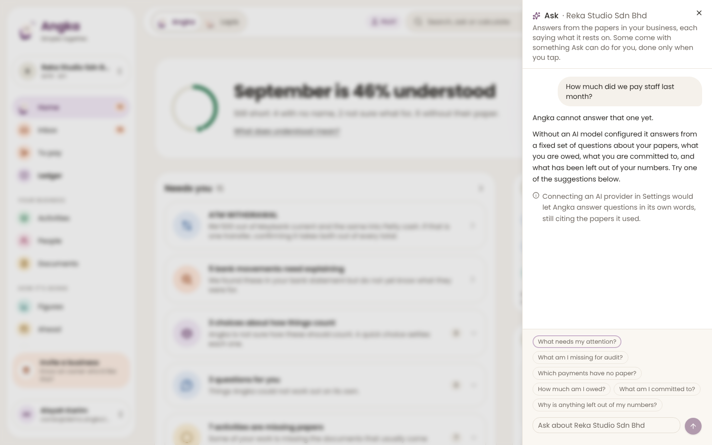 |

### Responsive behaviour

- From 768px: sidebar and top bar.
- Below 768px: a phone top bar. On Home it holds the Angka / Lapis toggle, a round search button and an initials button that opens the left drawer (18rem, the same sidebar body). On other pages it shows a back chevron, the page title centred and search.
- A fixed bottom tab bar: Home, Inbox, raised Add, To pay, More, with badges and safe-area padding. More opens a bottom sheet: Ledger as a row, tile grids for Your business and How it's going, then Settings and Your account.

| Home | Drawer open | More sheet | Inner page |
|---|---|---|---|
| 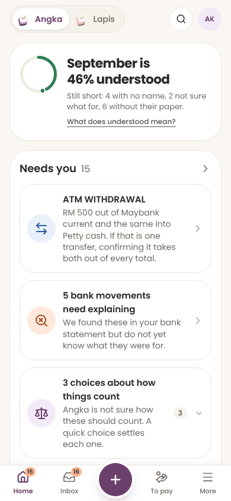 | 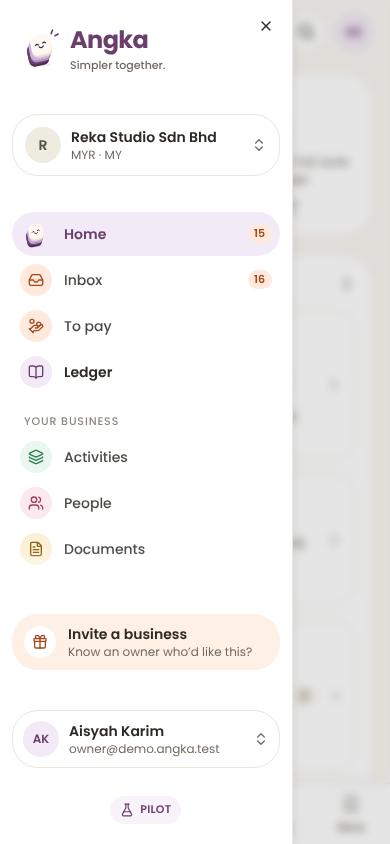 | 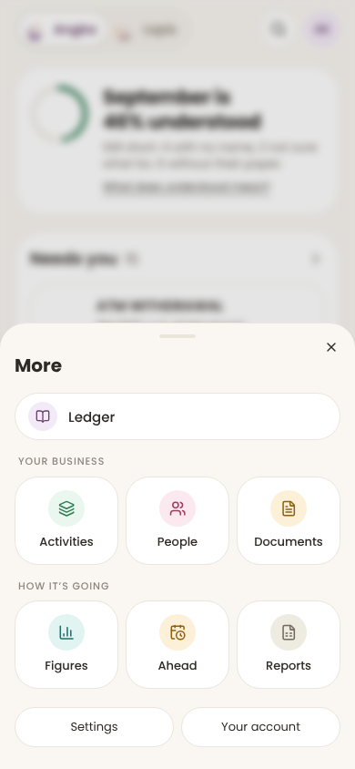 | 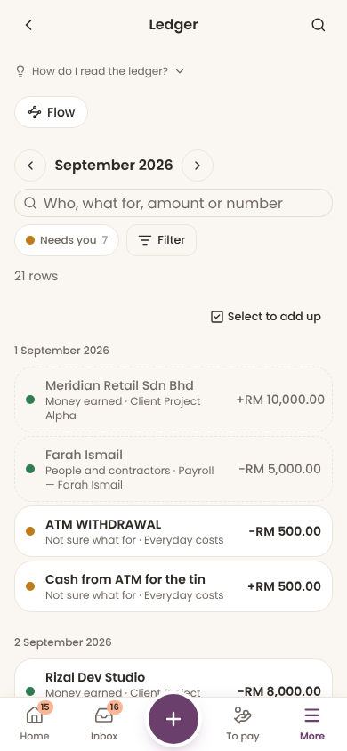 |

### Styling

- **Active item:** lavender wash `#F3EAF7`, plum text `#6B3F6B`, semibold, rounded 16px, `aria-current="page"`. Phone bar: plum icon and label, heavier stroke.
- **Tokens:** plum `#6B3F6B`, paper `#FAF7F2`, white sidebar and cards, hover `#F6F2EC`, ink `#2D2A26`, muted `#716A63`, border `#EBE5DC`, focus ring `#9B6F9B`. Dark: ground `#1D191C`, sidebar `#262125`, brand `#D2A6D2`.
- **Type:** Poppins for UI; Caveat for handwritten asides; Geist Mono. Nav 14px, group labels 11px uppercase, tab labels 11px.
- **Accessibility:** skip link, labelled badges, plum focus ring, 60px tab cells, reduced motion turns off the rise, lift, ring and mascot animations.
- **Roles:** owner, member, viewer. A viewer has no Add. Otherwise the nav is the same for everyone. There is no link from the app to AXLE (`/admin` redirects to `/axle`).

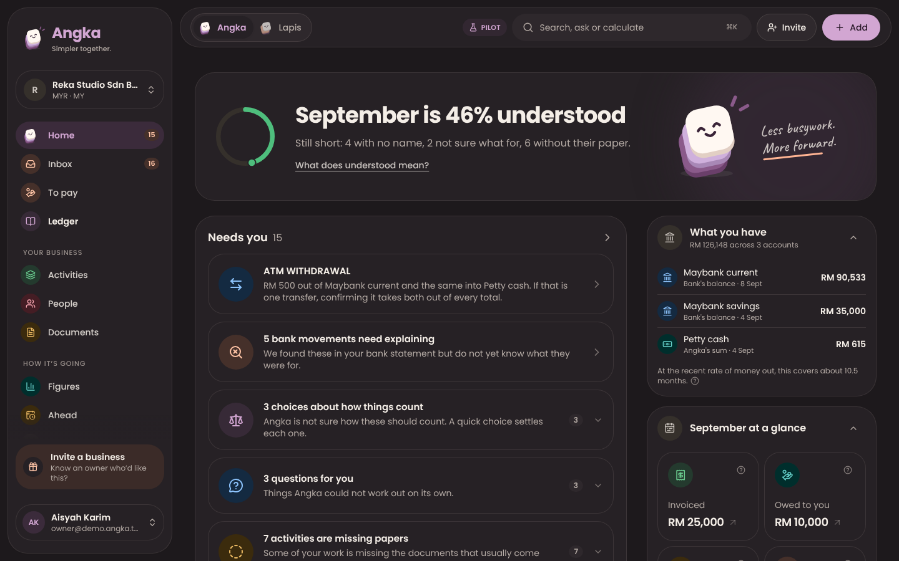

### Dashboard: Home (`/`, `app/(app)/page.tsx:50`)

1. **Greeting:** "September is 46% understood", completeness ring, "Still short: ..." line, "What does understood mean?", mascot with a Caveat tagline.
2. **Add to phone** card (until installed).
3. **Needs you (15):** attention cards with tinted icon tiles (transfer to confirm, bank movements to explain, choices, questions, missing papers).
4. **Lapis promo:** "Turn your work into the right documents." with "Create a document".
5. **What you have** (right column): balance per account and a runway line.
6. **September at a glance:** four tiles (Invoiced, Owed to you, Fixed monthly costs, Everyday costs) and the biggest spend line.
7. **Your activities:** four activity cards and "All".
8. **Coming up:** dated list of what is owed, owing and committed.
9. **Empty state:** with no bank lines, Home becomes "Start here" (three steps).

No date-range picker: Home shows the latest month with data.

Full page: [desktop](screenshots/01b-customer-dashboard-desktop-full.png), [phone](screenshots/02e-customer-dashboard-mobile-full.png) (the fixed bottom bar lands mid-page in a full-page capture).

---

## 2 AXLE, the console for Angka

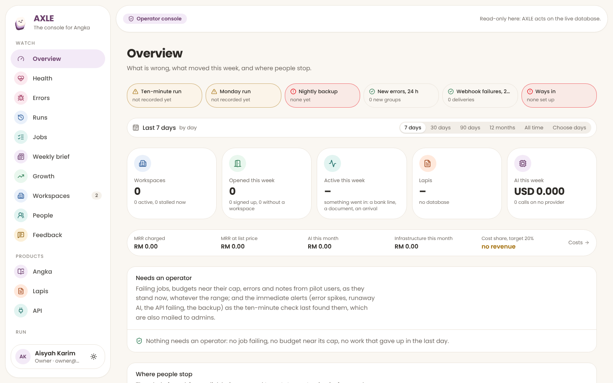

### Shell

- **Where:** `axle.angka.antarax.ai` with clean paths (set by `AXLE_HOST` in `proxy.ts`); locally at `/axle`. The demo person is a staff owner, so it renders read-only.
- **Layout:** the app's own shell: floating 248px sidebar, floating 64px top bar, page title and lead from the nav item, footer "Run by REKA Inisiatif Sdn Bhd".
- **Entry files:** `app/(axle)/layout.tsx:36` (sidebar :74, header :90, phone nav row :116, footer :121, operator card :129), `components/axle/axle-nav.tsx:64` (config), `:131` (sidebar), `:180` (phone row), `:210` (title), `lib/axle/staff.ts`, `lib/axle/roles.ts`.
- **Brand block:** Angka mascot (40px), "AXLE" in bold plum, "The console for Angka". Top bar chip "Operator console" with a shield.

### Navigation

| Group | Label | Route | Icon (lucide) | Badge |
|---|---|---|---|---|
| Watch | Overview | `/` | Gauge | alarms (peach) |
| Watch | Health | `/health` | HeartPulse | |
| Watch | Errors | `/errors` | Bug | errors in last 24h (peach) |
| Watch | Runs | `/runs` | History | |
| Watch | Jobs | `/jobs` | ListChecks | |
| Watch | Weekly brief | `/brief` | Newspaper | |
| Watch | Growth | `/growth` | TrendingUp | |
| Watch | Workspaces | `/tenants` | Building2 | workspace count (grey) |
| Watch | People | `/people` | UsersRound | |
| Watch | Feedback | `/feedback` | MessageSquareText | unseen (peach) |
| Products | Angka | `/angka` | BookOpenCheck | |
| Products | Lapis | `/lapis` | FileText | |
| Products | API | `/api` | Plug | |
| Run | AI | `/ai` | Cpu | |
| Run | AI calls | `/model-calls` | ListTree | |
| Run | Costs | `/costs` | Coins | |
| Run | Plans | `/plans` | Layers | |
| Run | Features | `/features` | ToggleRight | |
| Run | Billing | `/billing` | Wallet | |
| Run | Requests | `/requests` | FileLock2 | open PDPA requests, admins only (peach) |
| Run | Email | `/email` | Mail | |
| Run | Access | `/access` | KeyRound | |
| Run | Staff | `/staff` | ShieldCheck | |
| Run | Security | `/security` | LockKeyhole | |
| Run | Announcements | `/announcements` | Megaphone | |
| Run | Help centre | `/help-centre` | LifeBuoy | |
| Run | Settings | `/settings` | Settings2 | |
| Trail | Audit | `/audit` | ScrollText | |

Roles: every page needs staff rung viewer or above; non-staff get a 404, and two-step sign-in can be required first. The five rungs (viewer, support, operator, admin, owner) all see the same nav; controls inside pages say "needs {role}".

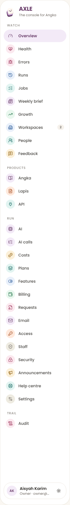

### Global controls

No search, palette, bell, help, workspace or product switcher, create button or AI entry. The operator card at the foot (initials, name, "Owner · email") has a theme toggle that cycles light, dark and system, and a sign-out icon (only with a database). Without a database the top bar says "Read-only here: AXLE acts on the live database." Pages carry their own range picker.

### Responsive behaviour

Below 768px the sidebar goes. The header keeps the mark, "AXLE", the theme toggle and sign-out, and all 28 places become one sideways-scrolling chip row above the title, with no group labels. No drawer and no bottom bar.

| Phone | Dark |
|---|---|
| 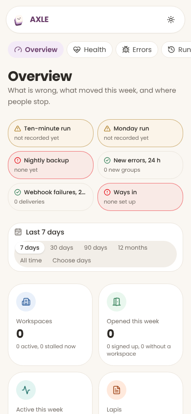 | 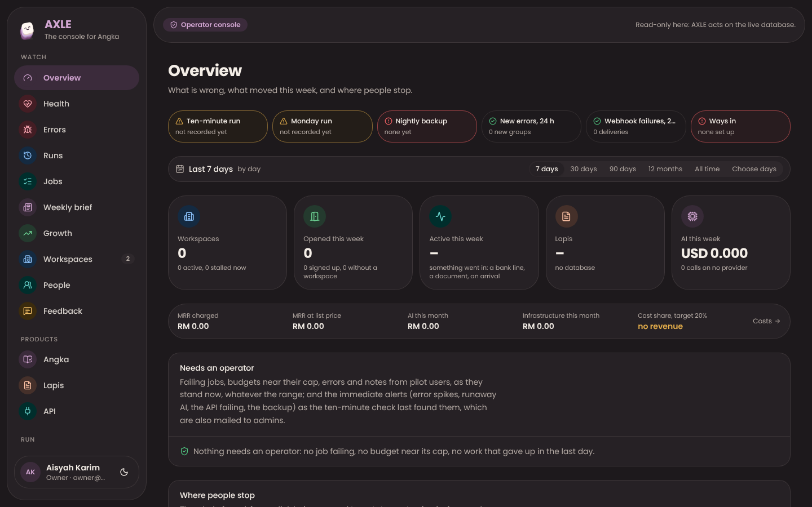 |

### Dashboard: Overview (`app/(axle)/axle/page.tsx:53`)

1. **Status strip:** six tiles (Ten-minute run, Monday run, Nightly backup, New errors 24 h, Webhook failures, Ways in), tinted ok, warn or fault.
2. **Range picker:** 7 days, 30 days, 90 days, 12 months, All time, Choose days.
3. **Five KPI tiles:** Workspaces, Opened this week, Active this week, Lapis documents issued, AI cost this week.
4. **Cost strip:** MRR charged, MRR at list price, AI this month, Infrastructure this month, cost share against a 20% target.
5. **Needs an operator:** alarms and links to unread feedback, errors and Lapis Business requests.
6. **Where people stop:** funnel chart.
7. **By day:** bar chart of accounts made and workspaces opened.
8. **Stalled workspaces** (when any).
9. **Workspaces:** six newest with counts and stage chips.
10. **Recent operator actions:** audit feed.
11. **Planned:** roadmap list.

[Full page](screenshots/03b-axle-dashboard-desktop-full.png). Most figures read zero because the demo has no database.

---

## 3 Lapis by Angka (signed-in shell)

Not captured: the signed-in shell needs a Supabase-backed Lapis account. The source is `components/lapis/lapis-shell.tsx:99` and `app/(lapis)/layout.tsx:34`. It is the Angka shell "focused on documents":

| Group | Label | Route | Icon | Badge |
|---|---|---|---|---|
| (none) | Documents | `/lapis/home` | FileText, peach | |
| (none) | Customers | `/lapis/people` | Users | |
| (none) | To chase | `/lapis/chase` | BellRing | chase count |
| (none) | Quick sale | `/lapis/sale` | Store | |
| Your paper | Branding | `/lapis/branding` | Palette | |

- **Top bar:** Angka / Lapis toggle, Pro chip, "Find a document or a customer" search, Invite, plum "New document".
- **Phone bar:** Documents, Customers, raised peach New document, Sale, More.
- **Active colour:** peach `#FFE9DC`.
- **Profile menu:** Settings, Plan & billing, Appearance, Show me around, Help and guides, About Lapis, Privacy, Terms, Sign out.
- **Footer:** "Lapis is part of Angka, and Angka is part of AntaraX, the AI studio from REKA".
- **Home (`/lapis/home`):** header, welcome, Add to phone, Lapis guide checklist, Today takings, To chase row, drafts for approval, drafts, documents table with filters, invite card.

Signed out, Lapis has a quiet public bar (wordmark "by Angka", What is Angka?, Sign in, theme toggle):

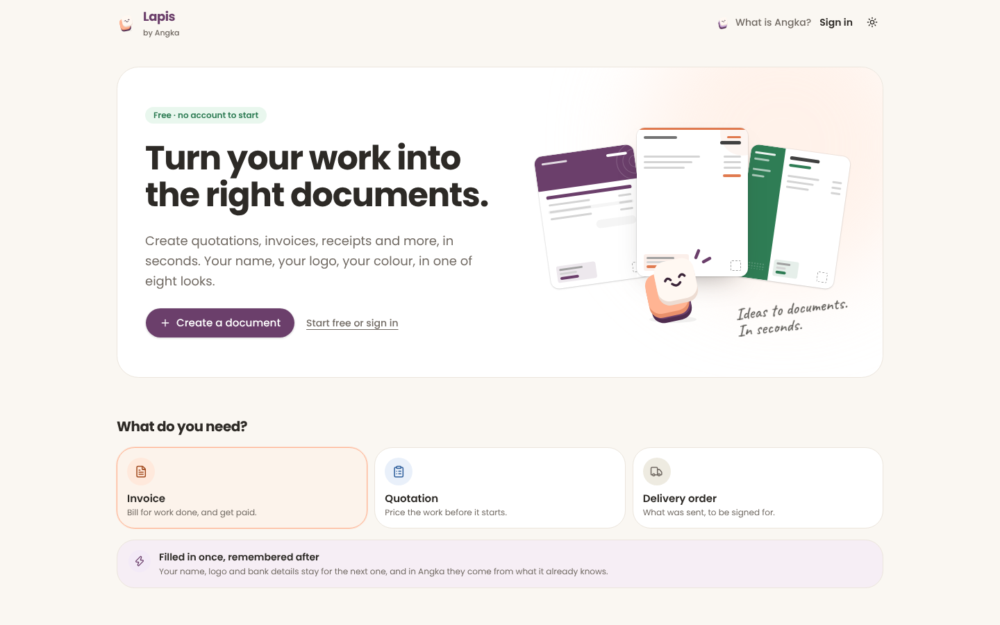

---

## 4 Sign-in

The real form (email and password) was rendered with dummy Supabase settings and a tiny local mock. The demo build shows "Open the demo business" instead.

| Real form | Phone | Demo build | Lapis sign-in |
|---|---|---|---|
| 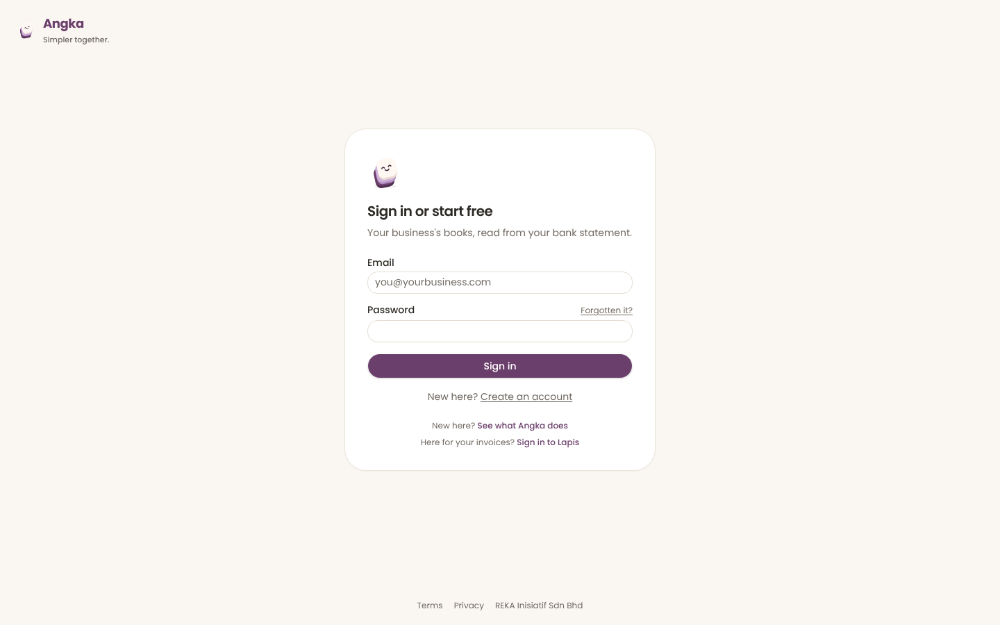 | 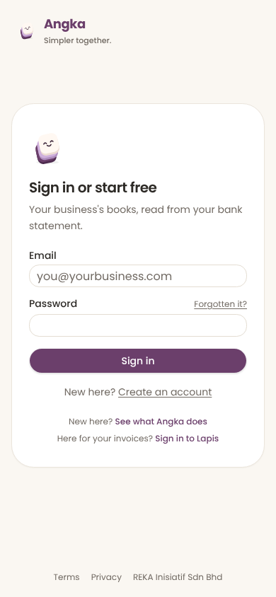 | 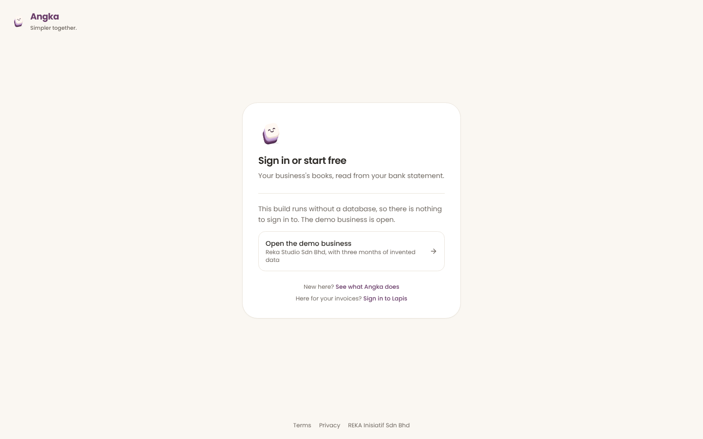 | 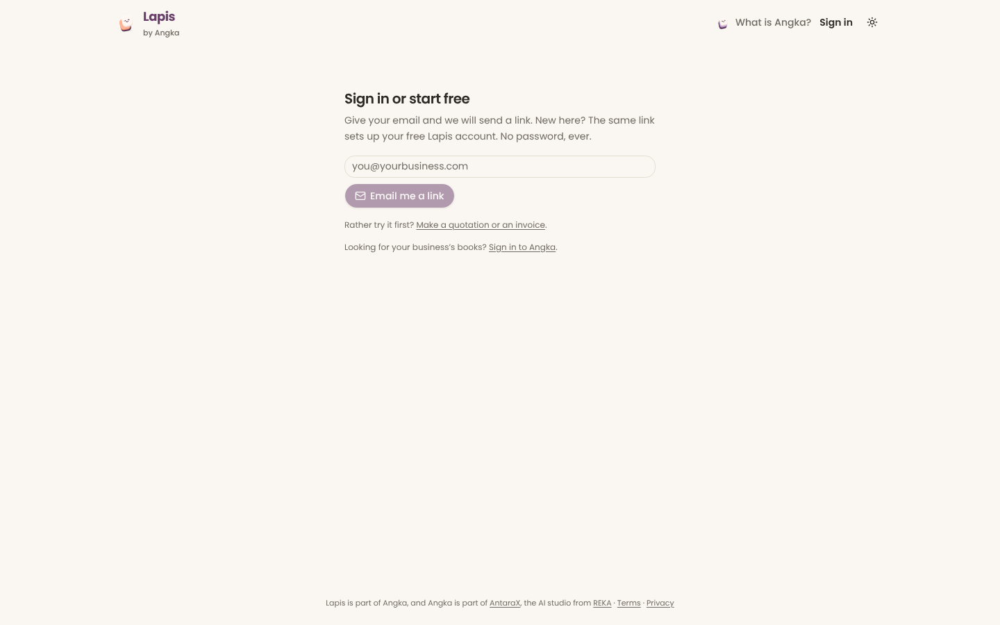 |

The footer reads "Terms · Privacy · REKA Inisiatif Sdn Bhd". There is no help link.

---

## Reference images in the repo

`docs/reference/` holds three AI-generated design concepts named for 23 September 2026. They are not the live app. They show an older nav (a Products group with Angka and Lapis, and an Insights group with Ask and Hand-off), and a phone bar of Home, Documents, Ask, Insights, More.

| Dashboard concept | Brand sheet | Phone concepts |
|---|---|---|
| 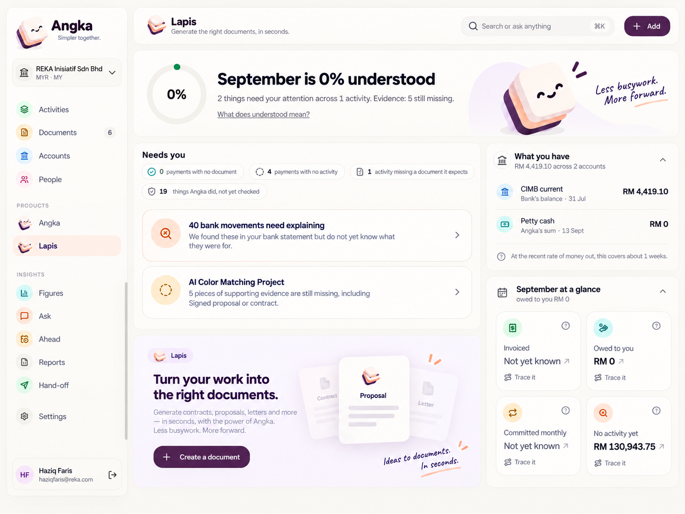 | 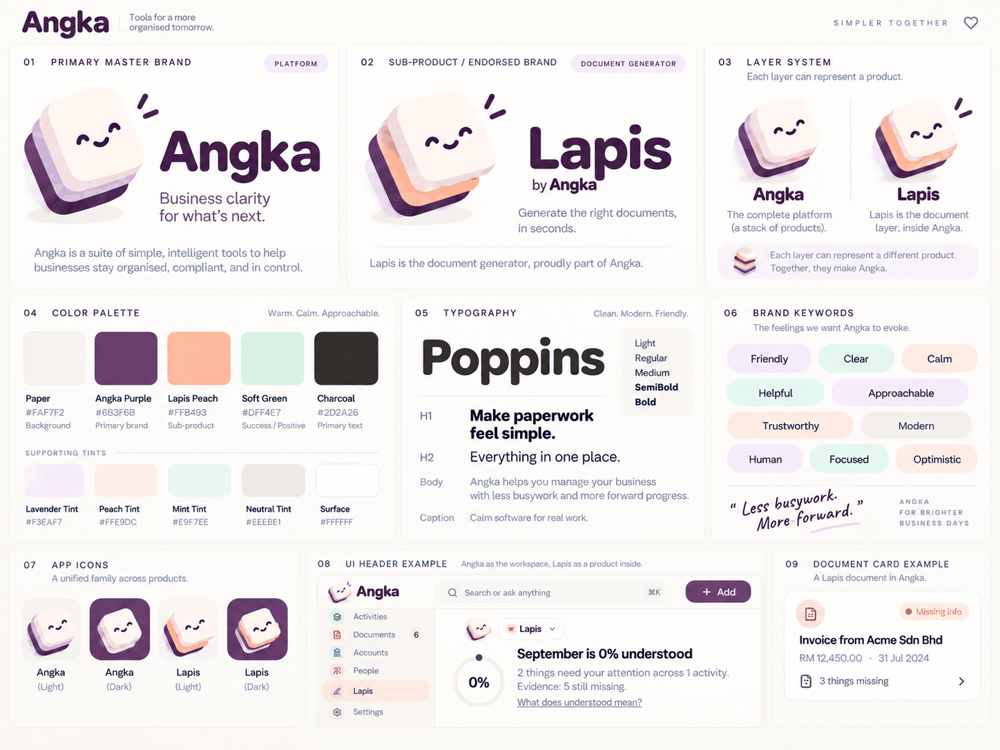 | 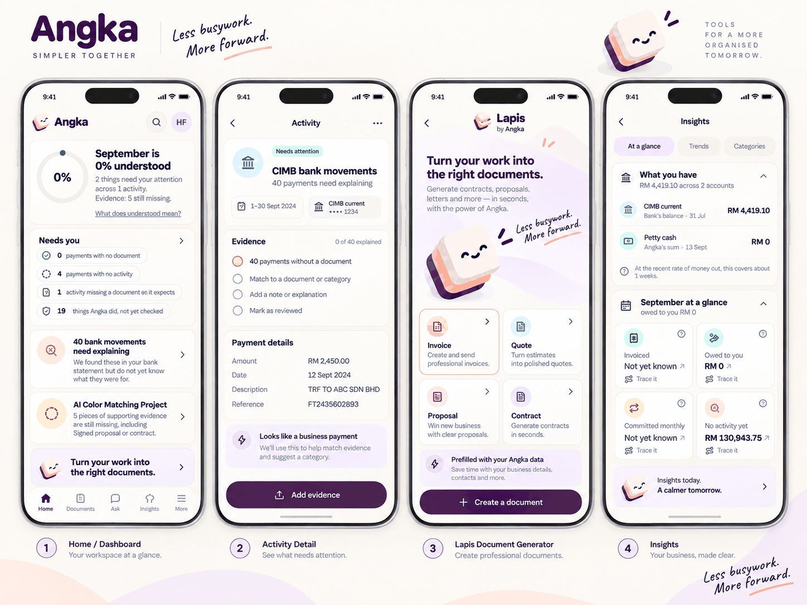 |

---

## What to keep

- **One nav config feeds everything.** `nav-items.ts` and `axle-nav.tsx` drive the sidebar, the phone sheet, the phone titles and the page titles.
- **Round tinted icon tiles** in fixed identity hues, with live counts only where they mean something.
- **The floating sidebar and top bar**, the same in Angka, Lapis and AXLE.
- **The phone pattern:** a bottom bar with four places and a raised primary action, plus a More sheet. No hamburger for the daily places.
- **One primary action per product:** Add in Angka, New document in Lapis.
- **Search, Ask and calculate in one box** with Cmd+K.
- **The theme choice** in the profile menu (light, dark, system). The brand kit names it the reference implementation.
- **The support-view banner** and the sample banner, as patterns for impersonation and environment notices.
- **The AXLE Overview order:** status first, then range, KPIs, money, what needs a person, then trends.

## What conflicts with the brand kit

- **Credit line:** no "Angka · by AntaraX" in the chrome. "REKA Inisiatif Sdn Bhd" on sign-in and "Run by REKA Inisiatif Sdn Bhd" in AXLE are used as product credits.
- **AXLE look:** it is the app's light plum shell with a theme toggle and the Angka mascot. The kit wants a dark-only `#071233` console with REKA orange `#FB9800` and the AntaraX A, named "AXLE · Angka", on `axle.antarax.ai`.
- **Focus ring:** plum `#9B6F9B`, not AntaraX blue `#0459F7`.
- **Type:** Caveat and Geist Mono are in use; the target is Poppins plus JetBrains Mono.
- **Taglines:** three run at once ("Simpler together.", "Less busywork. More forward.", "Business clarity for what's next").
- **Dark ground and text:** the dark ground is `#1D191C`, not the dark product ground. Text `#2D2A26` is not the shared navy.
- **AntaraX layer:** no AntaraX app tiles, intan eyebrow or congkak motif. The AI sparkle appears only on Ask.
- **Help:** there is no `/guide` in the user-guide format, no help link on sign-in and no Help in AXLE.
- **Money:** AXLE writes `USD 0.000`; the standard is `US$`.
- **Error copy:** the error page says "This page tripped over itself".
- **Labels:** "PILOT" and the group labels are uppercase; check them against the eyebrow rule.
- **AXLE nav size:** 28 places in one list. On phones they become an unlabelled chip row.
- **DESIGN.md is out of date:** it gives a 248px sidebar, Geist Sans, groups Overview/Records/Insight/Workspace, a count on Documents, "no toggle is exposed yet", and a Cmd+K trigger in the sidebar. None of these match the code.
