# AX Frame: dashboard and navigation inventory

Repo `haziqfaris/axframe` at `a0ae746` (15 Oct 2026). Next.js 16 App Router, React 19, Supabase, lucide-react icons. One app serves both the customer app and AXLE.

Machine-readable version: [nav.json](nav.json).

How the screenshots were made: the app ran locally (`next dev`, port 3105) against a small fake Supabase on port 3205 that answered auth and table reads with fictional data ("Demo Sdn Bhd", user "Aina Rahman"). No real backend was touched. The Next.js dev badge was hidden with CSS.

Things to know before reading:

- The customer app is one client component (`src/App.tsx`). Screens are switched by state and the `?v=` query, not by routes.
- Desktop and phone are two different shells, swapped at 860px wide. The product calls them two altitudes: desktop is the **Ledger** (full grid), phone is **Insight** (a three-second read).
- Every nav label, icon and page description comes from one registry, `src/features/shell/pageMeta.ts`.

---

## 1. Customer app, desktop

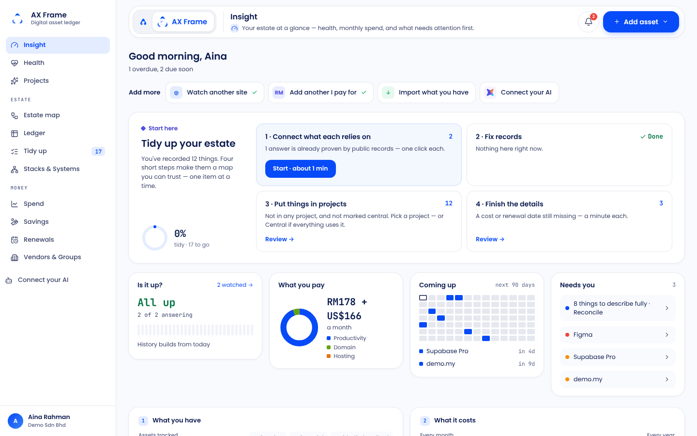

Entry files: `src/App.tsx:271` (sidebar), `:308` (top bar), `src/features/shell/pageMeta.ts:173` (nav layout), `src/features/shell/BrandPill.tsx:11`, `src/components/ProfileMenu.tsx:8`, `src/features/shell/desktop.css`.

**Layout.** A fixed white left sidebar, 240px wide. On the right, a floating white top-bar card (64px tall, 24px radius) sits above the scrolling content. Content is capped at 1240px. There is no collapsible rail.

**Brand.** The sidebar shows the breathing Frame mark (36px), "AX Frame" and the sub-line "Digital asset ledger". The top bar repeats the brand as a pill: the AntaraX "A" (links to antarax.ai), then a white chip with the Frame mark and "AX Frame" (links home). Next to the pill come the page title, a small icon chip and a one-line description. There is no "by AntaraX" credit in the chrome.

### Nav items

| Group | Label | Route | Icon (lucide, 16px) | Roles | Gating / badge |
|---|---|---|---|---|---|
| (none) | Insight | `?v=insight` (home) | Gauge | owner, member | |
| (none) | Health | `?v=health` | HeartPulse | owner, member | |
| (none) | Projects | `?v=projects` | Sparkles | owner, member | |
| Estate | Estate map | `?v=map` | Workflow | owner, member | |
| Estate | Ledger | `?v=ledger` | Table2 | owner, member | |
| Estate | Tidy up | `?v=tidy` | ListChecks | owner, member | Count badge of steps to go (hidden at 0) |
| Estate | Stacks & Systems | `?v=systems` | Network | owner, member | |
| Money | Spend | `?v=executive` | LineChart | owner, member | |
| Money | Savings | `?v=savings` | HandCoins | owner, member | |
| Money | Renewals | `?v=renewals` | CalendarClock | owner, member | |
| Money | Vendors & Groups | `?v=vendors` / `?v=groups` | Building2 | owner, member | Two tabs inside the page |
| Pinned at foot | Connect your AI | `?v=ai` | Bot | owner, member | Violet pill, solid when active |

Reached from the profile menu, not the nav: Profile (drawer), Billing (`?v=billing`, billing actions are owner-only), Notifications, Support & FAQ, Workspace. Reconcile (`?v=reconcile`) is reached from the dashboard's "Needs you" card and from Tidy up.

**Active state.** Soft blue fill `#E4EDFF`, Frame blue `#074AF8` text and icon, weight 600, 9px radius. A child screen keeps its parent lit (Groups lights Vendors & Groups).

### Global controls

| Control | What exists |
|---|---|
| Search | None global. The Ledger has its own search box. |
| Command palette | None |
| Notifications | Bell in the top bar, 44px round, red unread count. Dropdown with "Mark all read" and a link to notification settings. |
| Create | "Add asset" primary button with a menu: Is my website up?, Something I pay for, Import what you have, Connect your AI, Something else (full form). It turns secondary on Stacks & Systems, Groups and Projects, which have their own main action. |
| AI entry | "Connect your AI" pinned item and quick start. The kit's AI sparkle marks AI work only. |
| Help | "Support & FAQ" in the profile menu, plus a small help icon that brings back a dismissed page intro. No `/guide` or `/help`. |
| Workspace switcher | Inside the profile menu, only when you belong to more than one workspace. |
| Product switcher | None. The AntaraX "A" just links out. |
| User menu | Profile, Billing, Notifications, Support & FAQ, Workspace, Switch workspace, Sign out (with a "Sign out?" confirm). |
| Theme, language | None. Light only, English only. |
| Plan, environment, impersonation | None in the chrome. An "Early access" card sits bottom-right while REKA has open access switched on. |

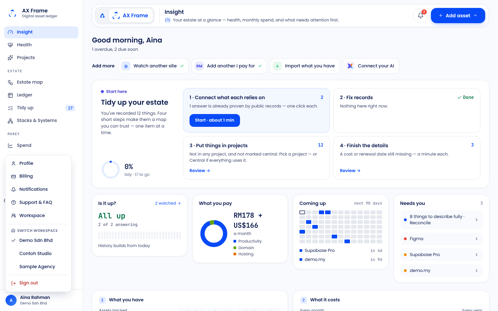
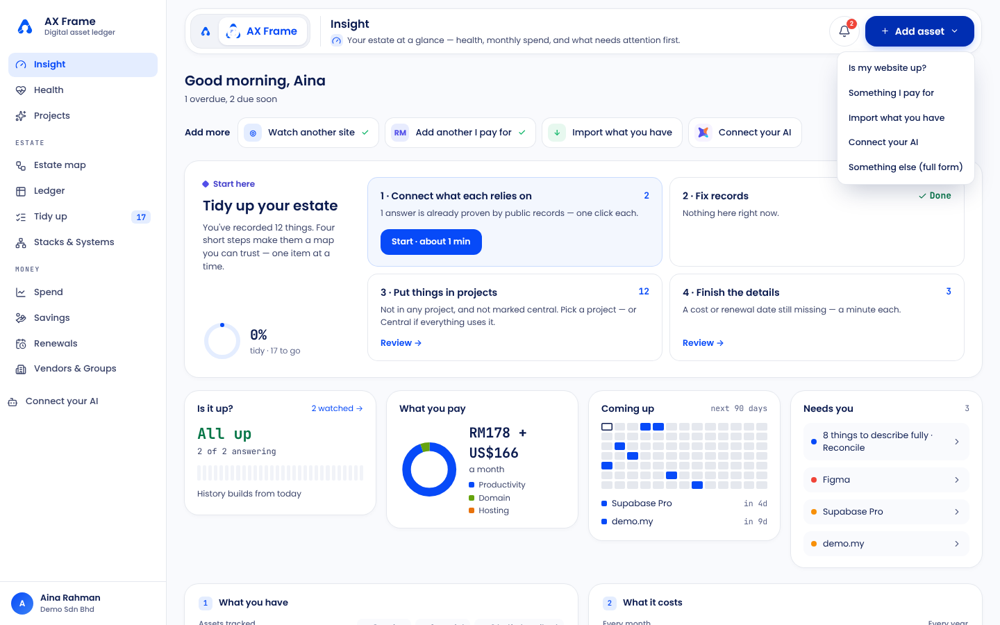
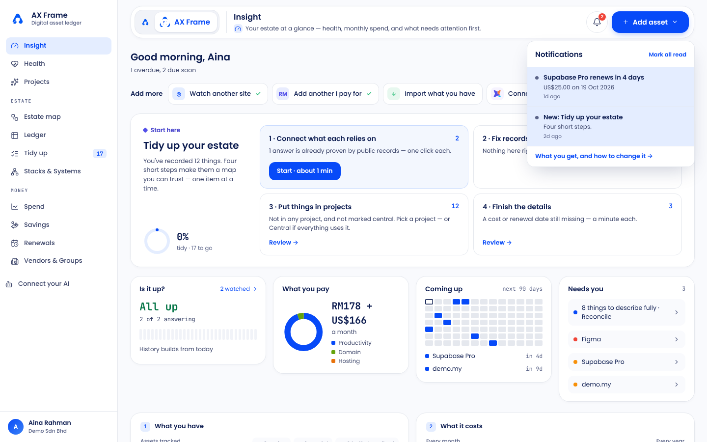

### Dashboard: Insight (`src/features/overview/Overview.tsx:45`)

In order, top to bottom:

1. **Greeting**: "Good morning, Aina" with the attention headline ("1 overdue, 2 due soon"), and a "Could save" link when Savings has suggestions.
2. **Quick start**: four cards for a new account (website, something I pay for, import, connect your AI). Once three things are tracked they shrink to an "Add more" chip row. Opening one grows a panel in place.
3. **Tidy up your estate**: progress ring and four step cards with counts (shown once three things are tracked and steps remain).
4. **Four status cards**:
   - **Is it up?**: uptime text and daily bars.
   - **What you pay**: a donut by category, with totals by currency.
   - **Coming up**: a 90-day calendar grid.
   - **Needs you**: an attention list plus a Reconcile row.

   Each card shows a dashed blue "Example" blueprint until real data exists.
5. **1 What you have**: count, status chips, a category bar and a link to the Ledger.
6. **2 What it costs**: monthly and yearly totals, a period picker, expected vs recorded, and "Where it goes" bars by system or stack.
7. **3 How it fits together**: a read-only mini map and "Open the map".

Full page: [01-customer-dashboard-desktop-full.png](screenshots/01-customer-dashboard-desktop-full.png). The Ledger, the desktop altitude's main grid: [01e-customer-ledger-desktop.png](screenshots/01e-customer-ledger-desktop.png).

---

## 2. Customer app, phone

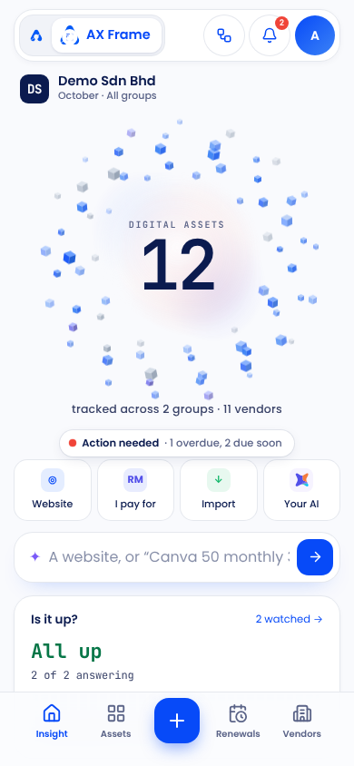 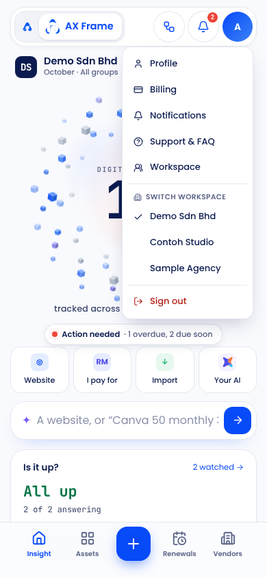

Entry files: `src/App.tsx:390` (mobile shell), `src/App.tsx:447` (tab bar), `src/features/insight/InsightScreen.tsx:46`, `src/features/insight/insight.css:145`.

**Layout.** A phone-width column (max 430px). At the bottom is a fixed tab bar, 82px tall and blurred. Insight also has a top app bar card. Other screens use a back link and a page title. There is no hamburger drawer: the avatar menu is the menu.

| Place | Label | Goes to | Icon |
|---|---|---|---|
| Tab bar | Insight | Insight | House 22px |
| Tab bar | Assets | Asset list | LayoutGrid |
| Tab bar | + | "Add to your workspace" sheet: the four quick starts, Something else, New project, New stack or system | Plus in a 50px blue square |
| Tab bar | Renewals | Renewals list | CalendarClock |
| Tab bar | Vendors | Vendors (Groups from there) | Building2 |
| App bar | Estate map | Map | Workflow |
| App bar | Bell | Notifications sheet | Bell |
| App bar | Avatar | Same menu as desktop | Initial |

Active tab is Frame blue. Inactive tabs are muted ink.

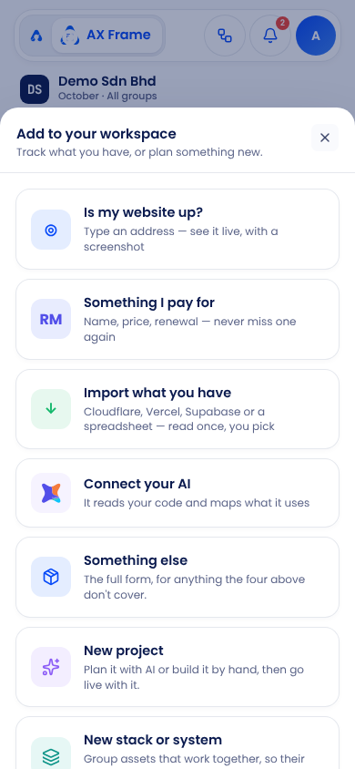

### Dashboard: Insight on a phone

In order, top to bottom:

1. App bar: brand pill, map, bell, avatar.
2. Workspace row: initials tile, workspace name, month.
3. **Halo hero**: the breathing cube halo, with the asset count under the "Digital assets" eyebrow. Under it, a caption and a health chip.
4. Quick-start buttons and the **AskBox**, a sparkle input that routes you to a quick start.
5. The same four status cards as desktop.
6. **AX Frame · Understand**: one rule-based sentence with warn and fault highlights.
7. Entry cards: something is down, Could save, Tidy up, things to reconcile, Estate map, Projects.
8. **Your assets** carousel: overdue and expiring first, then an "Add asset" card.
9. Total monthly spend by currency.
10. **Renewal runway · 12 weeks** bar chart.

Full page: [02-customer-dashboard-mobile-full.png](screenshots/02-customer-dashboard-mobile-full.png).

---

## 3. AXLE (REKA operator console)

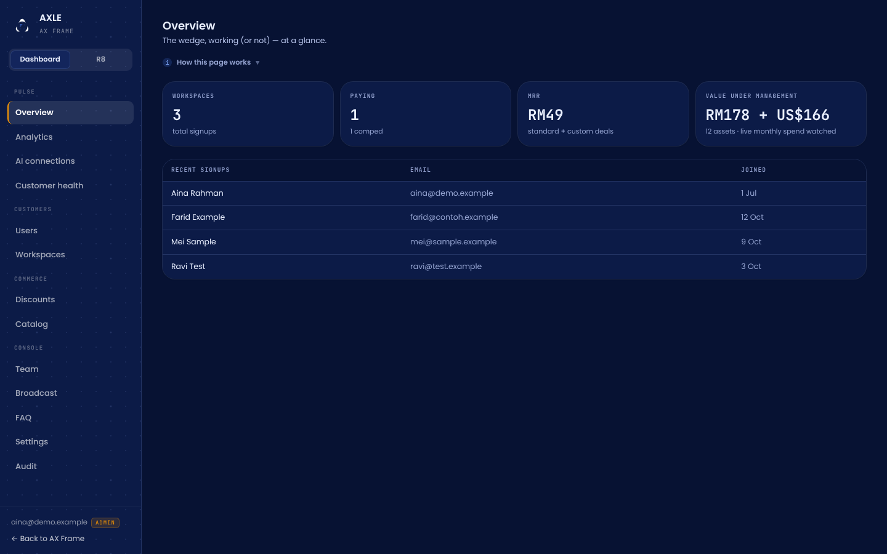

Entry files: `src/app/admin/layout.tsx:13`, `src/features/adminui/AdminShell.tsx:15`, `src/features/adminui/AdminNav.tsx:9`, `src/features/adminui/admin.css:18`, `src/lib/admin/auth.ts:9`, `src/middleware.ts:74`.

**Layout.** Dark only. A sticky 230px sidebar (raised navy with a dotted blueprint ground) beside the main content, capped at 1240px. There is no top bar. Below 860px the sidebar turns into a 250px drawer, opened by a hamburger button in the top-left corner.

**Brand.** The animated Frame mark, then "AXLE" with "AX FRAME" under it in mono capitals. The footer shows the staff email, a role chip in orange (VIEWER, SUPPORT or ADMIN) and "Back to AX Frame". The page title is "AXLE · AX Frame".

A **Dashboard / R8** switch sits under the brand. The console remembers which mode you last used, and the nav changes with the mode.

| Mode | Group | Label | Route | Roles | Gating |
|---|---|---|---|---|---|
| Dashboard | Pulse | Overview | `/admin` | all staff | |
| Dashboard | Pulse | Analytics | `/admin/analytics` | all staff | |
| Dashboard | Pulse | AI connections | `/admin/ai` | all staff | |
| Dashboard | Pulse | Customer health | `/admin/health` | all staff | |
| Dashboard | Customers | Users | `/admin/users` | all staff | Recover needs support or admin |
| Dashboard | Customers | Workspaces | `/admin/workspaces` | all staff | Pricing needs admin; comp needs support or admin |
| Dashboard | Commerce | Discounts | `/admin/discounts` | all staff | |
| Dashboard | Commerce | Catalog | `/admin/catalog` | all staff | |
| Dashboard | Console | Team, Broadcast, FAQ, Settings, Audit | `/admin/team` … `/admin/audit` | all staff | |
| R8 | Operations | Overview, Jobs, Providers, Visual | `/admin/r8` … | all staff | Run, pause, test and capture by role |
| R8 | Setup | Configuration, Audit | `/admin/r8/configuration`, `/admin/r8/audit` | all staff | |

No nav item has an icon. Every role sees the same nav; the pages hide or disable actions by role (viewer, support, admin). A signed-in person who isn't REKA staff gets a "not on the staff list" page with Sign out. Troubleshoot (`/admin/r8/troubleshoot`) isn't in the nav; it is reached from links.

**Active state.** A light white fill with a 2px REKA orange `#FB9800` left border.

**Global controls.** There is no search, bell, user menu or sign-out in the shell. Each page has a "How this page works" guide. An **OPEN ACCESS** banner sits on every page while open access is on.

**Colours.**

| Role | Value |
|---|---|
| Ground | `#071233` |
| Raised | `#0C1B47` |
| Ink | `#EAF0FF` |
| Body | `#B6C3EA` |
| Actions | Frame blue `#074AF8` |
| Links and focus | `#4D84FE` |
| Accent | Orange `#FB9800` |

### Dashboard: Overview (`src/app/admin/page.tsx:10`)

Title and subtitle, then:

1. "How this page works" guide.
2. Four KPI tiles: Workspaces, Paying (with comped), MRR, and Value under management (by currency).
3. A recent signups table (six rows).

The R8 overview (`src/app/admin/r8/page.tsx`) has three blocks: "Needs an operator", a grid of five job tiles and a grid of nine outside-service tiles.

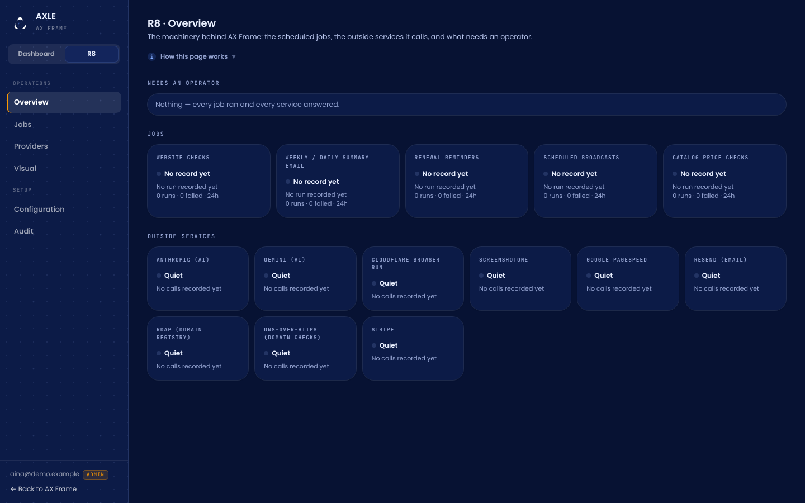

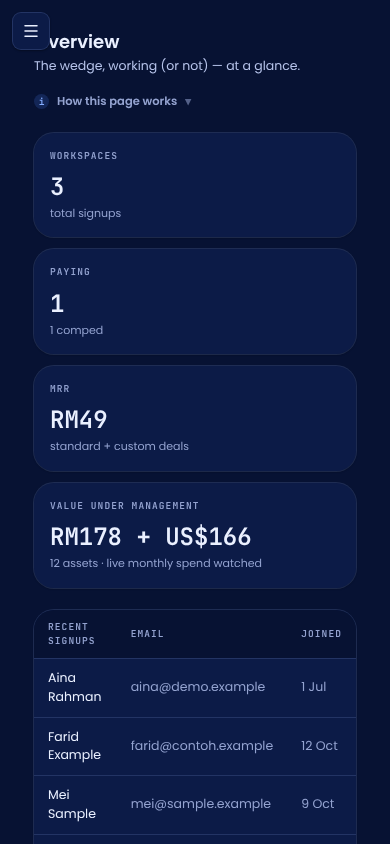 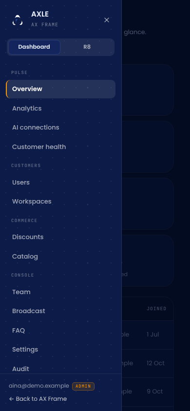

---

## 4. Sign-in

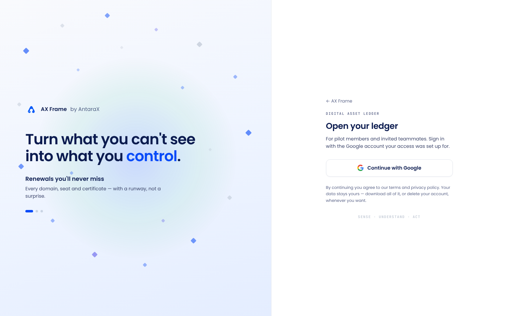 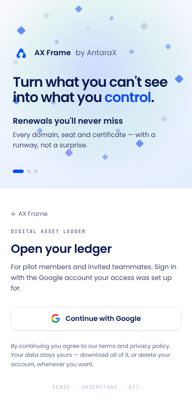

The customer sign-in shows the closed-pilot copy and "AX Frame by AntaraX". AXLE has its own sign-in on its host: [05b-axle-signin-desktop.png](screenshots/05b-axle-signin-desktop.png).

## 5. Spec mock (not the shipped app)

[spec-axf-hero-mobile.png](screenshots/spec-axf-hero-mobile.png) comes from `axf-hero.html`, the reference for the phone halo hero. It uses older sample data and orange cubes. The shipped phone screen is section 2.

---

## What to keep

- **One nav registry.** Labels, icons and descriptions all come from `pageMeta.ts`, so the header and the sidebar can't drift apart.
- **The floating top bar.** Brand pill, page title with a one-line description, bell, then one primary action. It is already shared with Angka.
- **Short, job-based nav groups** (Estate, Money) with counts only where they mean something (Tidy up).
- **Dashboard cards that show "Example" until real data exists.** A useful pattern for empty states across products.
- **AXLE's Dashboard / R8 split** (business vs machinery), the role chip, and the open-access banner as an always-visible switch warning.
- **Phone shell built for a quick read**: tab bar with a centre "+", and the avatar menu instead of a drawer.

## What conflicts with the brand kit

- **No credit line.** "AX Frame · by AntaraX" is missing from the app chrome. Only sign-in has it.
- **No Help item, no `/guide` or `/help`.** Help hides in the profile menu as "Support & FAQ" (13 §8).
- **Hard-coded violet** (`#7A5AF8`) on "Connect your AI", and a hard-coded avatar gradient. Both sit outside the Frame tokens.
- **"Workspace" instead of "organisation"** on settings and billing (13 §1). No plan name (Seed or Nova) appears in the chrome.
- **AXLE focus ring is `#4D84FE`**, not AntaraX blue `#0459F7` (13 §10).
- **AXLE phone bug.** A later CSS rule cancels the phone top padding, so the hamburger covers each page title (`admin.css:62` vs `:106`).
- **AXLE has no icons and no sign-out** in its shell.
- **US spelling.** AXLE says "Authorized staff only"; British spelling is "authorised".
- **AXLE address** is `axle-antarax.vercel.app`, not `axle.antarax.ai`.
- **Accessibility.** No `aria-current` on any nav, the phone "+" button has no name, and there is no axe check.
- **Out-of-date docs.** `AXF-AXLE-THEME.md` (July) describes a light canvas and old colours. The brand kit's Frame sheet still lists the old `#0062FB` primary and orange accent as gaps, but the repo already moved to Frame blue and keeps orange in AXLE only.
