# ISO Generator: dashboard and navigation inventory

Repo `haziqfaris/iso-generator` at `8dbf32e` (2026-10-05). React 19, TypeScript, Vite, Tailwind, react-router, lucide-react icons. Supabase backend in production, Cloudflare Worker for hosting, and a browser-only preview mode (`VITE_BACKEND=local`) that this inventory used.

One build serves two hosts (`src/app/hosts.ts:9-10`):

- **Workspace app** for consulting firms: `iso.nexustac.reka.tech`, home `/iso-documents`.
- **AXLE** for REKA staff: `axle.nexustac.reka.tech`, routes `/admin/*`. On screen it is called **"REKA Admin"**, never AXLE.

Both share one top bar (`src/app/Shell.tsx`). AXLE adds a left sidebar inside it. The product has no AntaraX branding anywhere, and it is not covered by a sheet in `AntaraX-brand-kit/guide/products/`.

Contents: [1 AXLE](#1-axle-reka-admin) · [AXLE scorecard](#axle-scorecard) · [2 Workspace app](#2-workspace-app-customer) · [3 Sign-in](#3-sign-in) · [How the screenshots were made](#how-the-screenshots-were-made) · [Keep and conflicts](#what-to-keep) 

---

## 1. AXLE (REKA Admin)

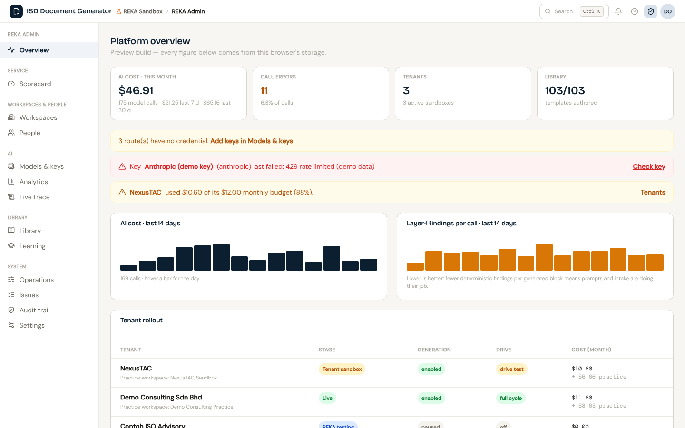

### Files

| What | Where |
|---|---|
| Access gate (platform admins only, by `platform_admins` membership) | `src/app/App.tsx:93-101` |
| `/admin/*` route; on `iso.*` it redirects to `axle.*` | `src/app/App.tsx:114-123`, `CrossHost` at `:8-13` |
| `/` goes to `/admin` on the AXLE host | `src/app/App.tsx:111` |
| Nav config (groups, items, rights) | `src/features/admin/AdminApp.tsx:54-97` |
| Desktop sidebar | `src/features/admin/AdminApp.tsx:131-162` |
| Phone nav (pill strip) | `src/features/admin/AdminApp.tsx:164-177` |
| Right-missing gate card | `src/features/admin/AdminApp.tsx:102-118` |
| Workspace scope picker (`?tenant=`) | `src/features/admin/TenantPicker.tsx:11-50` |
| Shared top bar, breadcrumb, AXLE toggle | `src/app/Shell.tsx:85-157` |
| Account menu, "View workspace as" | `src/app/UserMenu.tsx:109-147` |
| Staff rights (capabilities) | `src/lib/platform/capabilities.ts:11-48` |
| Overview page | `src/features/admin/pages/Overview.tsx:34-231` |
| Health card (live only) | `src/features/admin/pages/HealthCard.tsx` |

### Layout and brand

- Shared 48px top bar (`h-12`, `Shell.tsx:85`), then a 208px white sidebar (`w-52`, `AdminApp.tsx:132`) from 768px up. Content is centred at `max-w-7xl` with 16/24px padding.
- Top bar, left to right: navy square with the lucide `FileCheck2` icon; "ISO Document Generator" (only from 1280px, `Shell.tsx:97`); breadcrumb "workspace name › REKA Admin" (`Shell.tsx:99-128`).
- Sidebar eyebrow: "REKA ADMIN" (`AdminApp.tsx:136`). There is no credit line, version or AntaraX mark. The word "AXLE" only appears in helper text, such as the gate card's "AXLE → People → your name → REKA rights" (`AdminApp.tsx:114`).
- Tenant-scoped pages show a white "Workspace" picker bar above the page. The bar shows the workspace's stage, generation state and Drive mode, and says "Scope applies to this page and stays in the URL" (`TenantPicker.tsx:23-50`).

### Nav items

All icons are lucide-react at 15px. Rights are in `capabilities.ts:11-40`. An item whose right is missing is removed from the nav (`AdminApp.tsx:127, 138`). Opening its URL directly shows a gate card.

| Group | Label | Route | Icon | Right needed | Scoped by picker | Sub-sections |
|---|---|---|---|---|---|---|
| (none) | Overview | `/admin` | Activity | none | no | |
| Service | Scorecard | `/admin/scorecard` | Gauge | Usage & cost (`usage.read`) | yes | tabs: Scorecard, Support log, Word-file checks, Targets; Monthly report (PDF), CSV |
| Workspaces & people | Workspaces | `/admin/tenants` | Building2 | Workspaces (`tenants.manage`) | no | list on the left, detail on the right: readiness checklist, rollout stepper, features, AI budget, Google Drive, sandbox, danger zone |
| Workspaces & people | People | `/admin/users` | Users | People (`users.manage`) | yes | filters: Everyone, Active, Invited, Suspended, REKA admins; Invite someone, Invite a REKA admin, CSV |
| AI | Models & keys | `/admin/models` | Cpu | Models & keys (`models.route`) | no | keys, model routes, automatic provider switching, prices |
| AI | Analytics | `/admin/usage` | BarChart3 | Usage & cost | yes | server analytics live; local "Usage & cost" fallback (breakdown by tenant, day, model, user, project, template) |
| AI | Live trace | `/admin/trace` | ScrollText | Usage & cost | yes | runs list, verdict, What to fix, blocks, Replay, Timing, Raw events, export JSON |
| Library | Library | `/admin/library` | BookOpen | Library (`library.publish`) | no | read-only template browser |
| Library | Learning | `/admin/learning` | GraduationCap | Learning (`tuning.run`) | no | tabs: What people changed, Signals, Drafts & review queue, Test runs, Export, Workspace requests |
| System | Operations | `/admin/operations` | SlidersHorizontal | Settings & operations (`settings.manage`) | yes | pause generation, stop runs, hand projects over (live database only) |
| System | Issues | `/admin/issues` | ListChecks | none | yes | findings register (live only) |
| System | Audit trail | `/admin/audit` | ShieldCheck | none | yes | filter, CSV, before/after diff |
| System | Settings | `/admin/settings` | Settings2 | Settings & operations | no | Google Drive, preview maintenance |

There are no badges or counters in the nav. Unknown `/admin/*` paths go back to `/admin` (`AdminApp.tsx:266`).

### Global controls (top bar, shared with the workspace app)

| Control | Behaviour |
|---|---|
| Search | "Search… Ctrl K" button and Ctrl/Cmd+K dialog (`GlobalSearch.tsx:57`). Covers projects, documents and actions. The only AXLE action is "REKA Admin" (`:82`); AXLE pages are not searchable. |
| Notifications | Bell with unread count, mark all read, clear (`NotificationsMenu.tsx:36-48`). Live health problems reach REKA admins here. |
| Help | "?" drawer with tabs Guide, Tours, How the AI works, Shortcuts, plus the guide as a PDF (`HelpPanel.tsx:59-94`). These are customer-facing; there is no AXLE guide. |
| AXLE toggle | ShieldCheck icon, highlighted while in AXLE: "Back to workspace" / "REKA Admin console" (`Shell.tsx:145-155`). |
| Account menu | Name, e-mail and "REKA Sandbox · platform admin"; **View workspace as** (select); Back to workspace; Activity; Issues; Workspace settings; Language EN/BM; Density (comfortable or compact); Change password (live only); Sign out (`UserMenu.tsx:92-262`). |
| Background run pill | "Generating n/m" while a run continues in the background (`Shell.tsx:131-141`). |
| Not present | theme toggle, product switcher, plan badge, environment badge, AI assistant, create button in the shell. |

### Staff roles

Every REKA admin (a `platform_admins` row) can enter AXLE. What they can change is set by eight independent rights rather than a ladder (`capabilities.ts:11-40`): Workspaces, People, Models & keys, Usage & cost, Library, Learning, Settings & operations, and View as a workspace. Rights are edited on People › person › REKA rights. An admin cannot remove their own People right (`PeopleDirectory.tsx:1018`). The database enforces the rights through `private.has_capability`.

| Example | What they see |
|---|---|
| All rights ("Demo Operator") | all 13 items |
| Usage & cost + View as ("Sam Support") | Overview, Scorecard, Analytics, Live trace, Issues, Audit trail |
| No rights ("Rina Readonly") | Overview (cost shown as a dash with "needs the Usage & cost right"), Issues, Audit trail |

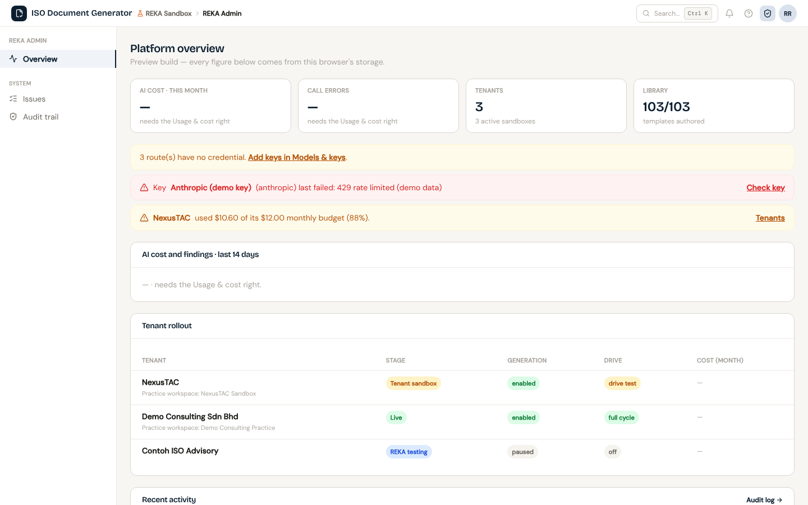
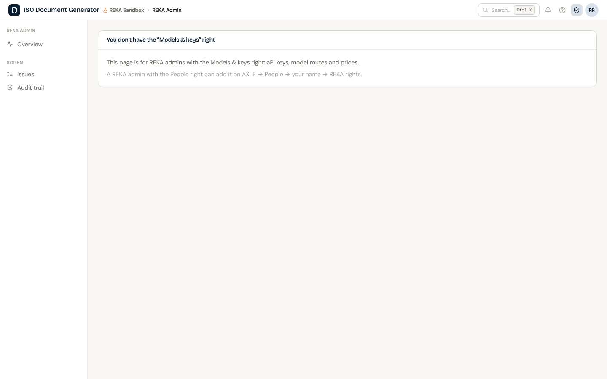

### Overview (`/admin`, `Overview.tsx`)

1. Heading "Platform overview" with a state line: "Preview build, every figure below comes from this browser's storage" or "Figures come from the shared database (model calls of the last 90 days)" (`:89-92`).
2. Four KPI tiles: AI cost this month (calls, last 7 and 30 days), Call errors (% of calls), Tenants (plus active sandboxes), Library (templates authored) (`:93-106`).
3. Needs-attention strip (`:108-154`): a generation is running (Watch the trace); no provider key, or routes without a credential (link to Models & keys); a key that last failed (Check key); a workspace at 80% or more of its monthly AI budget, with a hard-stop note (link to Tenants).
4. Health card (live backend only): failed or stuck runs and deliveries, purge backlog, model errors, cron, database size against its cap, with a refresh button (`HealthCard.tsx`).
5. Two 14-day mini bar charts: AI cost (navy), and Layer-1 findings per call (orange, "lower is better") (`:159-174`).
6. Tenant rollout table: tenant and practice workspace, stage, generation, Drive, cost this month (`:178-206`).
7. Recent activity: the last 10 audit entries in words, with an "Audit log →" link (`:207-227`).

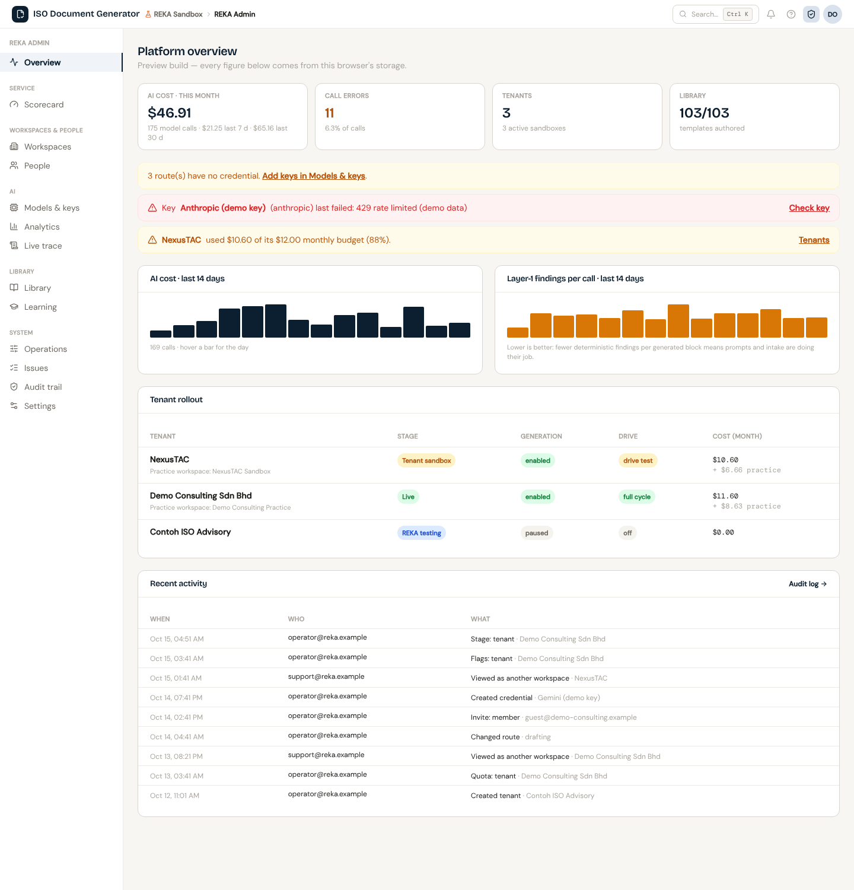

### Support view into a workspace

- **Drill-down:** Workspaces shows a list with a detail panel that opens with a readiness checklist ("Before X can work: 4 things left") and a rollout stepper (`Tenants.tsx:330-349`). See [11-axle-workspace-detail-desktop.png](screenshots/11-axle-workspace-detail-desktop.png).
- **View as:** the account menu's "View workspace as" select (right `impersonate.readonly`) switches the workspace app to that workspace. Each switch is written to the audit trail as `impersonate.view_as` (`src/lib/auth.tsx:343-356`). There is **no banner** while viewing. The only clue is the workspace name in the breadcrumb, and the screen still offers "New project", despite the right's name saying "readonly".

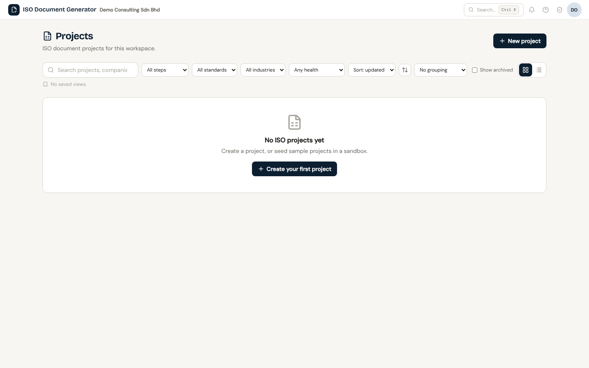

### Environment and state

- There is no persistent environment banner. The preview or live state is only stated in the Overview subtitle, in the Scorecard's blue preview notice, and in page fallbacks such as "Operations is computed by the live database".
- Sandbox workspaces carry an orange flask on the breadcrumb (`Shell.tsx:106`).
- The amber "Generation is paused" banner is turned off inside AXLE (`Shell.tsx:81`, `!inAdmin`).

### Phones

Below 768px the sidebar becomes a horizontally scrolling row of all permitted items as pills, with no group labels and no scroll hint (`AdminApp.tsx:164-177`). It works, but 13 items need sideways scrolling to discover. The breadcrumb truncates to "REKA Sa…". The account menu opens as a full-width sheet under the bar (`src/app/header-menu.ts:5-6`). There is no drawer.

| Overview on a phone | Strip scrolled | Account menu |
|---|---|---|
| 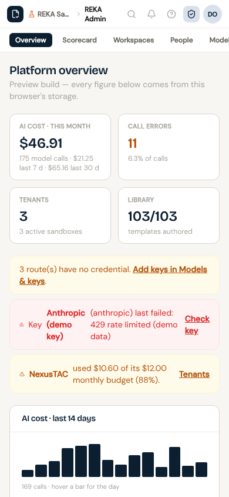 | 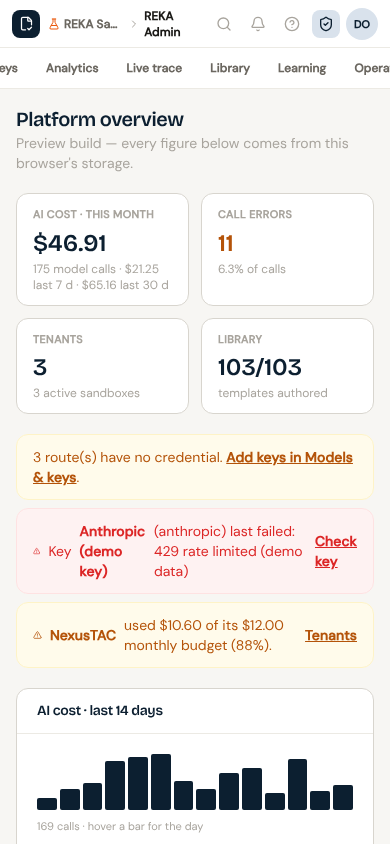 | 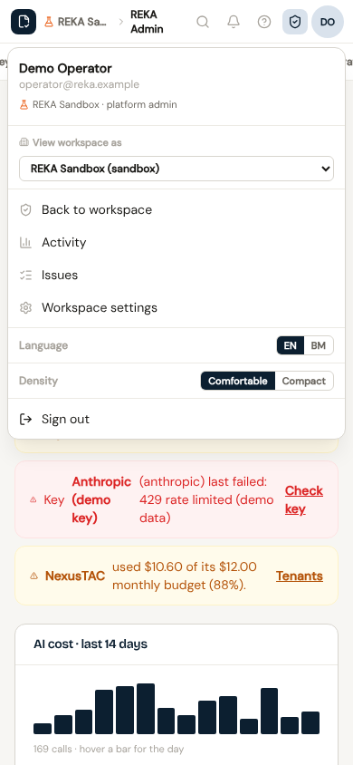 |

### Look

- Ground `#F7F6F3`, white surfaces, navy `#0C1F30` for actions and the active item, borders `#ECEAE4`/`#D8D5CE`, and text `#1A1916`/`#6B6760`/`#A8A49D` (`src/styles/index.css:75-92`).
- Tailwind's whole `orange` scale is remapped to navy (`tailwind.config.js:15-26`), so the console has no REKA orange anywhere.
- Fonts are DM Sans, Bricolage Grotesque (headings) and DM Mono (`tailwind.config.js:9-12`).
- Active sidebar item: navy-50 fill, navy semibold text and a 2px navy right border (`AdminApp.tsx:153`).
- Focus ring: 2px navy outline (`index.css:558-562`). Reduced motion is handled globally (`index.css:735-740`).

### Audit trail

Locally, the audit trail is a table of every admin action (when, actor, action code, target, tenant, before/after diff), with a filter and CSV export ([20](screenshots/20-axle-audit-trail-desktop.png)). Live, `AdminAuditPage` reads the server log: "Nobody can edit or delete an entry" (`src/features/activity/pages.tsx:55`). View-as switches, rights changes and rollout steps are all recorded.

### Cross-product (AXLE Link)

ISO Generator has none of the AXLE Link endpoints (`/internal/axle/v1/tenants`, `/usage`, `/health`, `/switches`, defined in `antarax-api/packages/lapisan-core/src/link/contract.ts:12` and `docs/07-operations-and-axle.md` §7.3). It is also not listed in `antarax-api/registry/registry.json`. The pieces an adapter would need already exist: the tenants list, per-tenant cost rollups (`rollup()` in `src/lib/platform/store.ts`), `health_snapshot()`/`health_problems()` RPCs, and a platform-wide generation pause (`src/server/generation-runs.ts:93`).

### Other AXLE pages

| Scorecard | Workspaces | People |
|---|---|---|
| 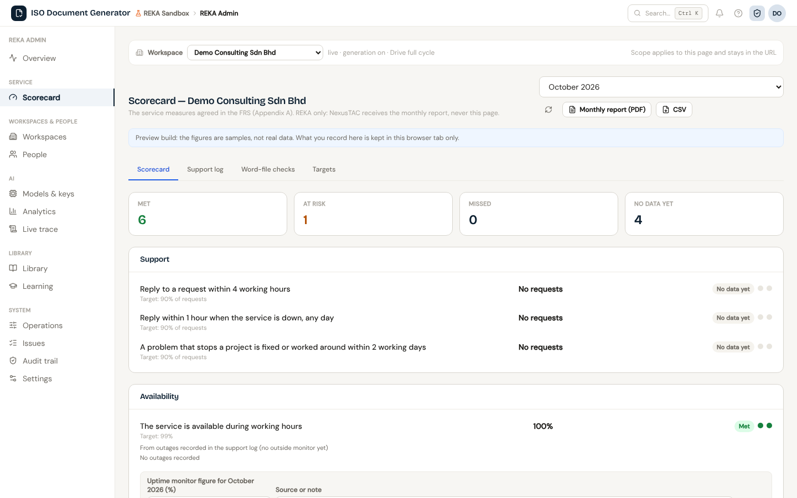 | 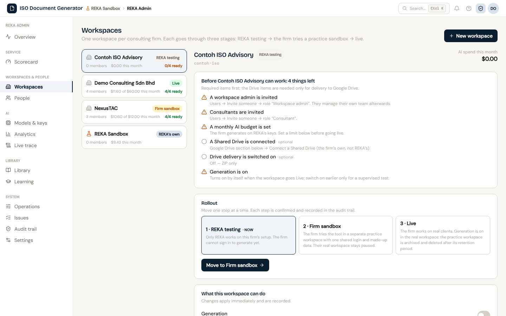 | 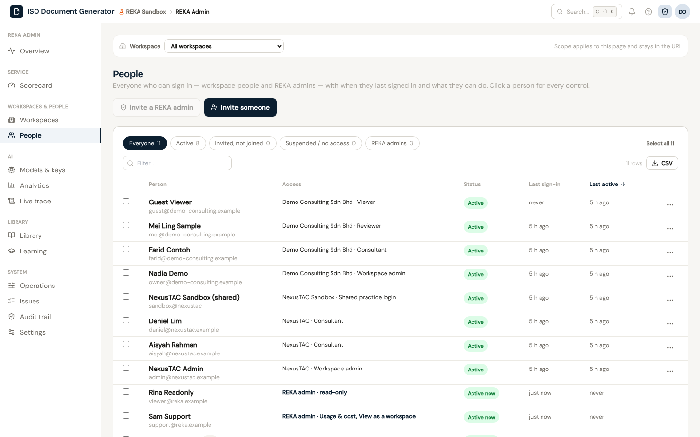 |
| **Models & keys** | **Analytics** | **Live trace** |
| 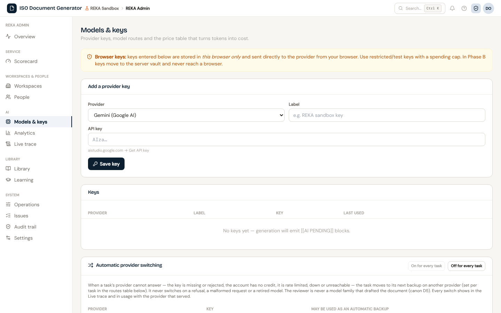 | 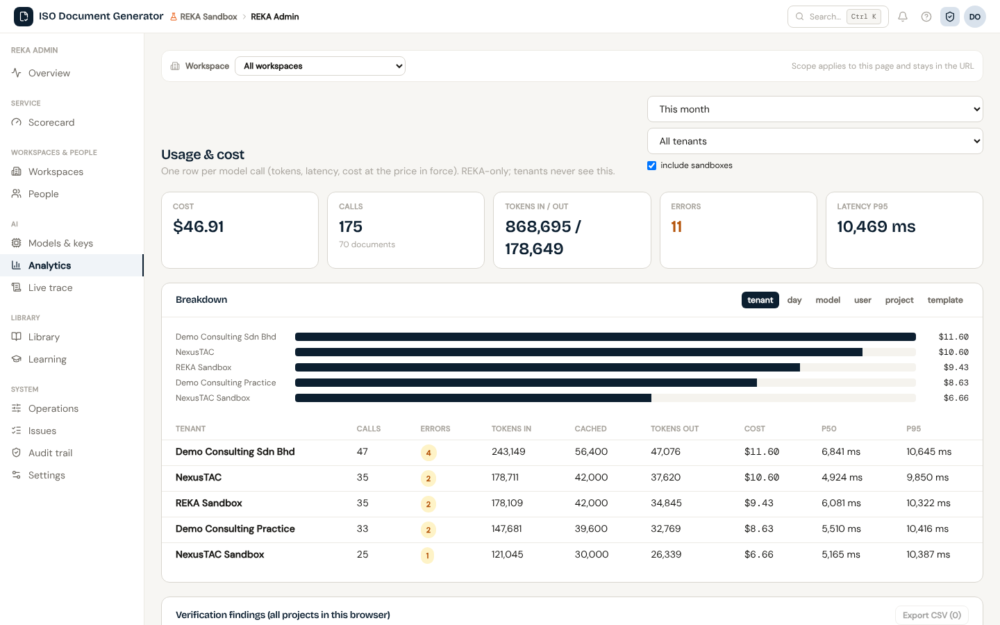 | 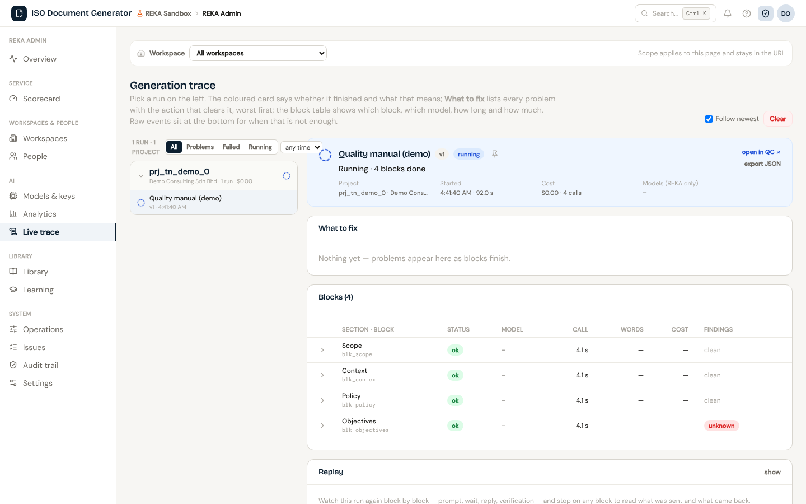 |
| **Library** | **Learning** | **Operations** |
| 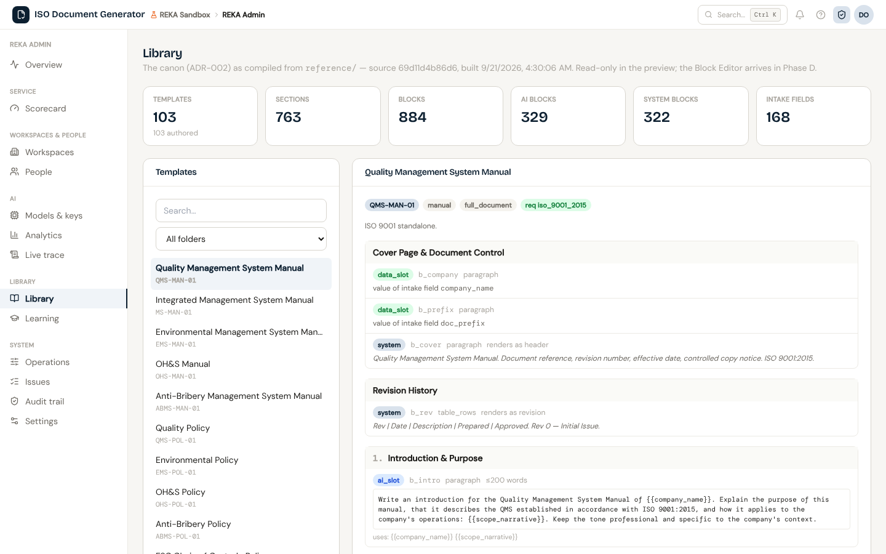 | 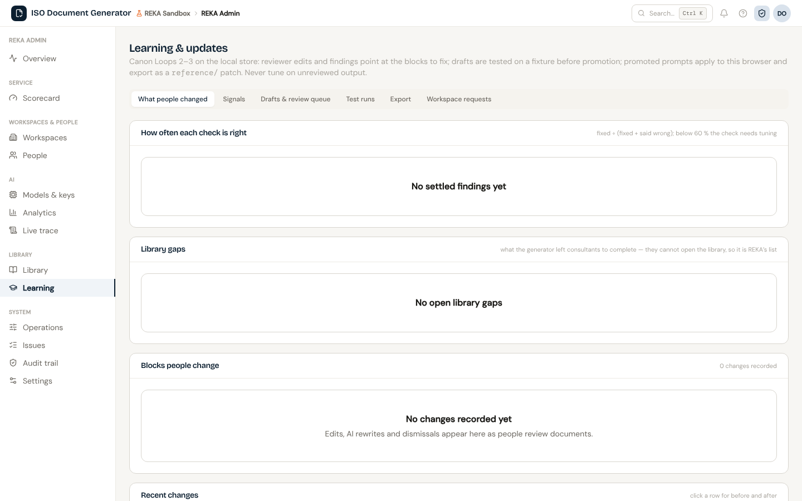 | 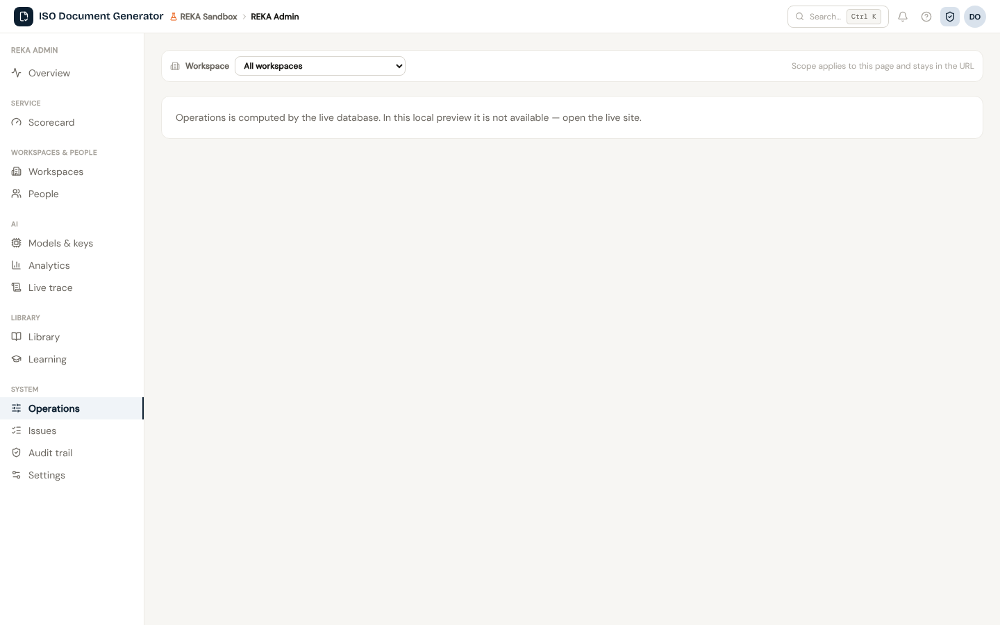 |
| **Issues** | **Audit trail** | **Settings** |
| 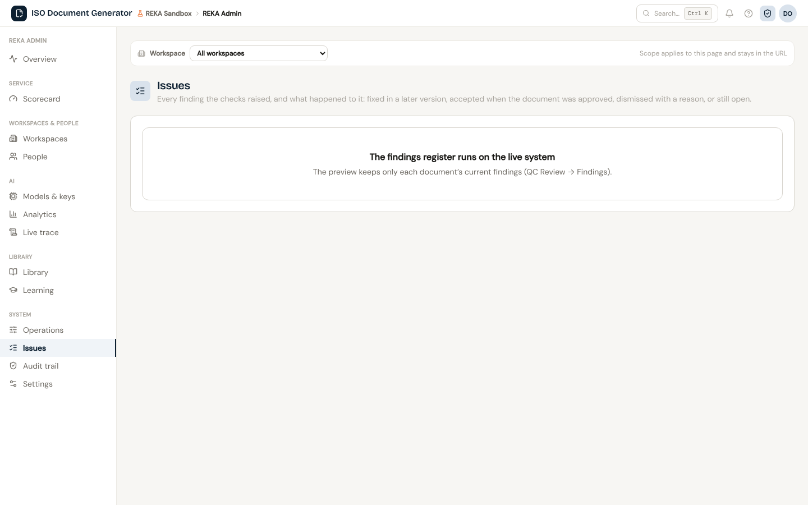 | 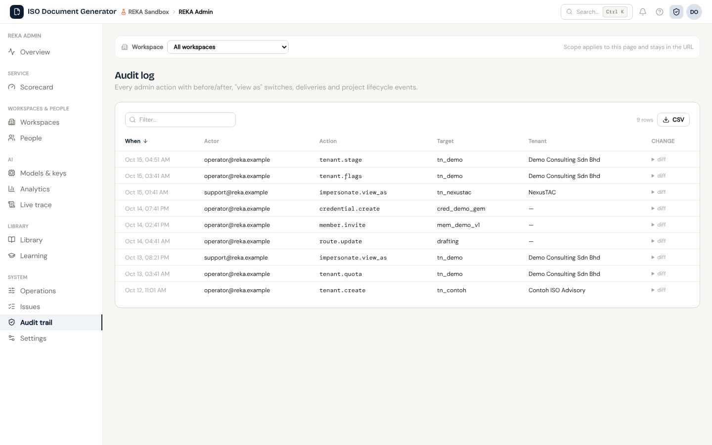 | 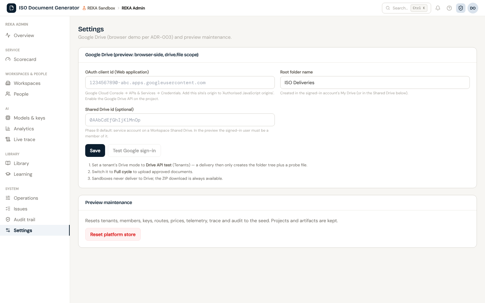 |

---

## AXLE scorecard

✓ = 1 · ◐ = ½ · – = 0

| # | Row | Score | Evidence |
|---|---|---|---|
| 1 | Landing dashboard | ✓ | `src/features/admin/pages/Overview.tsx:93-154`: four count tiles, then an attention strip (missing or failing keys, budgets at 80%+, running generation), plus the live Health card (`:156`) |
| 2 | Staff role ladder | ◐ | `src/lib/platform/capabilities.ts:11-40`: several staff with different powers through eight independent rights (read-only to all rights), but no named ladder of roles |
| 3 | Per-page explainer | ✓ | every page has a one-line explainer under its heading, for example `src/features/activity/pages.tsx:43,55,67` and `src/features/admin/pages/Tenants.tsx:550`; some lines use internal jargon ("Canon Loops 2–3", `Learning.tsx:574`) |
| 4 | Environment or state banner | ◐ | the state only shows in page text (`Overview.tsx:91` "Preview build…", Scorecard preview notice); no persistent banner, and the paused-generation banner is turned off in AXLE (`src/app/Shell.tsx:81`) |
| 5 | Support view into an organisation | ◐ | "View workspace as", audited (`src/app/UserMenu.tsx:109-135`, `src/lib/auth.tsx:343-356`), plus a workspace drill-down (`Tenants.tsx:330-349`); no banner while viewing |
| 6 | Works on phones | ◐ | `src/features/admin/AdminApp.tsx:164-177`: a pill strip that scrolls sideways, no drawer, no group labels and no scroll hint; the header truncates the workspace name |
| 7 | Kit 13 §6 dark look | – | light `#F7F6F3` ground, white sidebar, navy accent (`src/styles/index.css:75-92`); orange remapped to navy (`tailwind.config.js:15-26`); DM Sans and Bricolage instead of Poppins and JetBrains Mono (`tailwind.config.js:9-12`) |
| 8 | "AXLE · Product" name on screen | – | "REKA Admin" in the sidebar eyebrow (`AdminApp.tsx:136`), the breadcrumb (`Shell.tsx:125`) and the menu (`UserMenu.tsx:145`); "AXLE" appears only in helper text (`AdminApp.tsx:114`) |
| | **Total** | **4 / 8** | |

### Strengths worth adopting in the standard AXLE

- **The right-missing gate explains itself.** It names the right, says what it covers and who can grant it, and the nav hides what you cannot open (`src/features/admin/AdminApp.tsx:102-118, 127`).
- **Cost is shown as unknown, not zero.** An admin without the cost right sees a dash with "needs the Usage & cost right" rather than "$0.00" (`src/features/admin/pages/Overview.tsx:36-38, 94-103`).
- **Workspace scope lives in the URL.** One picker sits above every tenant-scoped page and keeps `?tenant=`, so the scope survives navigation and can be shared (`src/features/admin/TenantPicker.tsx:11-46`).
- **Each workspace opens on a readiness checklist and rollout stepper.** It starts with what is missing before the firm can work, then shows stages that are confirmed and audited one at a time (`src/features/admin/pages/Tenants.tsx:330-349`).
- **Live trace puts the diagnosis first.** Each run opens on a verdict and "What to fix", worst first, with raw events last (`src/features/admin/pages/Trace.tsx:1-8, 510`).
- **View-as and rights changes are audited, with a self-lockout guard.** View-as is logged as `impersonate.view_as` (`src/lib/auth.tsx:343-356`), and an admin cannot remove their own People right (`src/features/people/PeopleDirectory.tsx:1018`).

### Weaknesses

- **Wrong name and look.** "REKA Admin", light ground, navy accent and no AntaraX A (`AdminApp.tsx:136`, `Shell.tsx:94-97, 125`, `tailwind.config.js:15-26`).
- **View-as has no banner and is not read-only in the UI.** The right is called `impersonate.readonly` (`capabilities.ts:36-39`), yet the viewed workspace still offers "New project" and nothing says you are acting as the firm ([23](screenshots/23-axle-view-as-workspace-desktop.png)).
- **The "read everything" promise does not match the nav.** The comment says every admin can read the whole platform except cost (`capabilities.ts:6-7`), but pages are hidden without a change right (`AdminApp.tsx:127`). The Overview also leaks spend through budget alerts to admins without the cost right (`Overview.tsx:144-152`), and links them to pages they cannot open (`Overview.tsx:129`).
- **Words are inconsistent.** The nav says "Workspaces", while the Overview says "Tenants" and "Tenant rollout" (`AdminApp.tsx:63` against `Overview.tsx:104, 148-150, 178`). The gate copy lower-cases "API" into "aPI keys" (`AdminApp.tsx:111`).
- **Phone nav is a 13-pill strip** with no grouping or scroll hint (`AdminApp.tsx:164-177`). Search does not reach AXLE pages (`GlobalSearch.tsx:75-84`).
- **No AXLE Link, and it sits on a product-specific host.** The host is `axle.nexustac.reka.tech` (`src/app/hosts.ts:10`), and AXLE uses the customer sign-in screen.

---

## 2. Workspace app (customer)

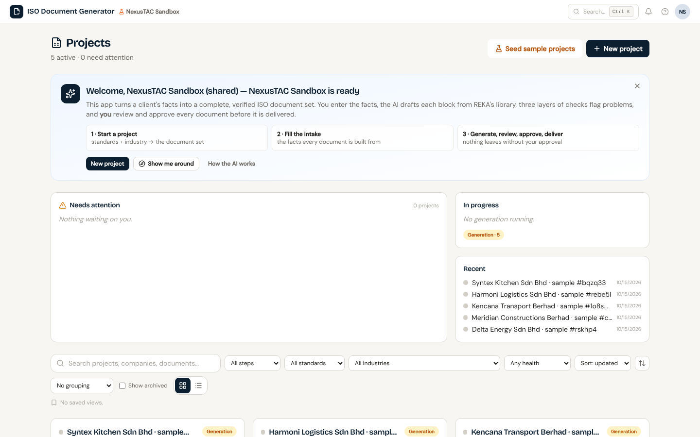

### Shell

- **Layout:** top bar only, with no sidebar (`Shell.tsx:84-168`). The brand button opens all projects. The breadcrumb shows the workspace (with a sandbox flask), then the project and step. Icons on the right: search (Ctrl K), bell, "?" help, the AXLE shield (platform admins only), and the avatar.
- **Account menu holds the navigation:** Team (workspace admin), Activity (workspace admin), Issues (everyone), Library (not REKA), Workspace settings (workspace admin), Language EN/BM, Density, Change password (live only), Sign out (`UserMenu.tsx:136-260`).
- **Project steps:** Setup › Intake › Scope Review › Generation › QC Review › Delivery, all inside `/iso-documents?project=…&step=…`.
- **Banners:** an amber "Generation is paused for this workspace…" when REKA has paused it (`Shell.tsx:159-163`), and the background-run pill.

| Group | Label | Route | Icon | Roles |
|---|---|---|---|---|
| Header | Projects (brand button) | `/iso-documents` | FileCheck2 | all |
| Account menu | Team | `/team` | Users | workspace admin |
| Account menu | Activity | `/activity` | BarChart3 | workspace admin, REKA |
| Account menu | Issues | `/issues` | ListChecks | all |
| Account menu | Library | `/library` | BookOpen | workspace members |
| Account menu | Workspace settings | `/settings` | Settings | workspace admin, REKA |
| Header | Help drawer and user guide | `/help/guide` | HelpCircle | all |

**Roles:** workspace admin, consultant (own projects only), reviewer and viewer (read-only; "View only…" replaces New project), and a shared sandbox login (can seed sample projects). The app uses no plan gating.

### Dashboard (`/iso-documents`, `src/features/iso/ProjectsHome.tsx:74`)

1. "Projects" heading with "5 active · 0 need attention · 1 generating".
2. Actions: New project, and Seed sample projects (sandboxes only).
3. Welcome card: three steps, New project, Show me around (tour), How the AI works.
4. Needs attention: projects with reasons, and a link to filter by blocking.
5. In progress: the running generation and per-step count chips.
6. Recent: the five latest projects.
7. Search and filters: step, standard, industry, owner, health, sort, direction, group by, show archived, grid/table, and saved views.
8. Project cards or table rows, with an empty state ("No ISO projects yet · Create your first project").

### Phones

The bar keeps its icons and drops the product name. The account menu opens as a full-width sheet under the bar and is the only menu.

| Home on a phone | Menu open |
|---|---|
| 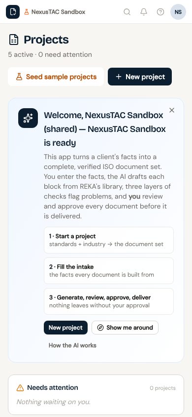 | 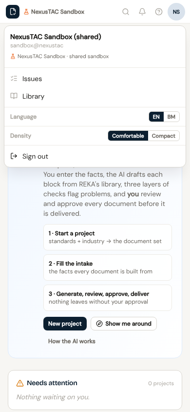 |

---

## 3. Sign-in

One sign-in screen serves both hosts (`src/app/SignIn.tsx`). A navy panel on the left reads "ISO Document Generator · by REKA · for NexusTAC" (`:97-98`), with the host name in the footer (`:109`). The form is on the right. Live, it uses e-mail and password, "Forgot password?" and "E-mail me a sign-in link instead". The preview uses e-mail only, with a "Preview personas" list (`:203-225`). There is no AXLE-specific sign-in: on `axle.*` the only change is the host text in the footer.

| Local preview | Live (from the repo's user guide) |
|---|---|
| 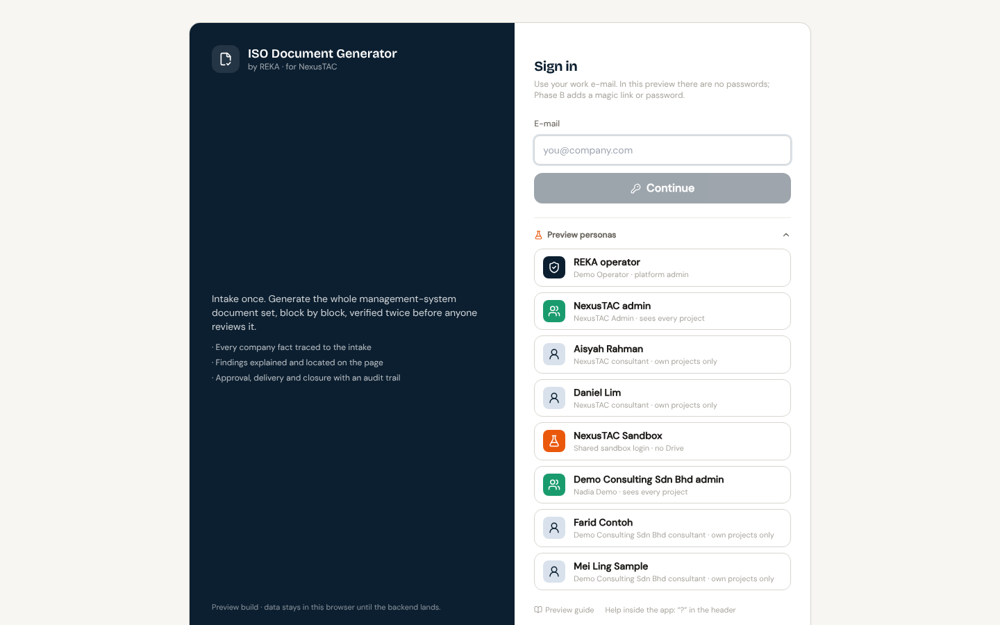 | 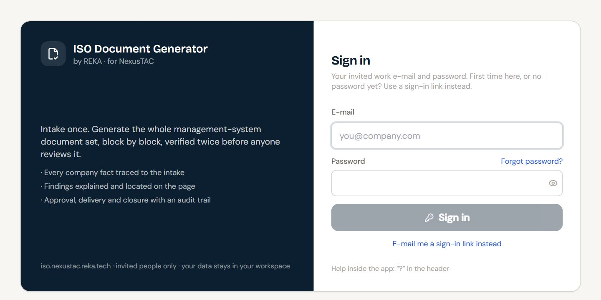 |

---

## How the screenshots were made

- I ran the repo's own browser-only preview (`vite --port 3109`, `VITE_BACKEND=local`), with no backend and no secrets.
- Before loading, I wrote fictional data to the browser's `localStorage` key `isogen:platform:v1`: three REKA admins with different rights, "Demo Consulting Sdn Bhd" and "Contoh ISO Advisory", about 175 model calls over 20 days, two vault-style keys (one failing), nine audit entries and one trace run.
- I signed in by e-mail or persona in Playwright (global install) at 1440x900 and 390x844. The full overview was captured with a 1440x1500 viewport, because the page scrolls inside `main`.
- I seeded customer projects with the app's own "Seed sample projects" button, in a throwaway browser profile.
- **Not captured:**
  - The Health card, Operations, server Analytics, the server Audit and the Issues register. They only render against the live Supabase backend, so the local fallbacks are shown instead.
  - The live public sign-in pages at `axle.` and `iso.nexustac.reka.tech`. The session's permission policy blocked this, so `repo-guide-01-signin.jpg` (from `docs/user-guide/src/shots/`, last commit 2026-10-05) stands in for the live sign-in.

---

## What to keep

- The capability gate card, and the nav hiding what you cannot open.
- The URL-kept workspace scope picker on tenant-scoped pages.
- An Overview that combines counts, fix-it alerts with links, 14-day trends, rollout and recent activity.
- The workspace readiness checklist and audited rollout stepper.
- The diagnosis-first live trace, and the audited view-as.
- One-line explainers under every page heading.

## What conflicts with the brand kit

- The name is "REKA Admin"; kit 13 §6 says "AXLE · ISO Generator" and bans "REKA Admin".
- The look is light and navy, with orange remapped away; §6 wants a dark `#071233` ground, `#0C1B47` raised surfaces, `#FB9800` accent, Poppins and JetBrains Mono, and the AntaraX A. §10 says AXLE is dark-only.
- The host is `axle.nexustac.reka.tech`, not `axle.antarax.ai`. There is no shared staff sign-in and no AXLE Link endpoints.
- The rights do not follow the viewer < support < operator < admin < owner ladder (antarax-api docs/07 §7.4).
- There is no AntaraX mark or credit in either surface. The credit reads "by REKA · for NexusTAC".
- The Bahasa Malaysia toggle is live, while kit 13 §7 parks BM. The focus ring is navy, not AntaraX blue.
- The words mix: "tenant" and "workspace" both mean the customer firm.
