# Janka: navigation and dashboard inventory

Repo `haziqfaris/janka-inventory-intelligence` at `7cc4b93` (15 Oct 2026). Vite + React 19, Appwrite backend, with a built-in local mode (no backend, data in IndexedDB) that made live screenshots possible. Machine-readable version: [nav.json](nav.json).

Janka has three shells:

1. **Customer web app** (desktop shell, `index.html`, routes under `/`)
2. **Phone scanner** (`/m/*`, bottom tabs, for workers on the floor)
3. **Janka AXLE**, REKA's staff console (`axle.html`, hash routes)

PLExyz Trace has no shell or nav of its own. It is the **RFID** item under Scan & tag, shown to admins and managers, and switched on by the "PLExyz Trace" setting in Settings > Workspace.

## 1 Customer web app

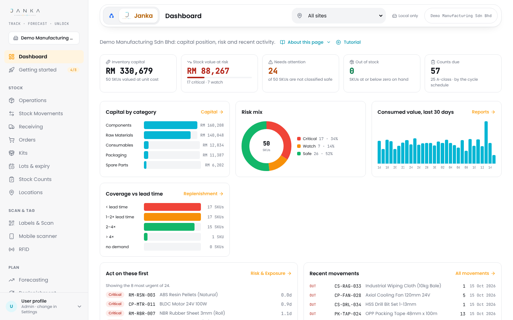

Entry files: `src/layout/AppLayout.tsx`, `src/layout/navConfig.ts:61` (single source of nav, titles and role rules), `src/layout/Sidebar.tsx:57`, `src/layout/TopBar.tsx:14`, `src/layout/BrandPill.tsx`, `src/layout/ProfileMenu.tsx:23`, `src/layout/OrgSwitcher.tsx`, `src/layout/SiteSelector.tsx`, `src/layout/SyncIndicator.tsx`, `src/styles/global.css:270-670`.

**Layout.** Light left sidebar, 248px, `#F7F7F8`, scrolls, with the profile row pinned to the bottom. To its right a floating top bar card (64px tall, 24px radius, white, soft shadow) sits in the page gutter above the content. Content column max 1440px, 32px padding.

**Brand block.** Sidebar: the drawn JANKA wordmark (22px), then the eyebrow `TRACK · FORECAST · UNLOCK` in 10px uppercase mono, then the organisation box. Top bar: the AntaraX "brand pill", a grey well holding the AntaraX A (links to antarax.ai) and a raised white chip with the Janka J and "Janka" (links home). No credit line, no version text.

### Nav items

| Group | Label | Route | Icon (lucide) | Roles | Gating |
|---|---|---|---|---|---|
| (none) | Dashboard | `/` | LayoutDashboard | all | |
| (none) | Getting started | `/start` | Rocket | all | hidden when the checklist is done; shows an `n/m` counter |
| Stock | Operations | `/inventory/operations` | Package | all | |
| Stock | Stock Movements | `/inventory/movements` | ArrowLeftRight | all | |
| Stock | Receiving | `/fulfilment/receiving` | Truck | all | Enterprise |
| Stock | Orders | `/fulfilment/orders` | ShoppingCart | all | Enterprise |
| Stock | Kits | `/fulfilment/kits` | PackageOpen | admin, manager | Enterprise |
| Stock | Lots & expiry | `/inventory/lots` | CalendarClock | all | Growth |
| Stock | Stock Counts | `/inventory/counts` | ClipboardCheck | all | Free (can be switched off) |
| Stock | Locations | `/inventory/locations` | MapPin | admin, manager | |
| Scan & tag | Labels & Scan | `/tagging/qr` | QrCode | all | Free |
| Scan & tag | Mobile scanner | `/m/scan` | Smartphone | all | Free |
| Scan & tag | RFID (PLExyz Trace) | `/tagging/rfid` | Radio | admin, manager | Free + Trace setting |
| Plan | Forecasting | `/intelligence/forecasting` | TrendingUp | admin, manager | |
| Plan | Replenishment | `/inventory/replenishment` | RefreshCw | admin, manager | Growth |
| Plan | PO Drafts | `/intelligence/po-drafts` | ClipboardList | admin, manager | Enterprise |
| Plan | Simulation | `/intelligence/simulation` | FlaskConical | admin, manager | Free |
| Watch | Alerts | `/intelligence/alerts` | Bell | all | Growth |
| Watch | Risk & Exposure | `/intelligence/risk` | ShieldAlert | admin, manager | Growth |
| Watch | Capital | `/intelligence/capital` | Wallet | admin, manager | |
| Organisation | Reports | `/reports` | BarChart3 | admin, manager | Free |
| Organisation | User guide | `/guide` | BookOpen | all | |
| Organisation | Settings | `/settings` | Settings | all | admin sections gated inside |

Plan gating keeps the item visible with a small pill (Growth in blue `#1D4ED8`, Enterprise in violet `#6D28D9`, "Off" in grey when REKA switched a free feature off) and the page shows an upgrade overlay. Role rules hide the item outright. No item has children or an unread counter.

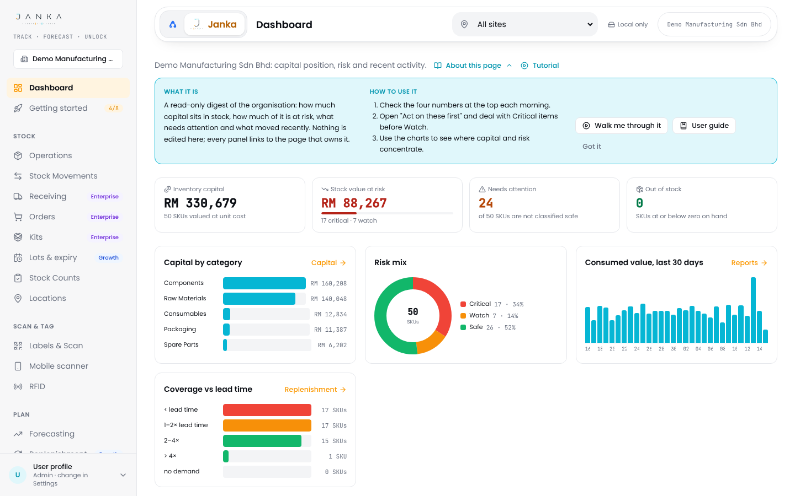

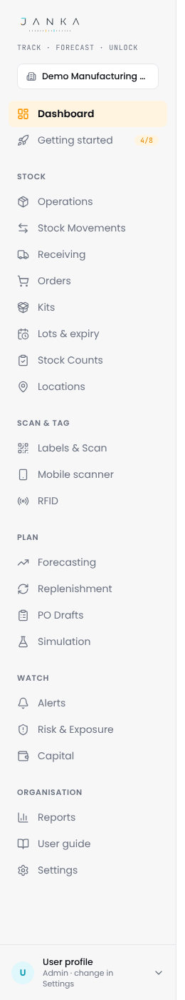

### Global controls

- **Top bar, right side:** site selector pill (MapPin, "All sites" or one site; hidden with a single site), sync status (Local only, Syncing… (n), Synced, Offline, Sync error) with a "Demo" badge for demo organisations, and the organisation name as a mono pill.
- **Top bar, left:** brand pill, then the page title (h1).
- **Organisation switcher:** box in the sidebar under the wordmark; a select only when the person belongs to more than one organisation. The name therefore appears twice on desktop.
- **Profile menu** (bottom of sidebar, opens upwards): name, email, role · organisation; Change password; User guide; Settings; Sign out… with an inline "Sign out of Janka on this device?" confirmation. In local mode only User guide and Settings show.
- **Per page:** "About this page" disclosure and a "Tutorial" button (guided tour) beside every page title.
- **Not present:** global search, command palette, notification bell, Help item or `/help`, product switcher, create button, AI or Assist entry point, theme toggle, language switcher, impersonation banner. A suspension banner appears when REKA suspends the organisation.

### Responsive behaviour

| Width | What changes |
|---|---|
| 1181px and up | Full top bar: site field, sync label, organisation name |
| 1180px and below | Site field narrows; organisation pill folds to a 44px icon |
| Below 1024px | Sidebar becomes an off-canvas drawer with a scrim; a 44px round hamburger appears at the left of the top bar; gutters drop to 16px |
| 760px and below | Top bar card 58px; site and sync fold to round icon buttons |
| 560px and below | Page title is visually hidden |
| Touch phones (720px, coarse pointer) | Redirected to the phone scanner unless "Use the desktop site" was chosen |

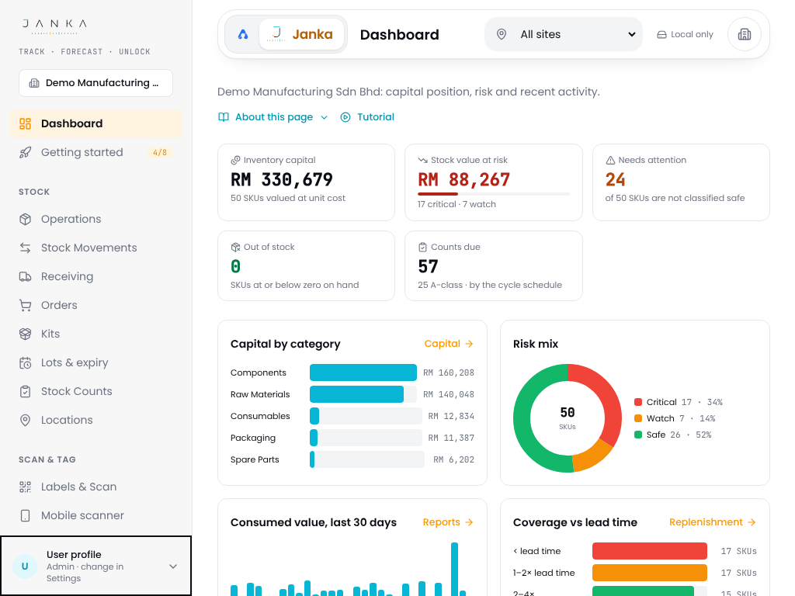
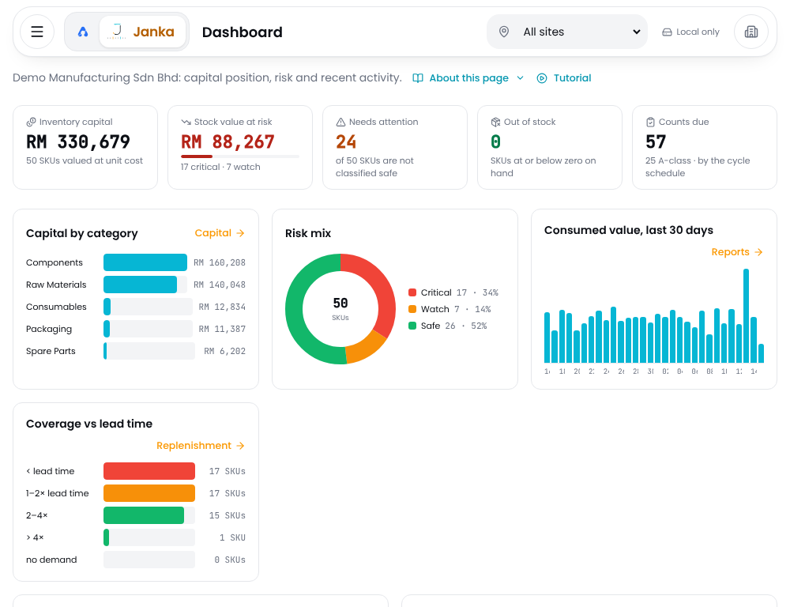

| Phone | Drawer open | Full length |
|---|---|---|
| 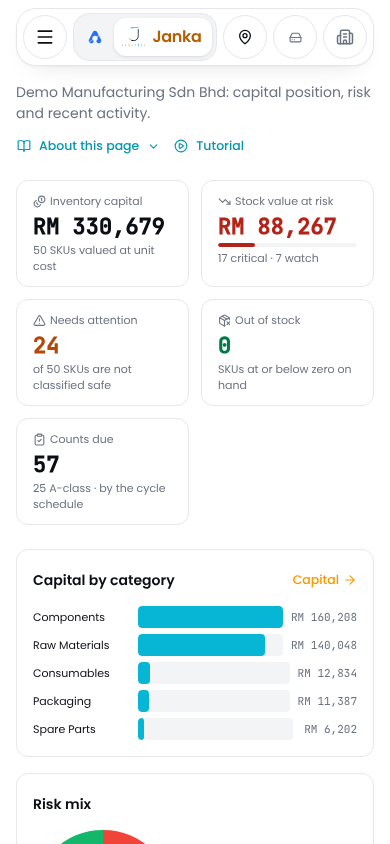 | 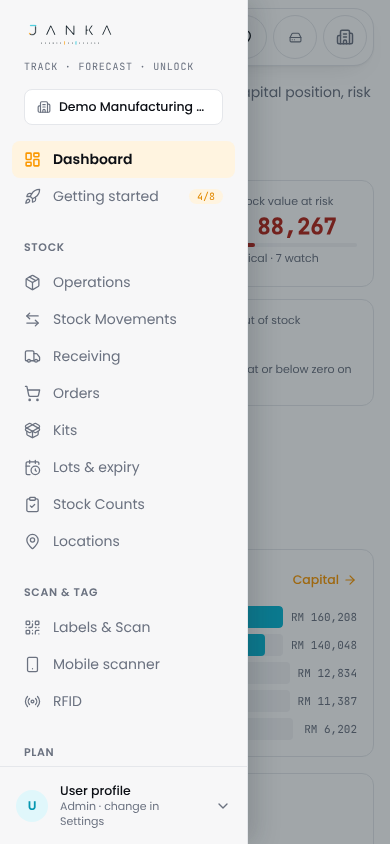 | 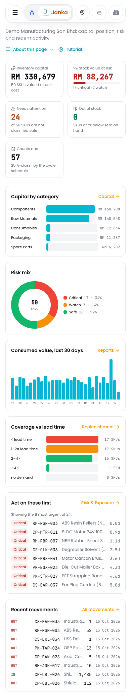 |

### Styling

- Active item: `#FFF4E0` fill, ink text semibold, icon in orange `#FB9800` (stroke 2.2). Inactive: grey `#6B7280`, stroke 1.8. 8px radius, 17px icons, 14px labels; group labels 11px uppercase.
- Fonts: Poppins for UI, JetBrains Mono for every figure, SKU code, eyebrow and the organisation pill.
- Focus: ink `#0B0E14` 2px rings on top bar and menu; form fields focus in orange. Profile menu is a full keyboard menu (arrows, Home, End, Esc). Reduced motion stops the drawer, splash, thinking marks and tour pulse.

### Role variants

Admin and manager see everything. A worker loses Kits, Locations, RFID, the whole Plan group, Risk & Exposure, Capital and Reports; Watch keeps only Alerts. The "Risk & Exposure" link on the dashboard is hidden for workers.

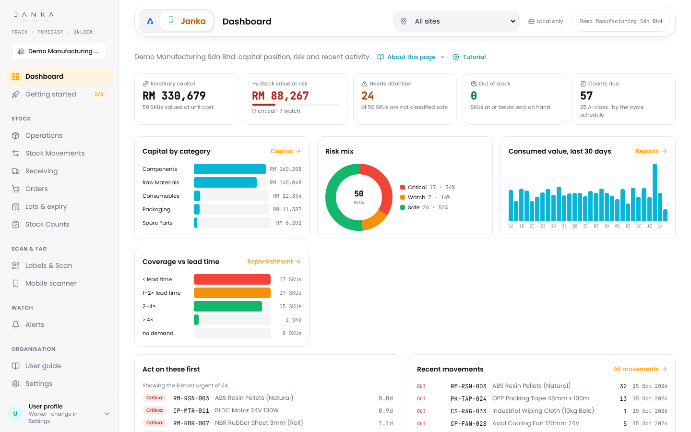

### Dashboard (`/`, `src/pages/DashboardPage.tsx`)

1. Page header: "<Organisation>: capital position, risk and recent activity." with About this page and Tutorial.
2. KPI strip: Inventory capital · Stock value at risk (red, with a share bar) · Needs attention · Out of stock, then conditional tiles: Counts due, Deliveries, Open orders, Expiry exposure (each links to its page).
3. Four chart cards in an auto-fit grid: Capital by category (horizontal bars), Risk mix (donut, Critical/Watch/Safe), Consumed value last 30 days (columns), Coverage vs lead time (banded bars). Each has a "Page →" link.
4. Two list cards: Act on these first (8 most urgent SKUs with risk pill and coverage days) and Recent movements (last 8 ledger lines).
5. Empty state "Nothing to show yet" with a link to Operations when there are no SKUs.

Filter: the top bar's site selector scopes every figure. There is no date-range picker and no greeting by name.

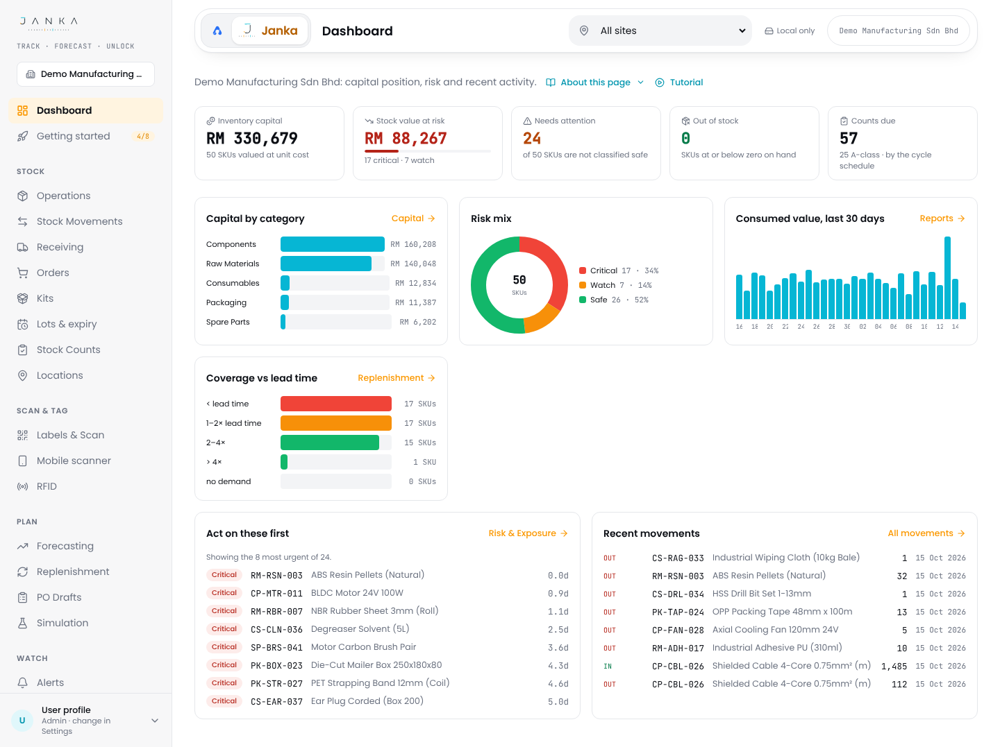

### PLExyz Trace

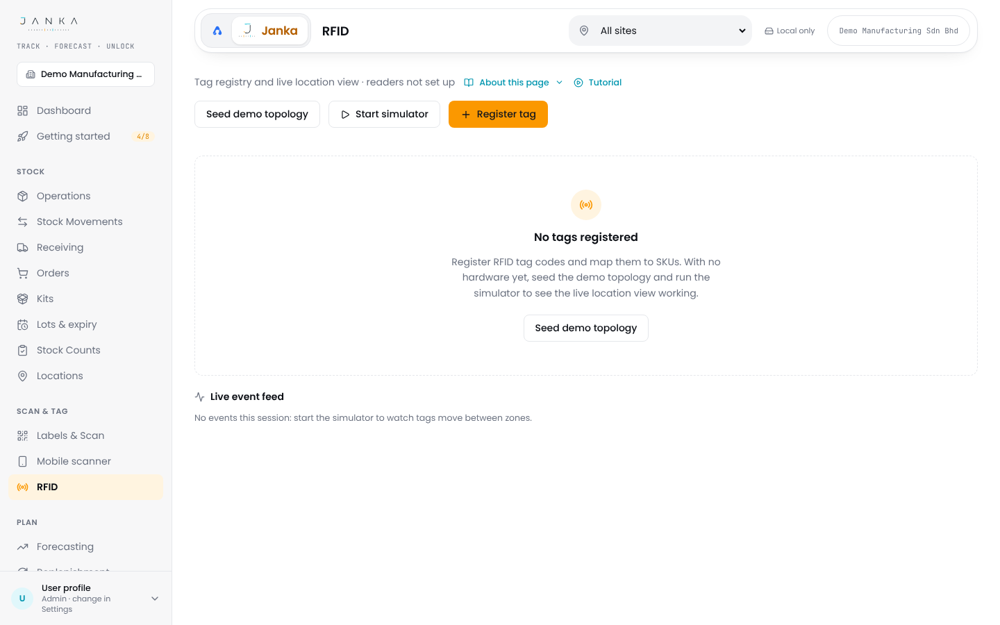

Lives at `/tagging/rfid` inside the Janka shell. Header actions: Seed demo topology, Start simulator, Register tag; an empty state and a live event feed.

### Sign-in

| Desktop | Phone |
|---|---|
| 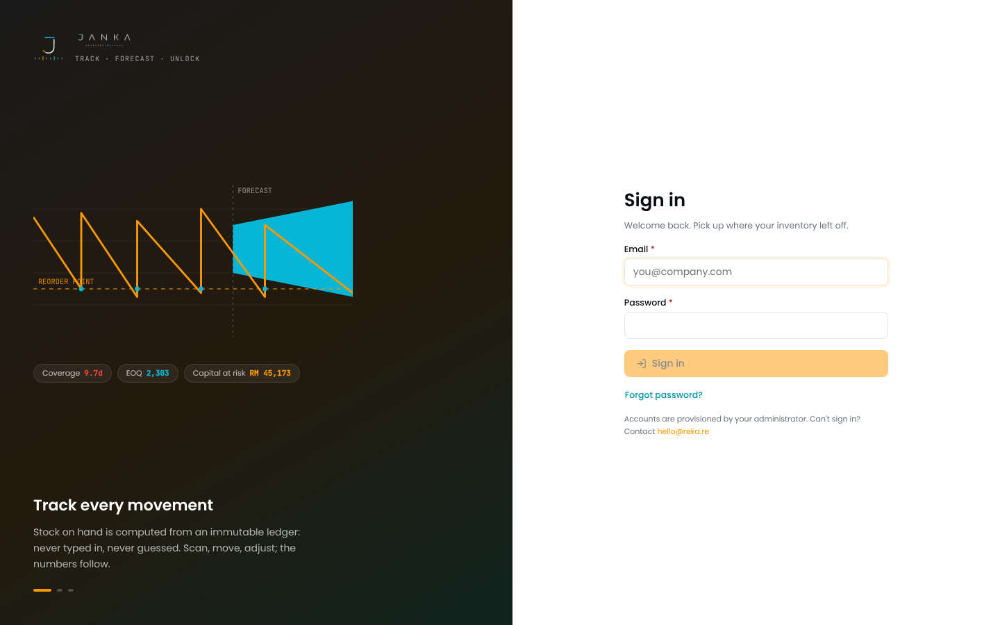 | 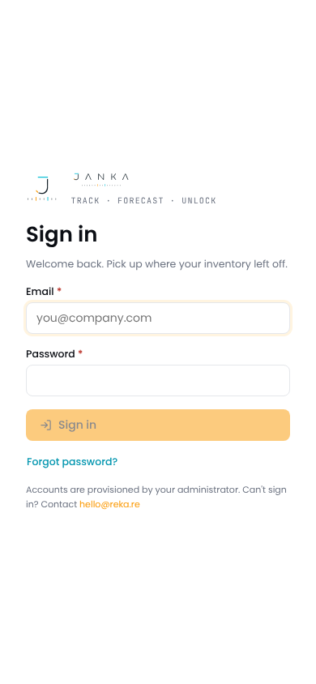 |

Split screen: dark brown-green brand panel with the J mark, wordmark, `TRACK · FORECAST · UNLOCK`, an animated forecast chart and a rotating three-slide carousel; white form side with Sign in, Forgot password and "Contact hello@reka.re". Below 900px the panel is dropped.

## 2 Phone scanner (`/m`)

Entry: `src/mobile/MobileApp.tsx:35` (shell), `:163` (routes), `:184` (phone redirect).

Top bar card with the same brand pill, the organisation icon and an open site selector. Fixed bottom tab bar, five equal tabs, 22px icons, active in orange:

| Tab | Route | Icon |
|---|---|---|
| Scan | `/m/scan` | ScanLine |
| Find | `/m/find` | Search |
| Check | `/m/check` | ClipboardList |
| Count | `/m/count` | ClipboardCheck |
| Me | `/m/me` | UserRound |

Home is Scan: "What are you doing?" with Receiving, Picking, Moving, Counting cards, then Look something up and Photo run. Me holds Tutorial, User guide, Use the desktop site and Sign out (no confirmation). No sync indicator here. Same tabs for every role.

| Scan | Check | Me |
|---|---|---|
| 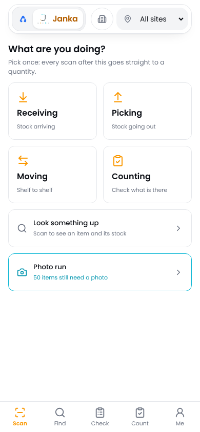 | 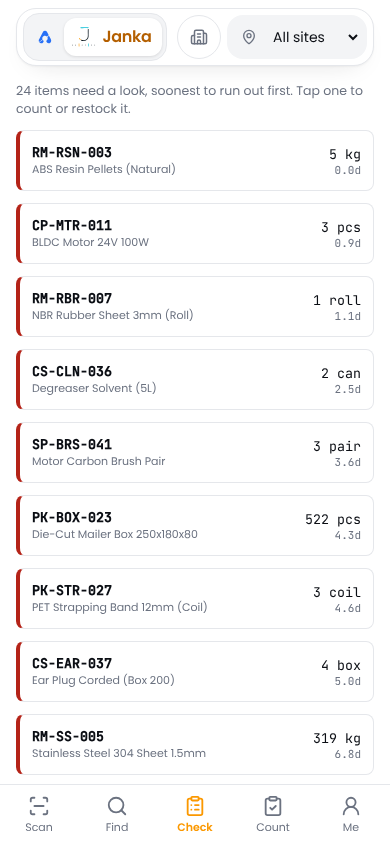 | 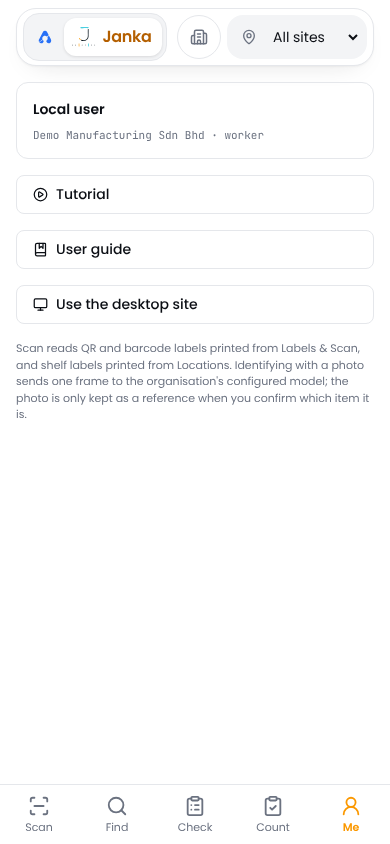 |

## 3 Janka AXLE (staff console)

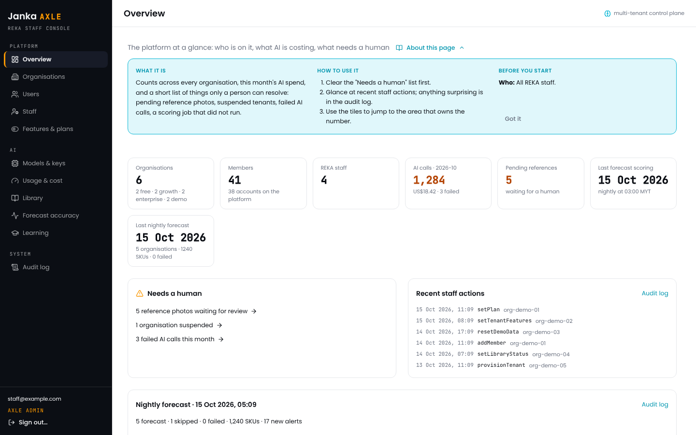

Entry: `axle.html` (title "Janka AXLE"), `src/axle/AxleApp.tsx:43` (sign-in and access states), `src/axle/AxleShell.tsx:27` (nav) and `:68` (frame), `src/axle/axle.css`, AXLE tokens in `design-system/tokens.css:92-100`.

**Layout.** Dark rail 232px (`#0B0E14`), sticky full height; light content area with a 56px white sticky header (page title, "multi-tenant control plane" note with a cyan Brain icon); content max 1200px.

**Brand block.** Text wordmark "Janka" + "AXLE" in orange mono, eyebrow `REKA STAFF CONSOLE`. No image mark, no AntaraX A.

| Group | Label | Route | Icon (lucide) |
|---|---|---|---|
| Platform | Overview | `#/` | LayoutDashboard |
| Platform | Organisations | `#/organisations` (+ `/:orgId`) | Building2 |
| Platform | Users | `#/users` | Users |
| Platform | Staff | `#/staff` | UserCog |
| Platform | Features & plans | `#/features` | ToggleLeft |
| AI | Models & keys | `#/ai/models` | Cpu |
| AI | Usage & cost | `#/ai/usage` | Gauge |
| AI | Library | `#/ai/library` | BookOpen |
| AI | Forecast accuracy | `#/ai/accuracy` | Activity |
| AI | Learning | `#/ai/learning` | GraduationCap |
| System | Audit log | `#/audit` | ScrollText |

Roles: AXLE admin and AXLE manager see the same nav (an `adminOnly` flag exists but is unused); write actions are gated inside pages.

**Controls.** Rail footer: staff email, role label (AXLE ADMIN / AXLE MANAGER in orange mono), Sign out… with inline confirmation. No search, bell, switcher, theme toggle or help link; each page has About this page.

**Active state.** `#171B27` fill, white semibold text, 3px orange left border; inactive text 62% white; 16px icons; orange 2px focus ring.

**Responsive.** Below 1024px the rail becomes a drawer behind a 40px hamburger (with `aria-expanded`), Esc closes it, the header note hides.

| Phone | Drawer open | Full length, desktop |
|---|---|---|
| 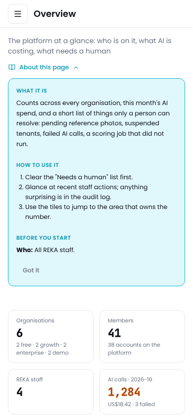 | 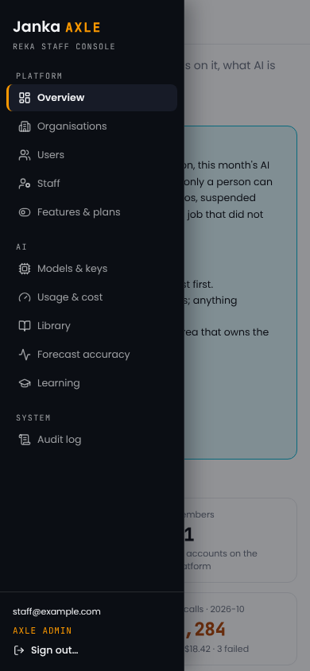 | 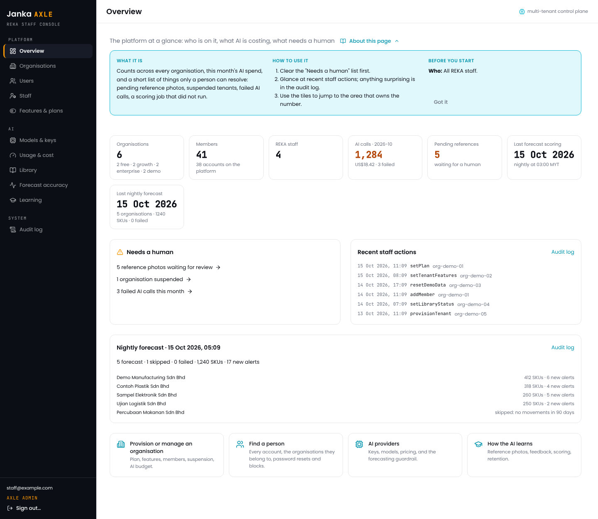 |

### Overview (`#/`, `src/axle/OverviewView.tsx`)

1. Header: "The platform at a glance: who is on it, what AI is costing, what needs a human".
2. Seven KPI tiles: Organisations (by plan and demo), Members, REKA staff, AI calls this month (US$ cost, failures), Pending references, Last forecast scoring, Last nightly forecast.
3. Needs a human: linked to-do list (pending photos, suspended organisations, failed AI calls, stale jobs).
4. Recent staff actions: last 8 audit entries.
5. Nightly forecast card: one line per organisation.
6. Four shortcut cards: Provision or manage an organisation, Find a person, AI providers, How the AI learns.

**Sign-in.** Cockpit ground (blueprint grid, slow sweep), glass card "Staff sign in", green "Authorized staff only · audit-logged".

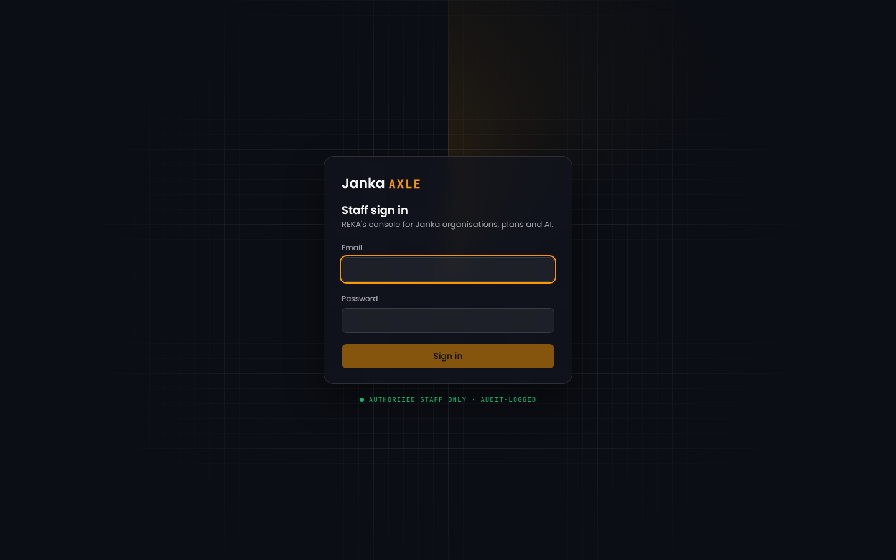

## What to keep

- One nav config file driving sidebar, titles, route guards and page intros: a good pattern for the standard.
- Plan gating as visible badges and role rules as hidden items: a clear, documented split.
- The AntaraX top bar card with the brand pill (A + product chip), 44px targets, and the clean fold-down at 1180, 1024, 760 and 560px.
- KPI strip, then four chart cards, then two "act on it" lists: a solid shape for a standard dashboard.
- About this page and Tutorial beside every page title, in the app and in AXLE.
- Keyboard-complete profile menu; reduced-motion handling everywhere.
- Phone scanner with five bottom tabs, task-first home.
- AXLE's Overview structure (KPIs, Needs a human, recent staff actions, shortcuts).

## What conflicts with the brand kit

- No AntaraX credit line in any chrome, sign-in or AXLE ("Janka · by AntaraX").
- REKA orange `#FB9800` is the primary everywhere (active nav, links, buttons, tabs); target Janka action `#077DA1`, accent `#0CC4FB`.
- `TRACK · FORECAST · UNLOCK` in uppercase mono under the wordmark, on sign-in and in the page title; "unlock" is banned, and so are uppercase mono eyebrows. Also "Upgrade your organisation to unlock it" on gated pages.
- Plan badges say Growth and Enterprise, not the Rise names (Galaxy, Quantum).
- `hello@reka.re` on sign-in and on suspended or switched-off screens, not `support@go.antarax.ai`.
- No Help item and no `/help`.
- Focus rings are ink or orange, not AntaraX blue `#0459F7`.
- No AI sparkle or Assist entry point.
- Money is written `RM 330,679` (space); standard is `RM330,679`.
- Sign-in panel is a brown-green gradient, not navy with the Tide Swell.
- Sidebar group labels in uppercase; nav labels mix Title Case ("Stock Movements", "PO Drafts") and sentence case.
- AXLE is named "Janka AXLE", not "AXLE · Janka"; its ground is ink `#0B0E14` rather than `#071233`/`#0C1B47`; no AntaraX A; uppercase mono labels; "Authorized" in US spelling; the content area is light although AXLE should be dark-only. The brand kit's audit quotes an older AXLE title (`axle.html:7`, "AXLE, REKA Admin" with a dash) that the repo no longer uses.

## How the screenshots were made

- Customer app and phone scanner: dev server in Janka's own local mode (no Appwrite settings), the built-in "Load sample data" (fictional "Demo Manufacturing Sdn Bhd"), plan, role and Trace set from Settings, which local mode allows.
- AXLE and both sign-in screens: dev server with a dummy Appwrite endpoint; Playwright answered `/v1/account` and the `admin-api` Function (`whoami`, `overview`, `listAudit`) with invented figures. No real backend was contacted.
- Full-length shots use a viewport as tall as the content, because the page scrolls inside `<main>`.
- The repo's own guide images (`docs/guide/images`, 140 JPEGs) were not needed.
