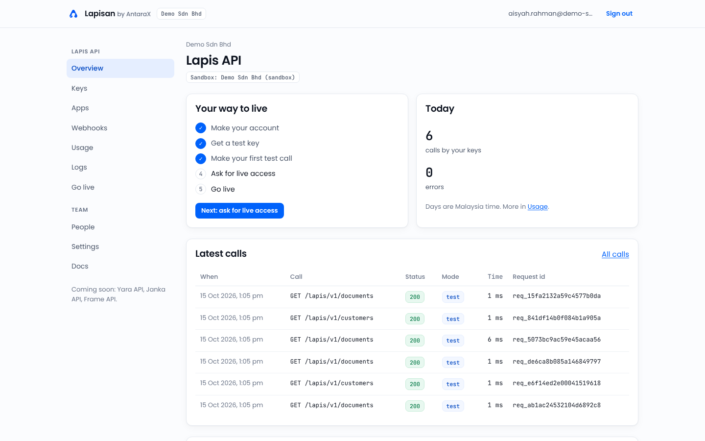
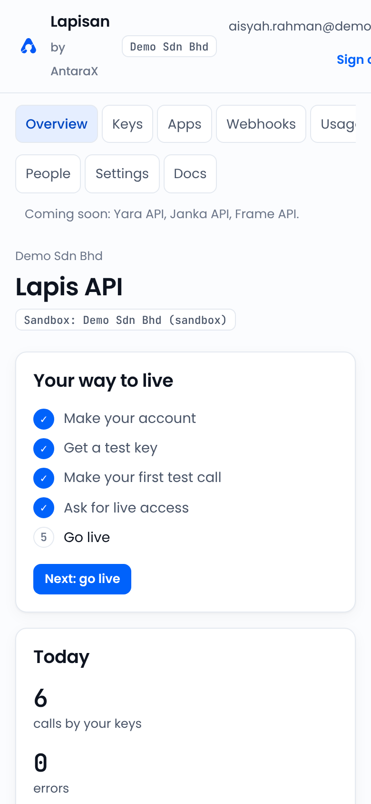
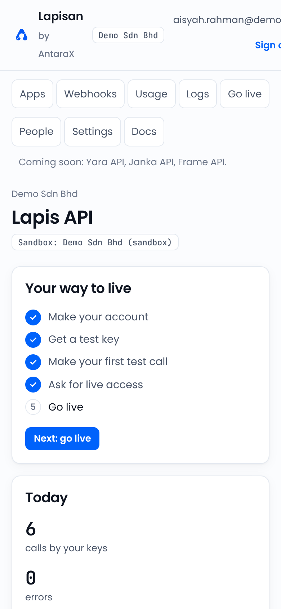
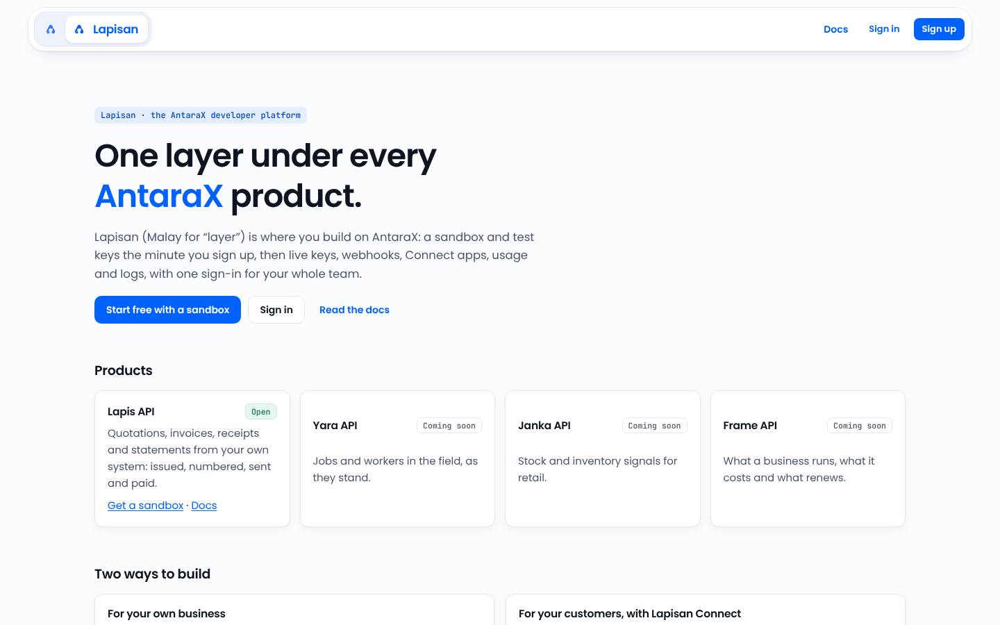
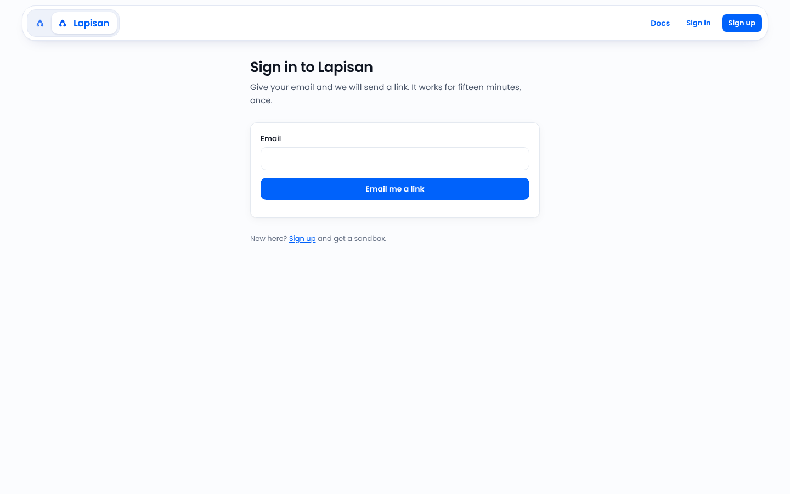
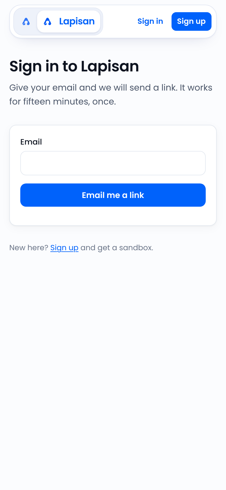

# Lapisan Console and AXLE Central: nav and dashboard inventory

Repository `haziqfaris/antarax-api` at commit `05ea388` (12 Oct 2026). Stack: Next.js 16.3.8 App Router, React 19.2.8, server actions, plain CSS with custom properties (no Tailwind, no icon library). The console lives in `apps/console` and will be served at `lapisan.antarax.ai` (built, not yet deployed).

Three surfaces:

1. **Developer**: the signed-in Lapisan Console, where a developer team manages its sandbox, keys, apps, webhooks, usage, logs and live access.
2. **Public frame** (surface "other"): landing, sign-up, sign-in and invite pages, using the antarax.ai floating bar.
3. **AXLE Central** (surface "axle"): planned at `axle.antarax.ai`, **not built**. No AXLE screen exists in this repo. Its requirements from the docs are summarised below and in full in [axle-central-requirements.md](axle-central-requirements.md).

All screenshots were taken from a local run in the console's own **demo mode** (no Supabase keys, so everything runs in memory with a stand-in Lapis API). The data is fictional (team "Demo Sdn Bhd", person "Aisyah Rahman").

## 1 Developer surface: Lapisan Console

### Shell

| | |
|---|---|
| Entry files | `apps/console/app/t/[team]/layout.tsx:7-52` (shell and sidebar), `apps/console/components/bar.tsx:4-43` (top bar), `apps/console/components/nav.tsx:6-15` (active link), `apps/console/app/globals.css:48-56,145-162` (bar and frame styles), `apps/console/lib/products.ts:20-34` (product list) |
| Layout | Sticky full-width top bar (56px, translucent `#fbfcfe` with blur, 1px bottom border, content max 1200px). Below it a two-column grid: a 220px text sidebar (sticky at 72px) and the page. No icons, no collapse, no rail. No footer on team pages |
| Brand block | The AntaraX A (`public/brand/antarax-mark.svg`, 28px), "Lapisan" in Poppins 600 16px, "by AntaraX" small in grey. Then a mono chip with the team name. The brand links to `/teams` when signed in |
| Page head | Crumb (team name, or team · product), H1, optional lead line |

### Nav items

| Group | Label | Route | Icon | Roles | Gating |
|---|---|---|---|---|---|
| Lapis API | Overview | `/t/[team]/lapis` | none | all | One group per live product; only Lapis API is live (`lib/products.ts:34`). Exact match for active |
| Lapis API | Keys | `/t/[team]/lapis/keys` | none | all | Making keys needs developer; live keys need approval |
| Lapis API | Apps | `/t/[team]/lapis/apps` | none | all | Registering apps needs developer |
| Lapis API | Webhooks | `/t/[team]/lapis/webhooks` | none | all | Endpoints need developer |
| Lapis API | Usage | `/t/[team]/lapis/usage` | none | all | |
| Lapis API | Logs | `/t/[team]/lapis/logs` | none | all | |
| Lapis API | Go live | `/t/[team]/lapis/live` | none | all | Asking and linking accounts need owner |
| Team | People | `/t/[team]/team` | none | all | Invite, change role, remove need owner |
| Team | Settings | `/t/[team]/settings` | none | all | Renaming needs owner; Sign out everywhere and Leave the team for all |
| Team | Docs | `https://antarax.ai/angka/lapis-api/docs` | none | all | External link, no new-tab marker |
| (text) | "Coming soon: Yara API, Janka API, Frame API." | none | none | all | Plain text from products marked `soon` |

Source lines: `layout.tsx:25,28-33` (product group), `layout.tsx:38-42` (Team group), `layout.tsx:44-46` (coming soon).

### Global controls

| Control | State |
|---|---|
| Search, command palette, notifications | None |
| Help, guide | None. Only the external Docs link. No support address shown |
| Organisation (team) switcher | None in the bar; the team name is a static chip. The brand goes to `/teams`, which jumps straight back when you have one team (`app/teams/page.tsx:21`) |
| Product switcher, app tiles | None; products are sidebar groups |
| Create button, AI entry, theme toggle, language | None (light only, English only) |
| User menu | None. The email is plain text (ellipsised at 22ch) |
| Sign out | "Sign out" ghost button in the bar (`bar.tsx:23-27`); "Sign out everywhere" on Settings |
| Plan, environment badges | None in the bar. Tenant chips on Overview ("Sandbox: …"); `test` and `live` chips in tables |
| Impersonation | None |
| Other | Skip link; a whole-app "Lapisan is not set up yet" page when production settings are missing (`app/layout.tsx:29,36-51`); a demo-only "decide it as AXLE would" panel on Go live |

### Responsive behaviour

One shell breakpoint at 860px (`globals.css:156-162`): the sidebar moves above the page and each group becomes a sideways-scrolling row of bordered pill links; group titles disappear. There is no hamburger, drawer or bottom bar. The top bar does not adapt: at 390px the brand wraps onto three lines and the email and Sign out button run off the screen (page width 421px at a 390px viewport).

| Phone, dashboard | Phone, product row scrolled |
|---|---|
|  |  |

### Look

- Active link: `aria-current="page"`, background `#e5eeff`, text `#0047c2`, weight 500, radius 8px. Hover `#f3f7ff`.
- Tokens (`globals.css:3-29`): blue `#0062fb`, blue ink `#0047c2`, orange `#fb9800` as a signal only, ink `#0e1420`, greys `#4a5568` and `#6b7588`, line `#e4e9f0`, page `#fbfcfe`, ok `#0b7d4b`, fault `#c0261b`. Radius 12px cards, 8px small.
- Fonts: Poppins 400/500/600 for words, JetBrains Mono for keys, ids, chips, figures and code. Nav links 14px; group titles 11.5px uppercase.
- Focus ring 2px `#0062fb`, offset 2px. Reduced motion only switches off button transitions.

### Role variants

Team roles are viewer, developer and owner (`docs/13-console.md:25-29`). The sidebar is the same for every role; pages hide forms or say what role is needed. People outside the team get a 404.

### Dashboard: Overview

Route `/t/[team]/[product]`; file `apps/console/app/t/[team]/[product]/page.tsx`. `/t/[team]` redirects here, or to Welcome when the team has no sandbox yet.

| Order | Kind | Title | Detail |
|---|---|---|---|
| 1 | greeting | Page head | Team crumb, H1 product name, tenant chips ("Sandbox: Demo Sdn Bhd (sandbox)") |
| 2 | quick actions | Your way to live | Five-step checklist (make your account, get a test key, make your first test call, ask for live access, go live) and one "Next: …" button |
| 3 | KPI | Today | Calls by your keys; errors (red when above zero); "Days are Malaysia time" |
| 4 | table | Latest calls | When, call, status, mode, time, request id; "All calls" link to Logs; empty state line |
| 5 | other | Try it | Pick a safe call and run it on the sandbox; shows status, request id and the JSON answer |

Full page: [01-developer-dashboard-desktop-full.png](screenshots/01-developer-dashboard-desktop-full.png).

Other screens worth seeing: the first-visit Welcome ([08](screenshots/08-developer-welcome-desktop.png)), Usage with four KPI tiles, a calls-by-day bar chart and a day-by-day table ([09 usage](screenshots/09-developer-usage-desktop.png)), Logs ([09 logs](screenshots/09-developer-logs-desktop.png)), Keys ([09 keys](screenshots/09-developer-keys-desktop.png)), People ([09 people](screenshots/09-developer-team-people-desktop.png)) and Go live with the demo's AXLE stand-in ([10](screenshots/10-developer-golive-demo-axle-decision-desktop.png)).

## 2 Public frame: landing and sign-in

| | |
|---|---|
| Entry files | `apps/console/components/site-frame.tsx:21-67` (bar), `:72-157` (footer), `apps/console/components/site-frame.css` |
| Layout | The antarax.ai floating white card bar (64px, radius 24px), sticky. Footer in navy `#0B1B4F` on the landing page only |
| Brand | A brand pill: the AntaraX A alone (back to antarax.ai), then the A with "Lapisan" in a raised white chip (home) |
| Right side | Docs (hidden under 560px), Sign in, Sign up; when signed in, the email and Sign out |
| Footer | Products, Solutions, Company columns from antarax.ai; "© 2026 AntaraX, a product line of REKA Inisiatif Sdn Bhd"; Privacy, Terms; "Lapisan by AntaraX · Lapis API docs" |
| A11y | 3px `#0459F7` focus ring; all motion off for reduced motion |

| Sign in, desktop | Sign in, phone |
|---|---|
|  |  |

## 3 AXLE Central (planned, not built)

There is no AXLE screen in this repository, so there is nothing to screenshot. What exists is the internal contract it will read through (AXLE Link, `packages/lapisan-core/src/link/`) and a demo-only "decide it as AXLE would" panel inside the developer Go live page. Real access-request decisions happen today in Angka's AXLE (`axle.angka.antarax.ai`).

### What docs/07 says AXLE Central should contain

Full version with file and line references: [axle-central-requirements.md](axle-central-requirements.md).

**What it is.** One operator view across every AntaraX product at `axle.antarax.ai`, on its own host and never under `api.antarax.ai` (docs/07:17, decision 0009:10). Stage 2, built in the same app as the AntaraX Hub (docs/08:100, roadmap 12:39). It does not replace the product AXLEs (Angka, Yara, YARA One, Janka, Frame); it links into them for depth (docs/07:7-17).

**Where its data comes from.** Only through AXLE Link, four signed endpoints every product serves: tenants, usage totals (at most 92 days per read), health (`ok`, `degraded`, `down` and a list of problems) and switches (docs/07:31-52). A product can be "not connected" (404 until it has a service key) or refuse central switches (403), and the UI needs a state for each.

**Sections.**

| Section | What an operator does |
|---|---|
| Overview | Every product's health, tenants, usage and switches on one screen |
| Organisations (tenants) | API on or off, plan, limit overrides, stop with a reason, notes |
| Keys | Every key (prefix, mode, scopes, made by, last used); stop one or all of a tenant's |
| Switches | Off for all, a product, a tenant or a key, each with a reason callers read |
| Calls | Calls, errors, p50 and p95 by day, route and tenant; latest failed calls with request ids |
| Lookup | One call by request id |
| Health and audit | Product health, unknown errors, operator actions (who, what, before, after, why) |
| Access requests | Approve with a plan or decline with a reason; email owners (Lapisan Console) |
| Connect apps | Suspend and revoke partners' apps |
| Accounts | Link tenants across products into one AntaraX account by owner email or company registration number |
| Staff | Roles |
| Billing (later) | Cross-product usage statements, one invoice per account |

**Operator tasks.** The incident playbook (docs/07:80-90): flooding key → switch off the key; bad release → switch off the product; leaked key → stop it and search usage by key id; everything → switch off `all`. Every switch reason is shown to callers, so it is written for the customer. Signals to watch: calls, errors, latency, failed calls, unknown errors, operator actions, tenants near their cap. Alerts to build: error rate over 5 % for 5 minutes, a tenant past 80 % of its daily cap, door p95 over 300 ms, usage writes failing; email first.

**Cross-product needs.** One staff ladder (viewer, support, operator, admin, owner, each including the one before) and two people for anything irreversible (docs/07:54-66). A product filter everywhere; plans and feature flags stay product-specific. Data protection: no request bodies, usage kept 13 months, data in Singapore. One staff sign-in across products (brand kit 13 §6).

**Look (brand kit 13 §6).** "AXLE · <product>", dark only on `#071233` with raised `#0C1B47`, REKA orange `#FB9800` accent, Poppins and JetBrains Mono, the AntaraX A in the corner. On screen the customer account is an organisation, not a tenant.

## What to keep

- The plain, task-first sidebar grouped by product, then team. It scales to more products by adding a group.
- The Overview's "Your way to live" checklist with one "Next" button: a clear onboarding pattern for any product dashboard.
- Mono for every id, key, figure and request id; status and mode chips (`200`, `test`, `live`).
- Tenant chips in the page head, so it is always clear which account (sandbox, own, partner) you are looking at.
- The demo mode itself: the whole journey runs with no secrets, which makes design review easy.

## What conflicts with the brand kit

- **Two bars and two blues.** Public pages use the antarax.ai floating bar in `#0459F7`; signed-in pages use a flat bar in `#0062fb`.
- **Phones.** The signed-in bar overflows at 390px; no menu button or drawer.
- **Help.** No Help item, `/help`, `/guide` or support line (13 §2 and §8).
- **Words.** "Team" and roles viewer, developer, owner, where 13 §1 asks for organisation and Owner, Admin, Member, Viewer.
- **Times.** 12-hour on screen ("1:04 pm"); 13 §3 asks for 24-hour on screen.
- **Targets and motion.** Nav links about 38px and small buttons 32px, under the 44px target; reduced motion covers only buttons in the console.
- **Missing shared pieces.** No icons, user menu, team switcher in the bar, product switcher or app tile.
- **Blueprint.** The brand kit says Lapisan uses the dark blueprint for developer material; the console is light only. Worth a decision.
- **AXLE.** Not built. The demo-only panel shows the name AXLE on a customer screen; keep it demo-only. When AXLE Central is designed, docs/07 says "tenant" but the screen word is organisation, and the staff role "support" should not be confused with "REKA support".

## Screenshots

| File | Surface | What | Viewport | Method |
|---|---|---|---|---|
| `01-developer-dashboard-desktop.png` | developer | Overview with bar and sidebar | 1440×900 | local run, demo mode |
| `01-developer-dashboard-desktop-full.png` | developer | Overview, full page | 1440×900 full | local run, demo mode |
| `02-developer-dashboard-mobile.png` | developer | Overview on a phone | 390×844 | local run, demo mode |
| `02-developer-dashboard-mobile-full.png` | developer | Overview on a phone, full page | 390×844 full | local run, demo mode |
| `02-developer-nav-scrolled-mobile.png` | developer | Product row scrolled (no drawer exists) | 390×844 | local run, demo mode |
| `05-developer-signin-desktop.png` | developer | Sign in | 1440×900 | local run, demo mode |
| `05-developer-signin-mobile.png` | developer | Sign in on a phone | 390×844 | local run, demo mode |
| `07-public-landing-desktop.png` | other | Landing page | 1440×900 | local run, demo mode |
| `08-developer-welcome-desktop.png` | developer | First-visit Welcome | 1440×900 | local run, demo mode |
| `09-developer-usage-desktop.png` | developer | Usage | 1440×900 | local run, demo mode |
| `09-developer-logs-desktop.png` | developer | Logs | 1440×900 | local run, demo mode |
| `09-developer-keys-desktop.png` | developer | Keys | 1440×900 | local run, demo mode |
| `09-developer-team-people-desktop.png` | developer | People | 1440×900 | local run, demo mode |
| `10-developer-golive-demo-axle-decision-desktop.png` | developer | Go live with the demo's AXLE stand-in | 1440×900 full | local run, demo mode |

Not captured: any AXLE screen (none exists); the live `lapisan.antarax.ai` sign-in page (the session's network proxy refused the host). The mobile Overview was taken after the access request was sent, so step 4 of the checklist is ticked there and not on desktop. The Next.js dev indicator was hidden with injected CSS.
