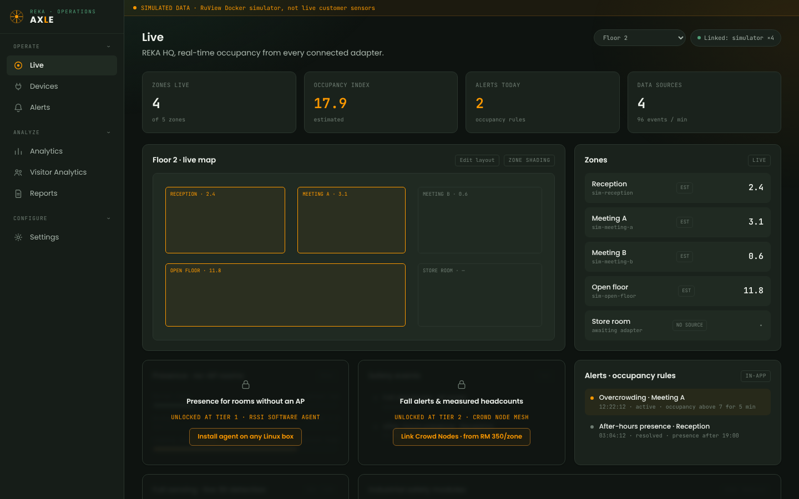
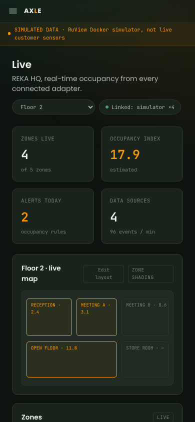
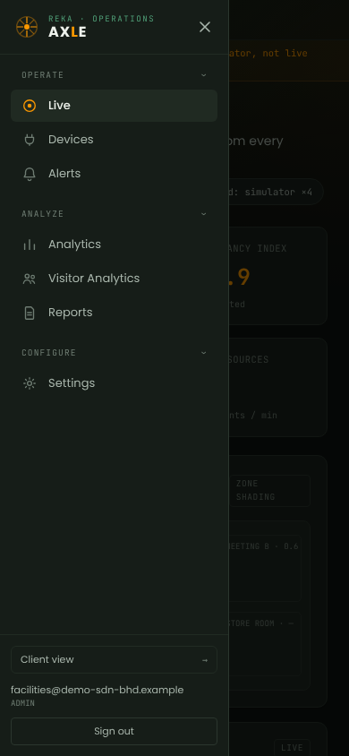
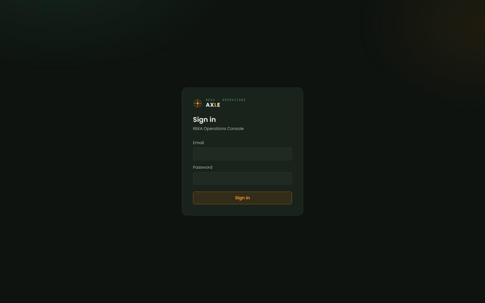
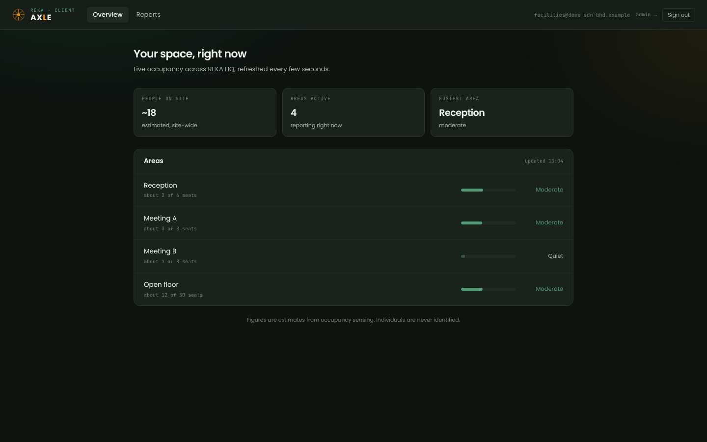
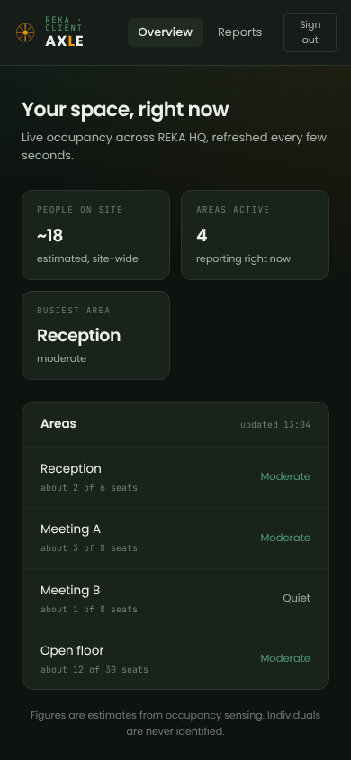

# PLExyz Crowd: dashboard and navigation inventory

Repo `haziqfaris/plexyz-crowd` at `ed08e96` (last commit 21 July 2026). Next.js 16 App Router, Tailwind v4, Postgres, HMAC cookie sessions. The brand kit marks Crowd as not in active development; this is a record of what ships today.

There are two surfaces, both for customers, both in the same Next.js app and behind the same sign-in:

1. **Main app** (route group `(dashboard)`): the facilities team's console, with a left sidebar. The code calls it the "admin/operational surface", but it is single-organisation with only admin and viewer roles, so it is the customer app. It is branded **"AXLE · REKA Operations Console"**, which the brand kit calls the most urgent fix in the portfolio.
2. **Client view** (route group `(client)`, `/client`): a trimmed, read-only top-bar view, also branded AXLE with the eyebrow "REKA · CLIENT".

**There is no real AXLE (internal, cross-organisation) console in this repo.** The `worker/` has no UI.

## How the screenshots were made

No demo mode renders without a backend, and the repo has no screenshots. I ran `next dev` on port 3104 with a dummy `SESSION_SECRET`, minted a session cookie locally with that secret, and had Playwright answer every `/api/*` call with fictional data: five zones on "Floor 2", the simulator adapter only, two alerts. Because only the simulator is "linked", the higher-tier panels render locked, which is the real state of the pilot; the heart-rate panel stays locked and out of the shots. The Next.js dev indicator was hidden with CSS. Names such as "REKA HQ" and "Floor 2" are hard-coded in the app, not from my data.

## 1. Main app (customer surface)

Full page, showing the sidebar footer: [01-customer-dashboard-desktop-full.png](screenshots/01-customer-dashboard-desktop-full.png). As a viewer: [01-customer-dashboard-viewer-desktop.png](screenshots/01-customer-dashboard-viewer-desktop.png) (only "Edit layout" disappears).

### Entry files

| What | File |
|---|---|
| Tab title "AXLE · REKA Operations Console" | `app/app/layout.tsx:17-20` |
| Session gate, renders the shell | `app/app/(dashboard)/layout.tsx:9-22` |
| Shell: sidebar, drawer, mobile bar, banner | `app/components/AppShell.tsx:104-185` |
| Nav links with collapsible groups | `app/components/AppShell.tsx:31-102` |
| Nav config | `app/lib/nav.ts:26-48` |
| Logo (AxleMark, AxleLogo) | `app/components/Logo.tsx:4-61` |
| Simulated-data banner | `app/components/SimBadge.tsx:3-10` |
| Settings sub-tabs | `app/components/SettingsNav.tsx:6-12` |
| Icons (custom inline SVG) | `app/components/Icons.tsx` |
| Tokens | `app/app/globals.css:3-26` |

### Layout

- Left sidebar, 224px (`w-56`), from 1024px up. Not sticky: the footer (Client view, email, role, Sign out) sits at the bottom of the page and scrolls with it.
- No desktop top bar. An amber banner, "SIMULATED DATA · RuView Docker simulator, not live customer sensors", runs across the top of the content on every page.
- Brand block: hub-and-spokes AXLE mark in amber, "AXLE" wordmark with an amber L, mono eyebrow "REKA · OPERATIONS" in green. No credit line, no version. Stock Next.js favicon.

### Navigation

| Group | Label | Route | Icon | Roles | Gating |
|---|---|---|---|---|---|
| Operate | Live | `/` | IconLive (ring and dot) | admin, viewer | none |
| Operate | Devices | `/devices` (+ `/devices/catalog`, `/devices/catalog/[type]`, `/devices/[sourceId]`) | IconAdapters (plug) | admin, viewer | editing admin-only in page |
| Operate | Alerts | `/alerts` | IconAlerts (bell) | admin, viewer | rule editing admin-only; no unread badge |
| Analyze | Analytics | `/analytics` | IconAnalytics (bars) | admin, viewer | none |
| Analyze | Visitor Analytics | `/visitor-analytics` | IconPeople | admin, viewer | uploads admin-only |
| Analyze | Reports | `/reports` (+ `/print/monthly`) | IconReports (document) | admin, viewer | none |
| Configure | Settings | `/settings` with tabs Setup, Zones, Floor Plan, Users, Audit | IconSettings (gear) | admin, viewer | writes admin-only |
| Footer | Client view → | `/client` | text arrow | admin, viewer | none |

Icons are custom 20x20 line SVGs drawn at 18px. Group headers are buttons that fold their group; the state is kept in `localStorage` as `axle_nav_collapsed`.

### Global controls

| Control | Today |
|---|---|
| Search, command palette, notifications, help, guide | none |
| Organisation switcher, product switcher, app tiles | none |
| Create button, AI entry, theme toggle, language | none (dark only, English only) |
| User area | email, role in caps, Client view link, Sign out button, all in the sidebar footer (no menu) |
| Environment badge | the simulated-data banner |
| Page header extras on Live | floor selector, "Linked: simulator ×4" status pill |

### Responsive

Below 1024px the sidebar goes; a slim top bar shows a hamburger and the AXLE wordmark. The hamburger opens a 256px left drawer over a 60% black scrim, with a close button, the same groups and the same footer. KPIs go from four columns to two, panels from three to one.

| Mobile dashboard | Mobile drawer open |
|---|---|
|  |  |

### Styling

- Active item: background `#202a22`, white text `#eef2ec`, medium weight, icon in amber `#fb9800`. Inactive: `#a9b6ac` text, `#6f7d73` icon. No `aria-current`.
- Grounds: `#0e1310` page, `#161d18` sidebar, `#1a221c` panels, lines `#2b362e`. Accent amber `#fb9800`, green `#4f9d76`, red `#e2574c`. Radial green and amber glows on the page.
- Poppins for UI, JetBrains Mono for numbers, eyebrows and tags.
- Focus ring: green, on inputs and selects only. No reduced-motion handling; the skeleton shimmer loops forever.

### Roles

Admin and viewer see the same nav. Viewers lose in-page editing (map layout, devices, alert rules, users, calibration).

### Dashboard (`/`, `app/components/Dashboard.tsx`)

Polls every 2.5 seconds.

1. Title "Live", subtitle "REKA HQ, real-time occupancy from every connected adapter." (hard-coded)
2. Floor selector and hardware status pill
3. Four KPI tiles: Zones live, Occupancy index (amber), Alerts today, Data sources
4. Floor 2 · live map: schematic of zone rectangles, busy zones in amber, "Edit layout" for admins (two columns wide)
5. Zones list: name, source id, EST / MEAS / NO SOURCE chip, occupancy
6. Presence · no-AP rooms: locked, "UNLOCKED AT TIER 1", "Install agent on any Linux box"
7. Safety events: locked, "Fall alerts & measured headcounts", "Link Crowd Nodes · from RM 350/zone"
8. Alerts · occupancy rules: feed of up to six alerts
9. Full sensing · live 3D detection: locked; when unlocked it shows 3D pose skeletons and a vitals (heart-rate) widget
10. Industrial safety modules: locked, "+RM 30–50/zone/mo" (two columns wide)

### Sign-in

AXLE lockup, "Sign in", "REKA Operations Console", email and password, amber outline button. No forgotten-password link, no credit, no sign-up (correct for a closed pilot).

## 2. Client view (second customer surface)

| What | File |
|---|---|
| Session gate | `app/app/(client)/layout.tsx:8-17` |
| Top-bar shell and nav | `app/components/ClientShell.tsx:10-68` |
| Overview | `app/components/ClientOverview.tsx:44-171` |
| Reports | `app/app/(client)/client/reports/page.tsx` |

- Layout: one top bar, no sidebar. AXLE lockup with eyebrow "REKA · CLIENT", two text tabs, then email, an "admin →" link and Sign out on the right. Content centred at 960px.
- Navigation: Overview `/client`, Reports `/client/reports` (Monthly space report in a new tab, 30-day occupancy CSV). No icons, no roles; every signed-in user sees the same, including the "admin →" link.
- No simulated-data banner on this surface.
- Responsive: below 640px the email and "admin →" link hide; Sign out wraps to two lines at 390px. No drawer.

### Dashboard (`/client`)

1. "Your space, right now", subtitle "Live occupancy across REKA HQ, refreshed every few seconds."
2. Three stat cards: People on site (~N, estimated), Areas active, Busiest area
3. Areas list: name, "about N of M seats", a capacity bar (amber busy, green moderate, faint quiet), label, "no recent data" for stale areas; "updated HH:MM" in Malaysia time
4. Footnote: "Figures are estimates from occupancy sensing. Individuals are never identified."

## What to keep

- The plain-language client overview: capacity-relative busy labels, "about N of M seats", and a stale area saying "no recent data" instead of zero.
- EST and MEAS chips on every zone number, matching the brief's "every number says whether it is estimated or measured".
- A visible simulated-data disclosure (reworded, and on both surfaces).
- Grouped sidebar (watch, study, configure) and the simple drawer on mobile.
- Poppins and JetBrains Mono, numbers in mono.

## What conflicts with the brand kit

- **AXLE everywhere a customer looks**: tab title, sidebar, mobile bar, sign-in, client view, report titles and footer. Rename to PLExyz Crowd and use `plexyz-crowd-mark.svg` with "by AntaraX".
- Amber on green-black instead of the PLExyz violet `#2C09B2` / Crowd accent `#6040CC`; local status colours instead of the shared set.
- Dark only; customer products must be light first.
- Focus ring green and inputs-only; should be AntaraX blue `#0459F7` everywhere. No reduced motion.
- No help, guide, support contact or app tile.
- Hard-coded "REKA HQ" and "Floor 2".
- "Client view" and "Users" should be organisation and members; "Analyze" and "summarized" in US spelling.
- Locked panels name falls, safety, through-wall sensing and vitals, use "unlocked", and show prices; the brief rules all of these out.
- Simulated banner names "RuView Docker simulator"; the client view has no disclosure.
- The client view links every user to the operations console ("admin →").
- Errors are lower-case API strings ("login failed", "API unreachable. Is the stack running?").
