# PLExyz Grid: dashboard and navigation inventory

Repo `haziqfaris/plexyz-grid` at commit `6a2b570` (15 Oct 2026). Stack: npm workspaces monorepo with two Vite + React 19 single-page apps (`apps/grid` for customers, `apps/axle` for REKA), Tailwind CSS 4, lucide-react icons, motion, recharts, Supabase. Shared tokens live in `packages/shared/design-tokens.css`. Machine-readable version: [nav.json](nav.json).

Three shells exist:

1. **Customer staff app** (`apps/grid`): sidebar plus floating top bar.
2. **Tenant portal** (same app, `tenant_portal` role): its own smaller sidebar shell.
3. **AXLE platform admin** (`apps/axle`): sidebar only.

Neither app has URL routing. Pages are React state (`activePage`), so the "route" column below gives that value.

How the screenshots were made: the customer app has a built-in no-backend demo mode (no Supabase env, seed data), so those are real local runs. The sign-in, pending-approval, free-plan and all AXLE screens were rendered against a dummy Supabase URL, with Playwright stubbing auth and REST calls with fictional data ("Demo Sdn Bhd"). No real backend was contacted. The live sites could not be reached from the sandbox.

---

## 1 Customer app (staff)

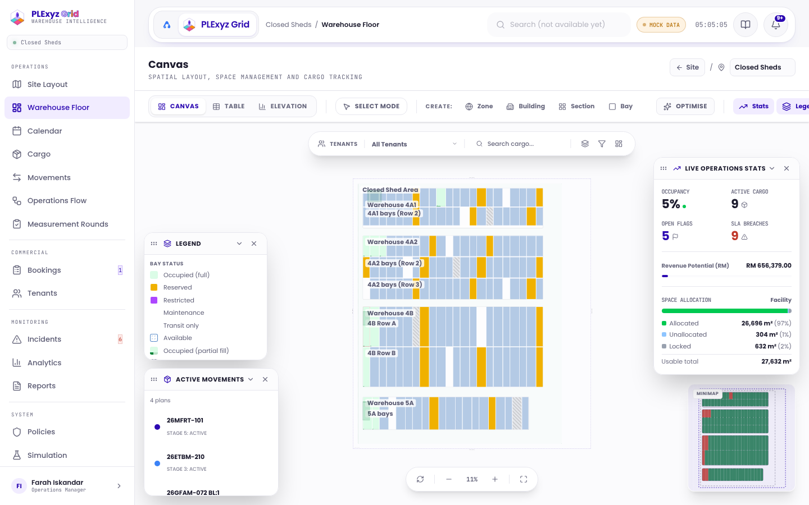

### Shell

- **Layout:** left sidebar 240px, full height, white with a right border. Beside it, a floating rounded top bar (64px desktop, 58px phone, radius 24px) sits inside the page gutter.
- **Entry files:** `apps/grid/src/App.tsx:80` (NAV_GROUPS), `:134` (NavButton), `:331` (sidebar), `:390` (user menu), `:572` (top bar). Auth front door is in `apps/grid/src/components/Auth/AuthGateShell.tsx:14`. Plan gating is in `packages/shared/src/entitlements.ts:62`.
- **Brand block (sidebar):**
  - the PLExyz Grid device mark (inline SVG, 30px)
  - the wordmark "PLExyz Grid"
  - the eyebrow "WAREHOUSE INTELLIGENCE" in mono uppercase
  - a facility chip with a pulsing green dot and the first facility's name
  - no credit line and no version text
- **Brand pill (top bar):** the AntaraX mark links out to antarax.ai, then "PLExyz Grid" on a raised white chip. The chip takes you home to the Warehouse Floor, and its text is hidden below 1024px.

### Navigation

| Group | Label | Route (activePage) | Icon (lucide) | Roles | Gating | Badge |
|---|---|---|---|---|---|---|
| Operations | Site Layout | site | Map | all staff | all plans; desktop-first | |
| Operations | Warehouse Floor | canvas (home) | LayoutDashboard | all staff | all plans; desktop-first | |
| Operations | Calendar | calendar | Calendar | all staff | Advanced | |
| Operations | Cargo | cargo | Package | all staff | all plans | |
| Operations | Movements | movements | ArrowLeftRight | all staff | Advanced | |
| Operations | Operations Flow | flow | Workflow | all staff | Advanced; desktop-first | |
| Operations | Measurement Rounds | rounds | ClipboardCheck | all staff | all plans | |
| Commercial | Bookings | bookings | ClipboardList | all staff | Standard | orange count of submitted requests |
| Commercial | Tenants | tenants | Users | all staff | Standard | |
| Monitoring | Incidents | incidents | AlertTriangle | all staff | all plans | red count of open or in-review incidents |
| Monitoring | Analytics | analytics | BarChart3 | all staff | Advanced | |
| Monitoring | Reports | reports | FileText | all staff | Standard | |
| System | Policies | policies | Shield | all staff | Standard | |
| System | Simulation | simulation | FlaskConical | all staff | Intelligent; desktop-first | |
| System | Team | team | UserCog | all staff | all plans | |
| System | Settings | settings | Settings | all staff | all plans | |

Items below the organisation's plan stay visible, show a lock icon, and open an upgrade screen ("Analytics needs the Advanced plan. Contact your REKA account team to upgrade..."). There are no sub-menus.

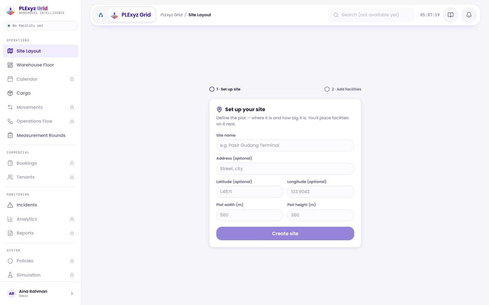
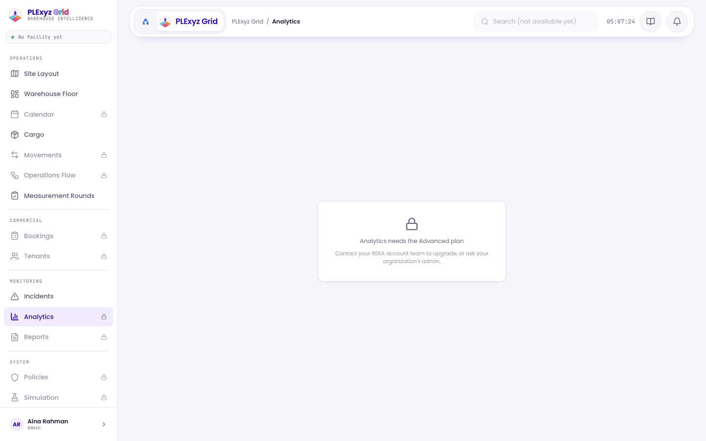

### Global controls

| Control | What exists |
|---|---|
| Search | Top-bar field "Search (not available yet)". Disabled, and shown only at 1280px and up |
| Command palette | None |
| Notifications | 44px bell with a violet count badge (caps at 9+). Counts active flags plus due reminders. Opens a 320px dropdown. On the Warehouse Floor the canvas panels draw over this dropdown |
| Help | None (no Help item, no /help) |
| Guide | Book button in the top bar and "User Guide" in the user menu. Both open a modal around the HTML guide, whose cover says "by REKA" |
| Organisation switcher | None |
| Product switcher | Only the AntaraX mark linking to antarax.ai |
| Create button | None global. Create tools sit in the floor toolbar |
| AI entry | None in the shell. Per page: "Optimise" on the floor, "AI Insights" and "Insight" on Analytics |
| Theme toggle, language | None (light only, English only) |
| User menu | Opens from the sidebar footer (avatar, name, role). Holds the name and email, the demo-only "Switch Profile" list, Account Settings, User Guide and Sign Out |
| Plan badge | None. Lock icons only |
| Environment badge | Amber "MOCK DATA" pill in demo mode |
| Other | Live 24-hour clock in mono, breadcrumb (facility / page), a persistence toast |

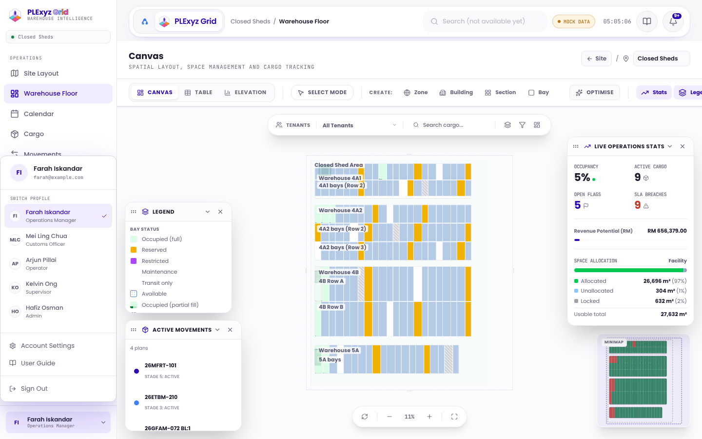
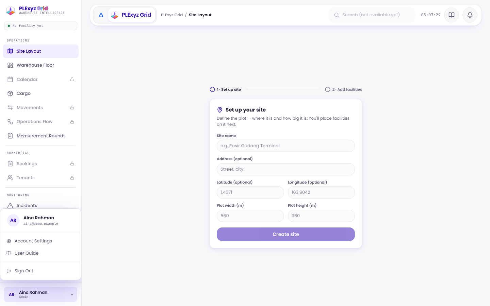
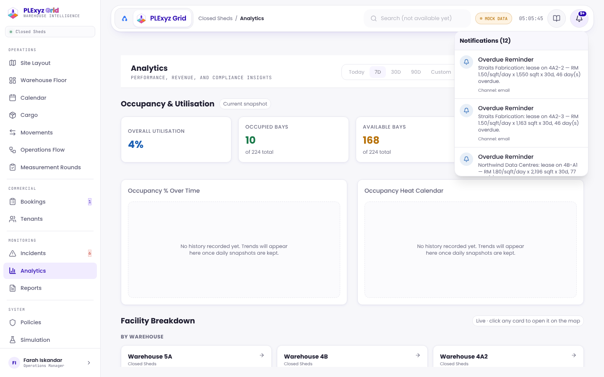
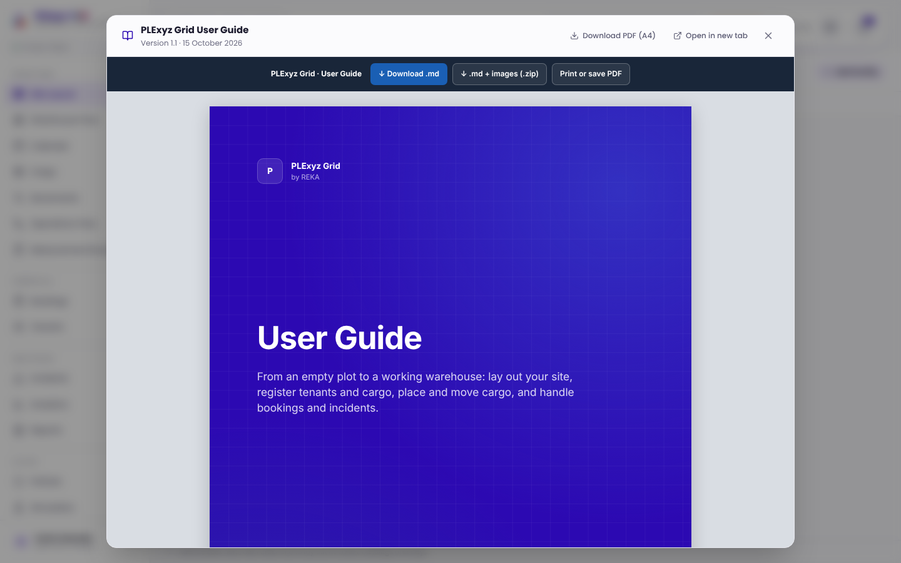

### Responsive behaviour

- **Below 768px:** the sidebar becomes a slide-over drawer, opened by a 44px menu button in the top bar and closed by tapping the backdrop. Desktop-first pages carry a monitor icon in the drawer and an amber "designed for a larger screen" banner. There is no bottom tab bar.
- **Below 640px:** the clock and breadcrumb are hidden.
- **1024px and up:** the facility name and product name appear.
- **1280px and up:** search appears.
- **Known issue:** the 4-column KPI grids on Analytics do not reflow on phones.

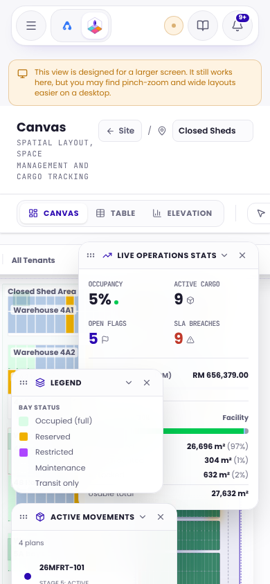 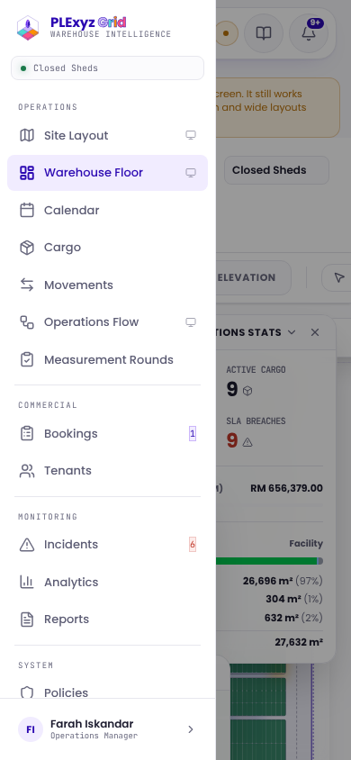 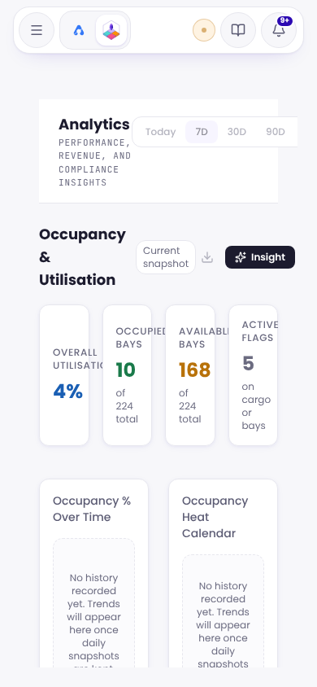

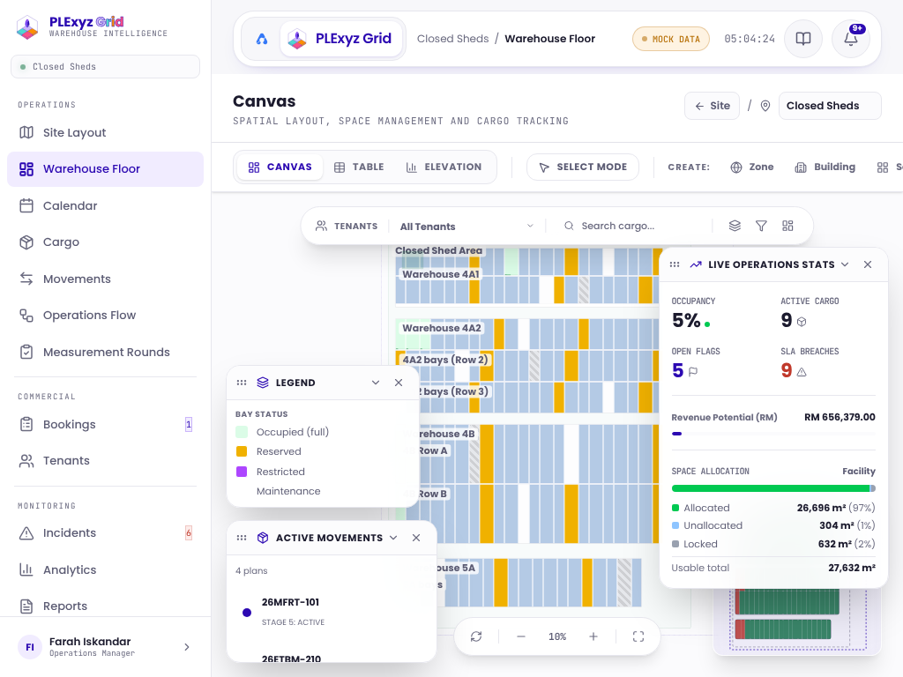

### Styling

- **Active item:** tint `#F1ECFF` background, violet `#2C09B2` text and icon, a 1px `#CBB6FA` border and a heavier icon stroke. Locked items are greyed to 70%. There is no `aria-current`.
- **Icons:** 18px in the nav.
- **Group labels:** mono 9px uppercase, wide tracking.
- **Fonts:** Poppins for UI and JetBrains Mono for labels.
- **Colour tokens:** ground `#F7F7FA`, text `#1C1B2E`, muted `#5C5C74` and `#6B6B80`. Status colours are the app's own: green `#1A7A4A`, amber `#B8720A`, red `#C0392B`.
- **Focus:** a violet ring on the header buttons only; inputs remove the outline.
- **Motion:** no reduced-motion handling.

### Role variants

Every staff role (Superadmin, Admin, Operations Manager, Supervisor, Operator, Customs Officer, Viewer) sees the same nav. Role limits apply to actions inside pages. The `tenant_portal` role gets the separate Tenant Portal shell (section 2).

### Dashboard (home)

There is no dashboard page. The app opens on the **Warehouse Floor** canvas (`CanvasPage.tsx:2444`). A new organisation with no facility opens on Site Layout's set-up form. From top to bottom, the floor shows:

1. **Page header:** "Canvas", with the mono subtitle, a "← Site" button and a facility select.
2. **Toolbar:**
   - Canvas / Table / Elevation view toggle
   - Select or Drag mode
   - Create: Zone, Building, Section, Bay
   - Optimise (AI placement)
   - panel toggles for Stats, Legend, Movements and Inventory
3. **Floating filter bar:** tenant select, "Search cargo...", layers, filters, and a button to hide the panels.
4. **The floor canvas**, coloured by bay status.
5. **Live Operations Stats** (draggable window):
   - KPIs for Occupancy %, Active Cargo, Open Flags and SLA Breaches
   - Revenue Potential (RM) with a bar
   - a space-allocation stacked bar (allocated, unallocated, locked m², usable total)
6. **Legend** (collapsible): the bay status swatches.
7. **Active Movements:** a list of active plans with their stage.
8. **Minimap** and **zoom controls** (reset, minus, %, plus, fullscreen).

The closest thing to a KPI dashboard is **Analytics** (`AnalyticsPage.tsx:325`):

- **Header:** a date-range chip row (disabled), Export All (disabled) and AI Insights.
- **Sections:** Occupancy & Utilisation, Facility Breakdown (by warehouse and zone cards), Cargo & Dwell Time, Movements & Operations, Revenue & Commercial, and Incidents & Compliance.
- **Per section:** KPI cards, recharts horizontal bars and a donut, plus tables. Over-time charts are honest "No history recorded yet" placeholders.

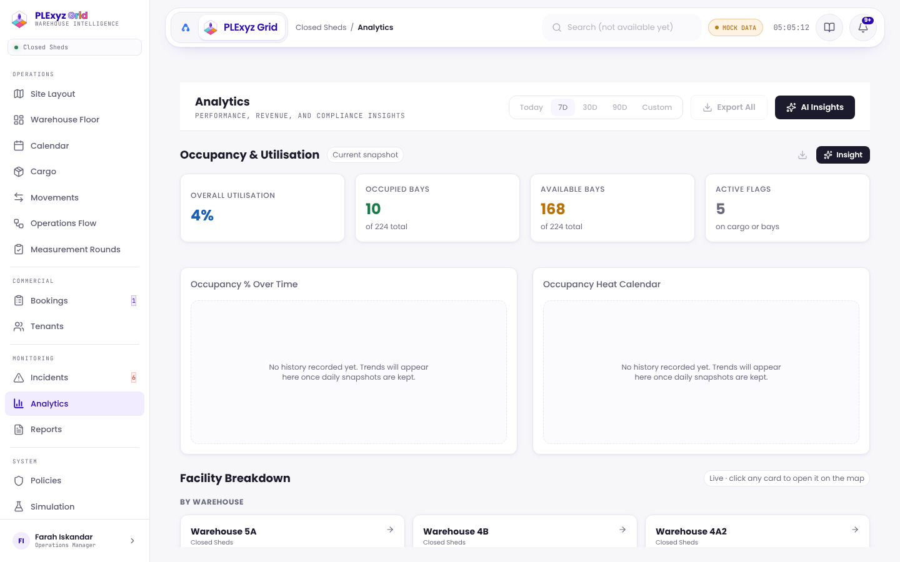

Full length: [01e-customer-analytics-fullpage-desktop.png](screenshots/01e-customer-analytics-fullpage-desktop.png). Site Layout: [01f](screenshots/01f-customer-site-layout-desktop.png).

### Sign-in and account screens

The sign-in screen is a split layout. The left half is a violet panel with a headline, three zone-coloured feature bullets and the footer "PLEXYZ GRID [em dash] WAREHOUSE INTELLIGENCE". The right half is a card on a hexagon pattern. The card offers "Forgot your password? Contact your REKA account manager" and "Create a workspace". A pending-approval card follows sign-up.

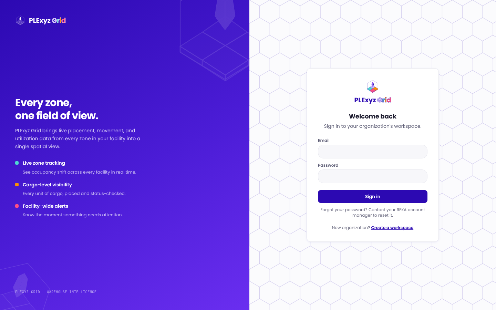

Phone: [05b](screenshots/05b-customer-signin-mobile.png). Sign-up: [05c](screenshots/05c-customer-signup-desktop.png). Pending approval: [05d](screenshots/05d-customer-pending-approval-desktop.png).

---

## 2 Tenant portal

- **Entry files:** `apps/grid/src/components/Tenants/TenantPortalShell.tsx:80` (nav), `:95` (sidebar), `:138` (mobile bar). It is selected in `App.tsx:247`.
- **Layout:** a 220px sidebar with no desktop top bar. Below 768px there is a 48px sticky bar with a menu button, and the sidebar becomes a drawer.
- **Brand:** no product or AntaraX branding. The block is a violet tile with the tenant's code, the tenant name and the eyebrow "TENANT PORTAL".

| Label | Route (tab) | Icon | Badge |
|---|---|---|---|
| Overview | overview | ShieldCheck | |
| My Cargo | cargo | Package | grey count, not departed |
| My Bays | bays | Warehouse | grey count |
| Bookings | bookings | ClipboardList | grey count, submitted or under review |
| Billing | billing | Receipt | |
| Reminders | reminders | Bell | grey count |

All items need the Tenant portal add-on. The footer shows "Signed in as …", then User Guide, then Sign Out ("Exit to Staff View" in demo mode).

**Overview** shows, in order:

1. a greeting ("Welcome back, <contact>")
2. four KPI cards: Active Cargo, Bays Leased, Monthly Charges ("RM 139,227") and Compliance Score
3. Recent Reminders (up to 3, with "View all")

On a phone the KPI row stays at 4 columns and clips.

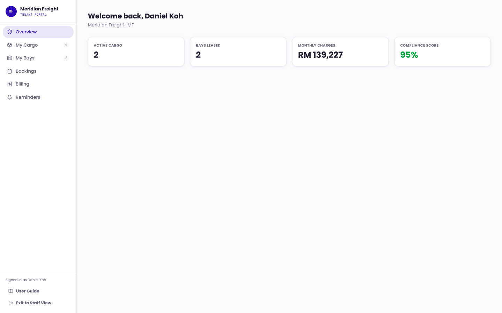

Phone: [04b](screenshots/04b-tenant-portal-overview-mobile.png). Phone drawer: [04c](screenshots/04c-tenant-portal-nav-open-mobile.png).

---

## 3 AXLE (PLExyz Grid AXLE, platform admin)

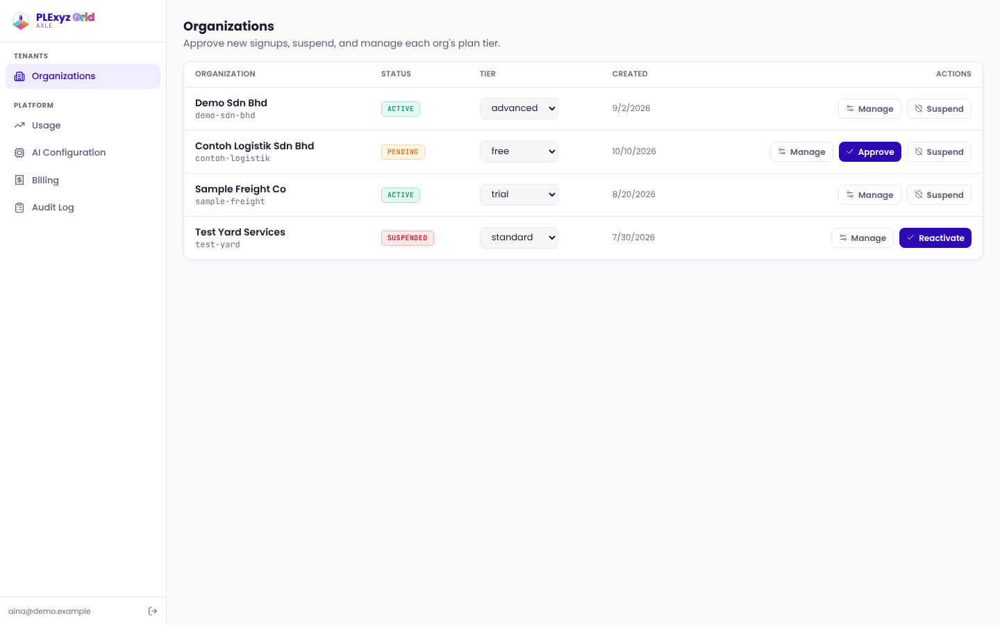

- **Entry files:** `apps/axle/src/App.tsx:53` (gate and page switch), `apps/axle/src/components/Layout/AdminShell.tsx:19` (nav), `:60` (sidebar), `:104` (footer). Deployed at plexyz-grid-axle.pages.dev.
- **Layout:** a 240px sidebar and no top bar. Below 768px the sidebar turns into a top bar with a menu/close toggle. The nav and footer then stack under it and push the content down; they do not overlay it.
- **Brand:** the same Grid device mark and wordmark, with the eyebrow "AXLE" in mono. The tab title is "PLExyz Grid AXLE [em dash] Platform Admin". It is light and violet, with the same tokens as the customer app.

| Group | Label | Route (activePage) | Icon | Roles | Gating |
|---|---|---|---|---|---|
| Tenants | Organizations | organizations (default) | Building2 | platform admin | platform_admins row |
| Platform | Usage | usage | TrendingUp | platform admin | same |
| Platform | AI Configuration | ai | Cpu | platform admin | same |
| Platform | Billing | billing | Receipt | platform admin | same |
| Platform | Audit Log | audit | ClipboardList | platform admin | same |

### Global controls

AXLE has very few global controls:

- **Footer:** the admin's email and a sign-out icon.
- **Banner:** a one-time password-reset banner, when needed.
- **Missing:** search, notifications, help, guide, an organisation or product switcher, impersonation, a theme toggle and an environment badge.

### Styling

- **Active item:** tint background, violet text, `aria-current="page"`.
- **Icons:** 16px.
- **Group labels:** bold 10px uppercase in Poppins.
- **Focus:** inputs remove the outline; no reduced-motion handling.

### Dashboard

There is no dashboard. AXLE opens on the **Organizations** table, which shows:

- **Columns:** name and slug, a status pill (pending, active, suspended), a tier select (free, trial, standard, advanced, intelligent), the created date and actions.
- **Actions:** Manage, Approve, Suspend and Reactivate.
- **Manage** opens a slide-over with members, limits, Stripe subscription, one-off invoice and add-ons.

The KPI-style page is **Usage**:

- six KPI tiles: requests, errors, refusals, average latency, P50 and P95
- "Was it useful?"
- reply quality
- a by-organisation table
- a recent-requests table

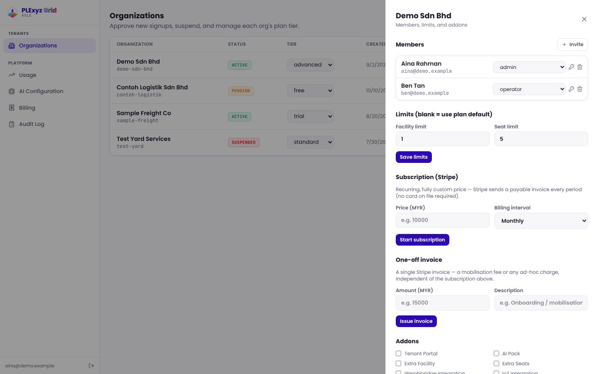
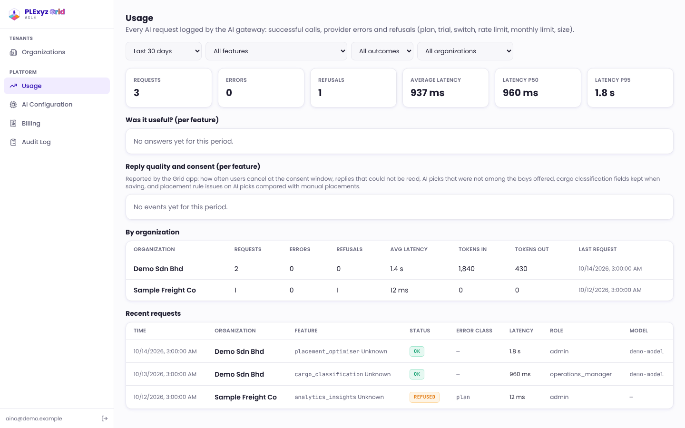

AI Configuration: [03d](screenshots/03d-axle-ai-configuration-desktop.png). Billing: [03e](screenshots/03e-axle-billing-desktop.png). Audit Log: [03f](screenshots/03f-axle-audit-log-desktop.png). Phone: [03g](screenshots/03g-axle-dashboard-mobile.png). Phone, nav open: [03h](screenshots/03h-axle-nav-open-mobile.png). Sign-in: [05e](screenshots/05e-axle-signin-desktop.png).

---

## Existing screenshots in the repo

The repo holds 52 user-guide shots in `apps/grid/guide/images/` (1x) and the same set at 2x in `docs/delivery/D1-user-guide/images/`. The guide is v1.1, dated 15 Oct 2026. The clone is shallow, so file dates are unknown.

They are fresh: `tour.jpg` matches today's UI, including the 12 Oct top bar. It is copied here as [repo-guide-tour-warehouse-floor.jpg](screenshots/repo-guide-tour-warehouse-floor.jpg). None of the repo shots show AXLE. The other 8 images in the repo are template examples.

## What to keep

- The grouped sidebar: Operations, Commercial, Monitoring, System. It matches the brand kit's areas.
- Count badges on Bookings and Incidents.
- Locked-but-visible plan gating with an upgrade screen.
- The desktop-first markers on mobile.
- The floating top bar with the AntaraX-then-product brand pill. It is already the shared AntaraX top bar pattern.
- 44px header targets.
- Honest "not available yet" and "No history recorded yet" states instead of fake charts.
- AXLE's `aria-current` and its small, clear nav.

## What conflicts with the brand kit

- **No AntaraX credit anywhere.** The guide cover says "by REKA".
- **The em-dash uppercase eyebrows ship.** "PLEXYZ GRID [em dash] WAREHOUSE INTELLIGENCE" is in `LoginPage.tsx:42`, and the AXLE equivalent is in `AdminLoginPage.tsx:37`.
- **Old zone colours.** The logo and `--zone-*` tokens still use the original colours, not the approved AntaraX versions.
- **Status colours are not the shared core.** The violet focus ring and missing outlines on inputs conflict with the AntaraX-blue ring rule. There is no reduced-motion handling.
- **No Help item or /help, and the guide is not at /guide.**
- **AXLE does not have the AXLE look.** It should be dark `#071233`, with REKA orange and the AntaraX A, named "AXLE · PLExyz Grid" at axle.antarax.ai. Today it is a light violet "PLExyz Grid AXLE".
- **Words:**
  - US "organization"
  - "workspace" used for the account
  - "Sign Out" in title case
  - Superadmin and other role names
  - "Contact your REKA account manager/team" instead of the support line
- **Plan names and formats:**
  - plans are free, trial, standard, advanced and intelligent, not Seed, Nova, Galaxy and Quantum
  - money is written "RM 1,234" with a space
  - AXLE uses US dates ("10/14/2026, 3:00:00 AM")
- **The Tenant Portal has no product branding at all.**
- **No app tile.** The AI buttons use generic Sparkles or a "✦" glyph, not the AntaraX sparkle.
- **Top-bordered stat cards are no longer used** (the `.kpi-card` CSS is dead), so the 07 conflict is effectively gone. The dead class could be removed.
