# Tinara: dashboard and navigation inventory

Read from `haziqfaris/tinara`, branch `build/production-foundation`, commit `02d53b7` (24 Jul 2026). Inventory taken 15 Oct 2026. Machine-readable version: [nav.json](nav.json).

Tinara is a Vite and React single-page app (HashRouter, Tailwind 4, Recharts, Supabase). The customer app and the admin console ("Tinara Admin") live in the same bundle; the console is the `/#/admin` route, open only to platform admins.

The app has two runtime modes, and they change what the shell shows:

- **Demo** (`VITE_ENABLE_DEMO_MODE=true`, the default in development): no sign-in, synthetic companies, a splash and launcher, and an identity switcher between two demo users (a USER and an ADMIN).
- **Pilot / production**: Supabase sign-in, organisation-scoped credits, "Change Password" in the user menu, and 8 of the 12 admin pages replaced by a "not yet wired" placeholder.

## How the screenshots were made

- Demo screens: the repo's own demo mode, run locally, with a campaign run through the wizard on its built-in synthetic data.
- Sign-in and pilot screens: demo mode off, the Supabase URL pointed at an unused local port, and Playwright `page.route()` answering the auth and REST calls with fictional data (organisation "Demo Sdn Bhd"). No real backend was contacted.
- There were no existing screenshots in the repo.

## 1 Customer app

### Shell

| | |
|---|---|
| Entry files | `components/Layout.tsx:43` (shell), `:58` (sidebar), `:94` (nav), `:154` (user block), `:234` (page header); routes in `App.tsx:595-685`; wizard layout `App.tsx:77-169` |
| Layout | Fixed left sidebar, 256px (`w-64`), navy `#0f172a`. Main area `ml-64`, padded 32px, full height with its own scroll. No top bar: a slim in-page header shows the page title in capitals and the long date ("DASHBOARD \| Thursday, October 15"). |
| Wizard | `/wizard` drops the sidebar for an immersive layout: wordmark, credits pill, optional "+250", and "Return to Dashboard". |
| Brand block | Plum "T" letter tile (no logo file), "Tinara" in Poppins 600, and a superscript "BY REKA" with REKA in orange `#fb9800`. |
| Credits card | "Intelligence Credits" and the balance, with "Top up" (to `/subscription`), or "+250" for admins when the credit top-up flag is on. |

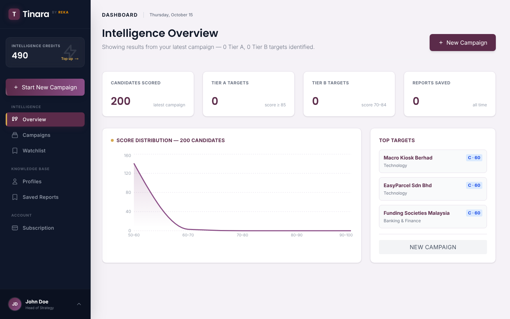

### Nav items

All items are visible to both roles. Icons are inline Heroicons v1 outline SVG paths (no icon library), 20px.

| Group | Label | Route | Icon | Roles | Gating |
|---|---|---|---|---|---|
| (primary action) | Start New Campaign | `/wizard` (asks to reset if a campaign has results) | plus | all | none |
| Intelligence | Overview | `/dashboard` | view-grid | all | none |
| Intelligence | Campaigns | `/campaigns` | collection | all | none |
| Intelligence | Watchlist | `/watchlist` | bookmark | all | The `watchlist` and `signalFeed` flags change the page, not the nav item |
| Knowledge Base | Profiles | `/profiles` | user | all | none |
| Knowledge Base | Saved Reports | `/saved` | bookmark (same as Watchlist) | all | none |
| Account | Subscription | `/subscription` | credit-card | all | none |

`/onboarding` exists and opens automatically on first run, but is not in the nav.

### Global controls

| Control | Today |
|---|---|
| Search, command palette, notifications, help, guide | None. Toasts appear top right. |
| Organisation switcher | None. The pilot takes the first membership; the organisation name is never shown. |
| Product switcher, AI entry, theme, language | None |
| Create | "Start New Campaign" gradient button at the top of the sidebar, plus "Start First Campaign" / "New Campaign" on the dashboard |
| User menu (opens upwards) | Avatar, name, job title. Items: Switch Identity (demo), Admin Console (admins only), Change Password (pilot only), Log Out |
| Plan badge | None; the credits card stands in for it |
| Environment badge, impersonation banner | None. Demo identity switching has no banner. |

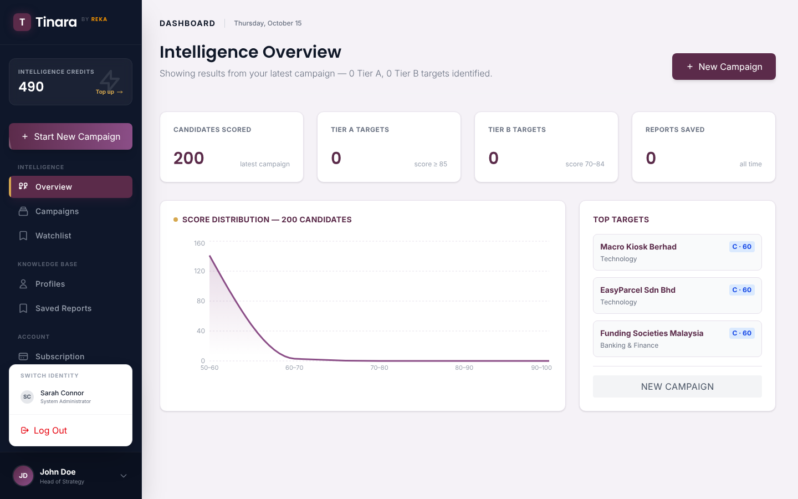
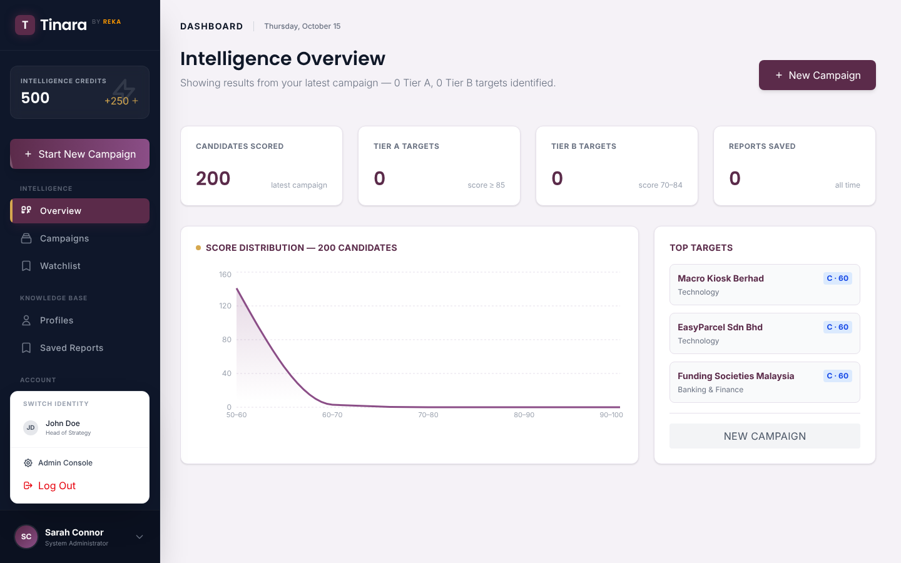

In pilot mode a partner's menu still shows the "Switch Identity" heading with nothing under it:

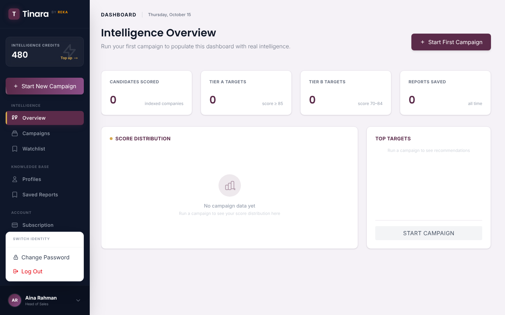

### Responsive behaviour

There is none. The shell has no breakpoints, so at 390px the 256px sidebar stays put and the content is squeezed into a column about 134px wide. There is no hamburger, drawer or bottom bar, so there is no "nav open" state to capture. The sign-in screen does adapt: its showcase panel hides below `lg`.

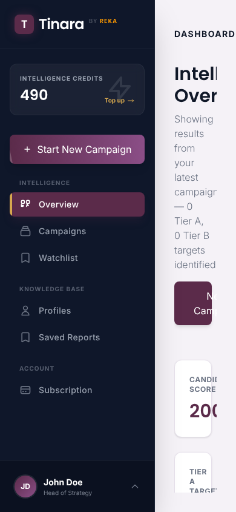

### Styling

- Active item: plum `#5B2B4A` fill, white text, a soft plum shadow and a 4px gold `#D6A84F` bar on the left. Inactive items are gray-400 and nudge right on hover.
- Colours: content `#F5F2F7`, cards white with border `#E6E0EB`, amethyst `#8B4E87` for gradients and charts, Tailwind default greens, blues and reds for status.
- Fonts: Inter for body, Poppins for display. No JetBrains Mono; KPI numbers are in Poppins.
- Accessibility: no aria attributes on the nav, no focus styles, the popover does not close on Escape, and no reduced-motion handling (fade, scale, pulse, bounce and spin always run).

### Role variants

Roles are USER and ADMIN; ADMIN means platform admin. The nav is the same for both. ADMIN adds "Admin Console" to the user menu and, with the top-up flag on, "+250" instead of "Top up". Organisation roles (owner, admin, member, viewer) are loaded but not used in the UI.

### Dashboard: Overview (`/dashboard`, `components/Dashboard.tsx`)

| # | Kind | Widget | Detail |
|---|---|---|---|
| 1 | Greeting | Intelligence Overview | Subline changes from "Run your first campaign..." to "N Tier A, N Tier B targets identified." |
| 2 | Quick action | Start First Campaign / New Campaign | Plum button, top right |
| 3-6 | KPI | Candidates Scored, Tier A Targets, Tier B Targets, Reports Saved | Four tiles; Tier A turns plum when above 0 |
| 7 | Chart | Score Distribution | Recharts area chart across five score bands (50 to 100), two thirds wide |
| 8 | Empty state | No campaign data yet | Replaces the chart before the first campaign; generic bar-chart icon |
| 9 | List | Top Targets | Top three companies with tier and score chip; faded "Demo data" before a campaign in demo mode |
| 10 | Quick action | Start Campaign / New Campaign | Grey button under Top Targets |

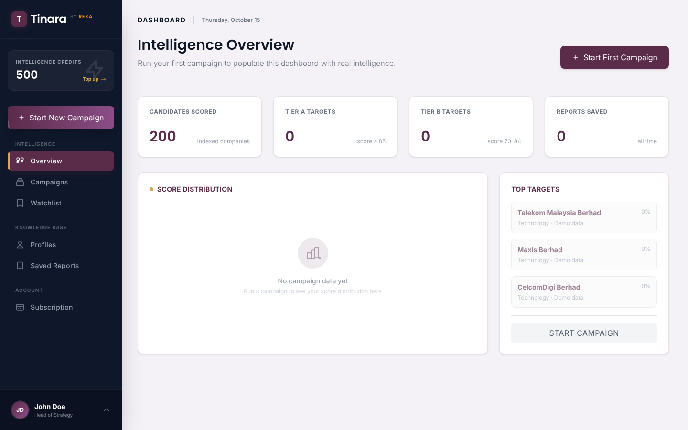
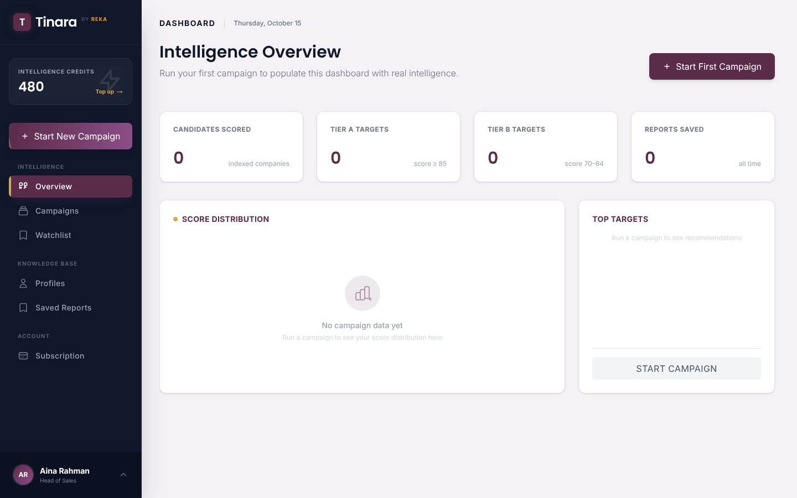

### Other customer screens

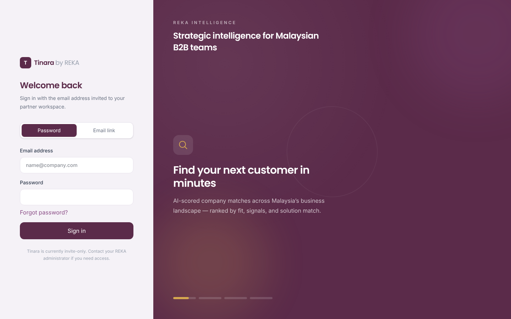
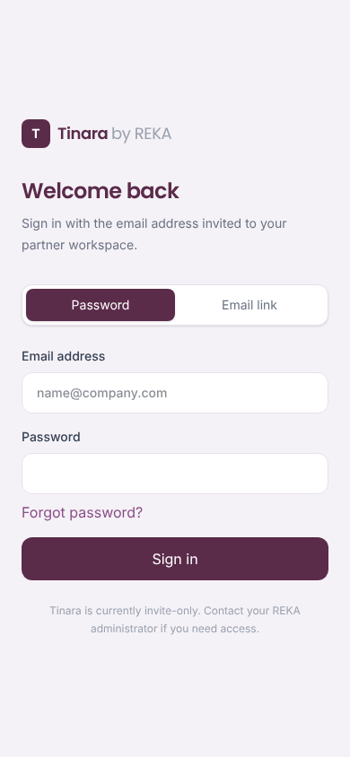
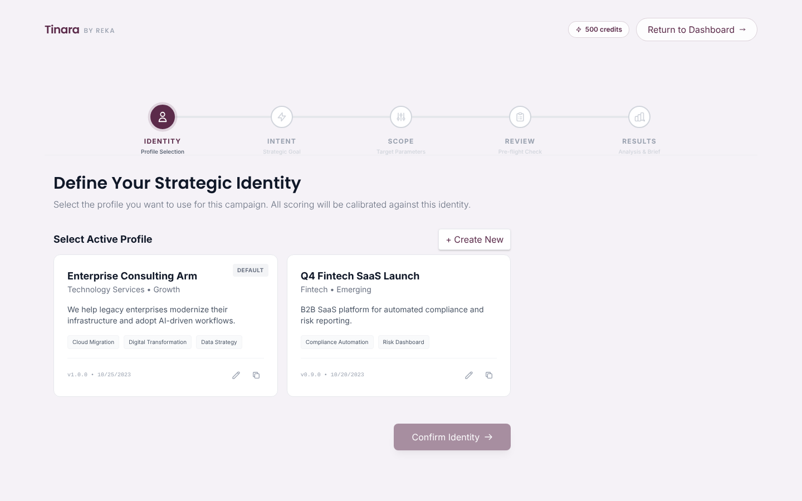
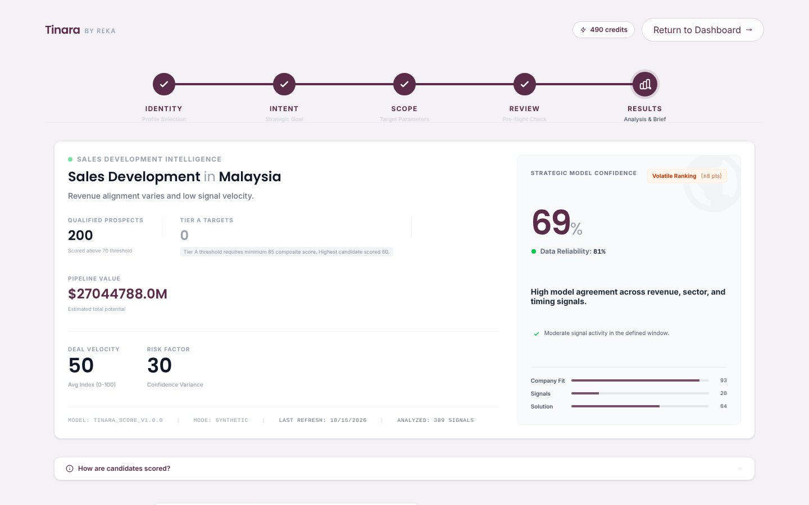
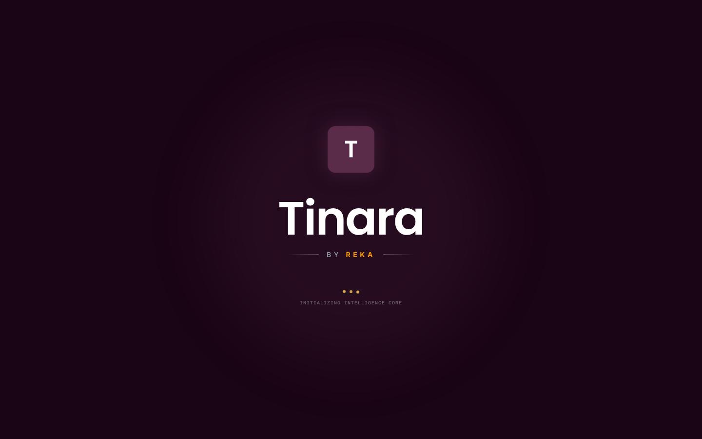
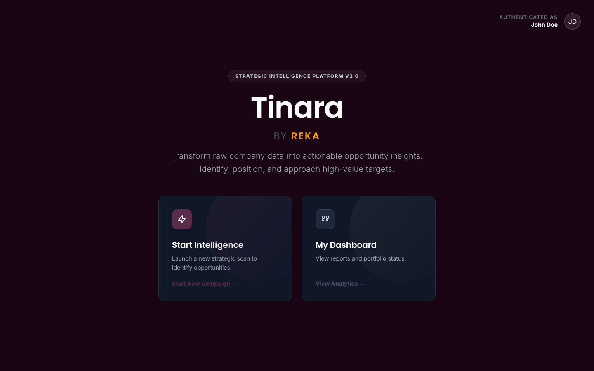

## 2 Tinara Admin (future AXLE · Tinara)

### Shell

| | |
|---|---|
| Entry files | `components/AdminLayout.tsx:44` (shell), `:51` (sidebar), `:74` (nav), `:145` (user block); routes `App.tsx:550-583` |
| Address | `/#/admin` inside the customer app. Non-admins are sent to `/dashboard`. |
| Layout | Fixed left sidebar, 240px (`w-60`), white with a grey border. Content `#F8F9FA`, scrolling. No top bar. |
| Brand block | 24px plum "T" tile, "Tinara Admin", a status dot reading OPERATIONAL or MAINTENANCE, and "Back to App" |

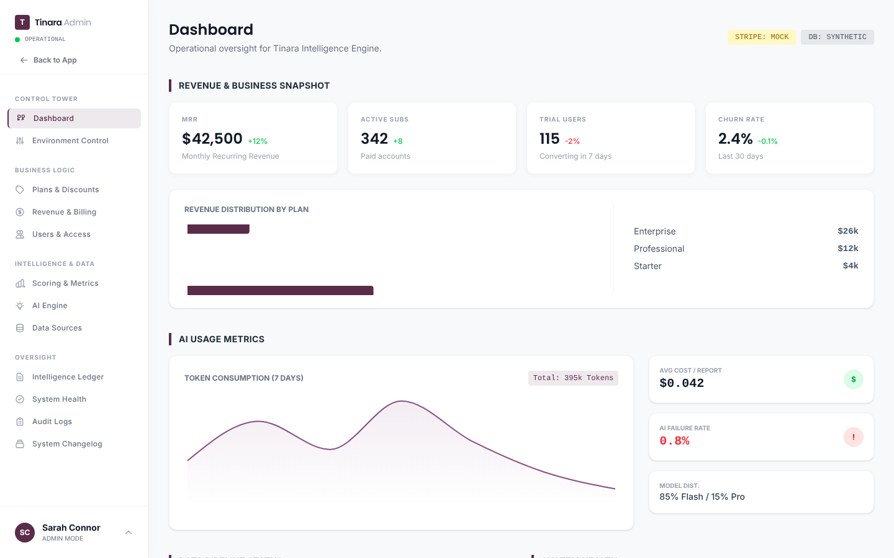

### Nav items

All items are for platform admins only. Icons are inline Heroicons v1 outline paths, 16px. "Placeholder in pilot" means the page shows "This panel is available in the demo build but not yet wired to live data" in pilot mode.

| Group | Label | Route | Icon | Gating |
|---|---|---|---|---|
| Control Tower | Dashboard | `/admin` | view-grid | Same hard-coded figures in both modes |
| Control Tower | Environment Control | `/admin/environment` | adjustments | Placeholder in pilot |
| Business Logic | Plans & Discounts | `/admin/plans` | tag | Placeholder in pilot |
| Business Logic | Revenue & Billing | `/admin/finance` | currency-dollar | Placeholder in pilot |
| Business Logic | Users & Access | `/admin/users` | users | Live |
| Intelligence & Data | Scoring & Metrics | `/admin/scoring` | chart-bar | Placeholder in pilot |
| Intelligence & Data | AI Engine | `/admin/ai` | light-bulb | Placeholder in pilot |
| Intelligence & Data | Data Sources | `/admin/data` | database | Live |
| Oversight | Intelligence Ledger | `/admin/ledger` | document-text | Live |
| Oversight | System Health | `/admin/system` | check-circle | Placeholder in pilot; in demo it holds the feature flags and maintenance mode |
| Oversight | Audit Logs | `/admin/audit` | clipboard-list | Placeholder in pilot |
| Oversight | System Changelog | `/admin/changelog` | collection | Placeholder in pilot |

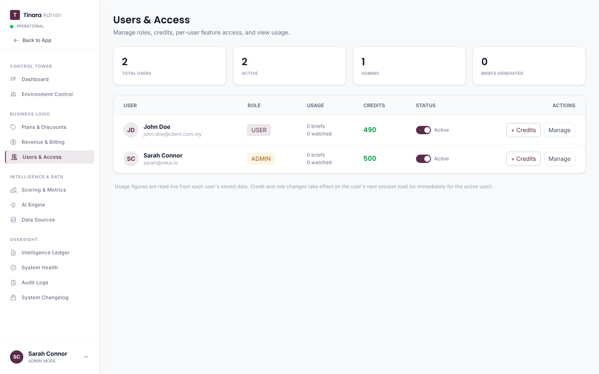
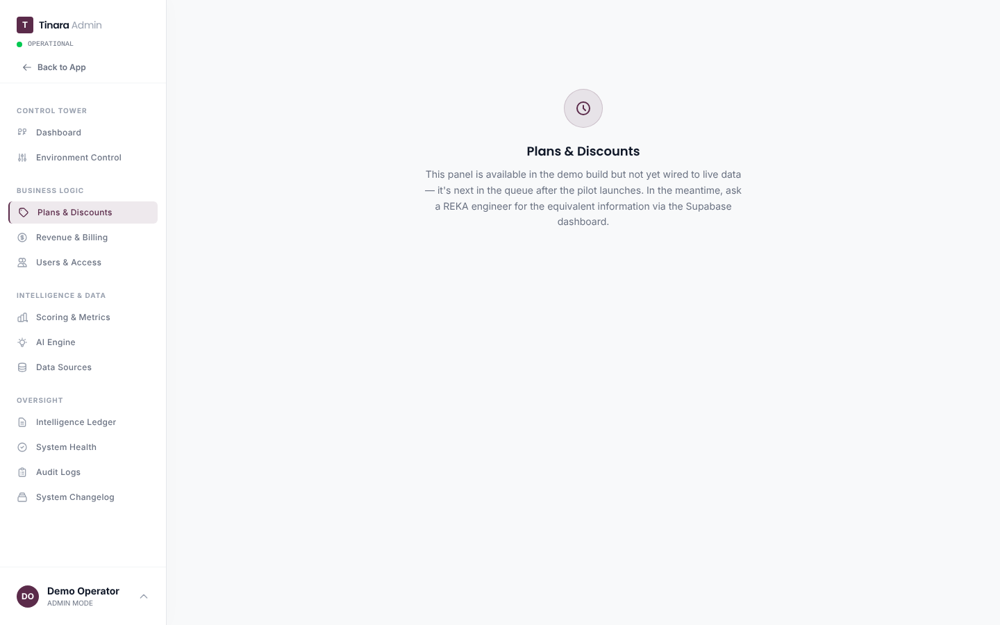

### Global controls

- No search, notifications, help, organisation switcher, AI entry or theme toggle.
- "Back to App" is the only way across to the customer app.
- Environment shown as chips on the dashboard ("STRIPE: MOCK", "DB: SYNTHETIC") and the sidebar status dot.
- User menu: avatar, name, "ADMIN MODE"; Switch Identity (demo), Change Password (pilot), Log Out.

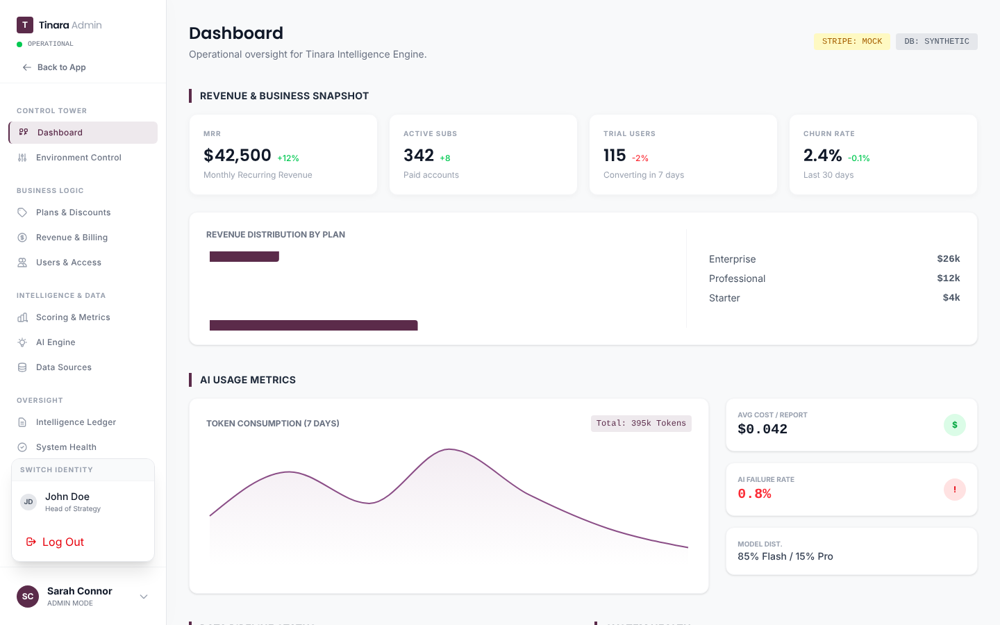

### Responsive, styling and roles

- Responsive: none; at 390px the content is squeezed beside the sidebar.
- Active item: plum at 10% fill, plum text and a 2px plum left border.
- Fonts: Inter and Poppins, browser default mono for figures.
- Accessibility: no aria, no focus styles, no reduced motion; 10px grey labels on white.
- Roles: a single platform admin role, no sub-roles.

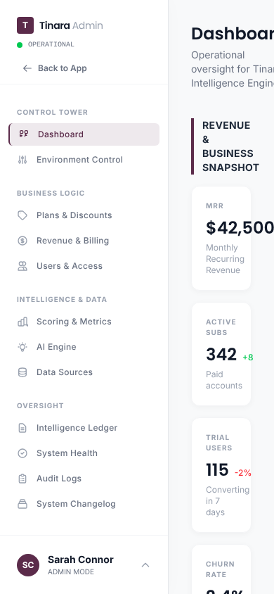

### Dashboard (`/admin`, `components/AdminOverview.tsx`)

Every figure is hard-coded and the same in demo and pilot.

| # | Kind | Widget | Detail |
|---|---|---|---|
| 1 | Greeting | Dashboard | "Operational oversight for Tinara Intelligence Engine." |
| 2 | Other | Environment chips | STRIPE and DB mode |
| 3-6 | KPI | MRR, Active Subs, Trial Users, Churn Rate | $42,500, 342, 115, 2.4%, each with a trend |
| 7 | Chart | Revenue distribution by plan | Horizontal bar chart (Starter, Pro, Ent) with a list in US dollars; only two of the three bars are visible |
| 8 | Chart | Token consumption (7 days) | Area chart Monday to Sunday, "Total: 395k Tokens" |
| 9 | KPI | Avg cost per report, AI failure rate, model split | Three stacked tiles |
| 10 | Table | Data pipeline status | Source, Status, Freshness, Rows |
| 11 | KPI | System health | Uptime, Avg latency, DB response, Error rate |

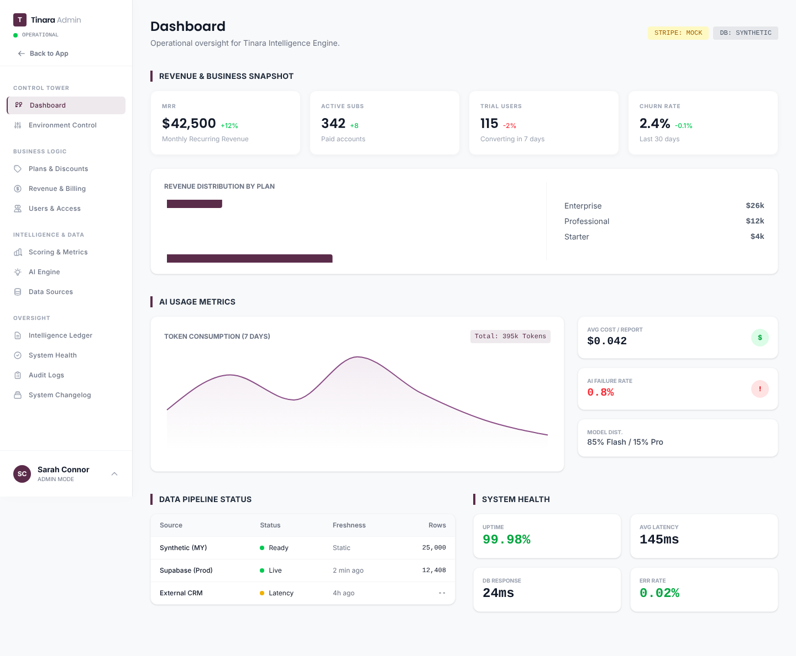

## What to keep

- The grouped sidebar (Intelligence, Knowledge Base, Account) is short and clear; seven destinations is a good size.
- One clear primary action at the top of the nav (New campaign), repeated on the dashboard.
- Credits shown in the chrome at all times, including the wizard, with amber and red warnings as they run low.
- The immersive wizard layout that removes the sidebar while a campaign is set up.
- The dashboard's four KPIs, score chart and top-three list map well to the product's job; the empty state already exists.
- In the console: the four groups, "Back to App", the environment chips and the pilot placeholder that refuses to show fake numbers (extend it to the dashboard).

## What conflicts with the brand kit

- **Credit line:** "by REKA" with orange REKA in the sidebar, wizard, sign-in and splash. Should be "Tinara · by AntaraX" in chrome and "Tinara by AntaraX, from REKA." on sign-in; orange removed.
- **Logo:** a "T" letter tile everywhere. The signal logo exists in the brand kit and is not used.
- **Colour:** plum `#5B2B4A` and amethyst lead; the kit moves to garnet `#7A1E3C` with gold and retires amethyst. Navy and maroon dark surfaces should become `#071233`.
- **Type:** Inter plus Poppins; the kit wants Poppins only and JetBrains Mono for scores, credits and counts.
- **Admin console:** "Tinara Admin", light and plum, inside the customer app. AXLE is "AXLE · Tinara", dark (`#071233`, raised `#0C1B47`), REKA orange accent, the AntaraX A, on its own address. Its dashboard shows invented US dollar revenue and old plan names (Starter, Pro, Enterprise) even in pilot.
- **Help:** no Help item, `/guide` or `/help`, and sign-in points to "your REKA administrator" instead of support@go.antarax.ai.
- **Words:** "Log Out" (Sign out), "Subscription" (Plan), "Users & Access" (Members), USER and ADMIN in capitals (Owner, Admin, Member, Viewer), "organization", and capitals or Title Case in place of sentence case.
- **AntaraX layer:** no AI sparkle by rankings or briefs, no kerawang in empty states, blur orbs instead of the Swell on sign-in, no app tile, no legal footer.
- **Accessibility:** no responsive layout at all, no AntaraX blue focus ring, no reduced motion, no aria on the nav.
- **Prototype names:** "Strategic Intelligence Platform v2.0", "REKA Intelligence", "Tinara Intelligence Engine", "Initializing Intelligence Core", and the metadata name "Remix: Remix: Remix: Tinara by REKA v1.5".
- **Organisation:** the organisation name is never shown and there is no switcher.
