# Yara: dashboard and navigation inventory

Product: **Yara** (work orders and job cards). Repo `haziqfaris/yara` at `e70cb3b` (15 Oct 2026). Stack: Next.js 15.5 App Router, Tailwind, Supabase, Recharts.

Yara has three shells:

| Surface | Who | Home | Shell |
|---|---|---|---|
| Management shell | Owner, Operation Manager (OM), Supervisor | `/dashboard` | `AppShell` = `Sidebar` + `Topbar` |
| AXLE console | REKA staff (`reka_admin`) | `/axle` (host `axle.yara.antarax.ai`) | the same `AppShell`, dark nav |
| Worker PWA | Workers on phones | `/worker` | `WorkerShell` |

The management shell and AXLE are one component switched by role (`dark = role === "reka_admin"`, `src/components/shared/AppShell.tsx:30`). Nav items are two static arrays in `src/components/shared/Sidebar.tsx`. There is no feature-flag or plan gating on nav items, only role filtering.

All screenshots were taken from the real app running locally against a throwaway mock backend with fictional data ("Demo Fabrication Sdn Bhd"). Nothing touched a real database. See [How the screenshots were made](#how-the-screenshots-were-made).

---

## 1. Management shell (customer app)

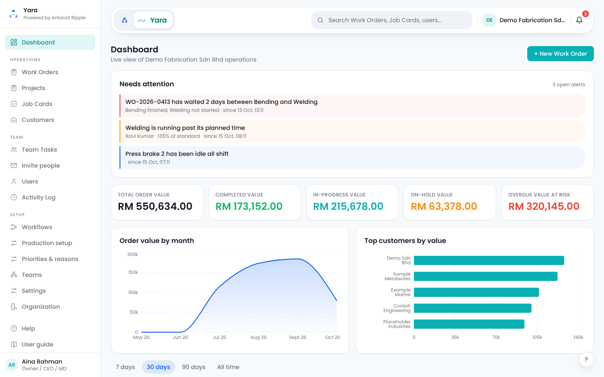

### Files

- `src/app/(app)/layout.tsx:9` loads profile, unread count and company, renders `AppShell`
- `src/components/shared/AppShell.tsx:62` layout, drawer, focus trap
- `src/components/shared/Sidebar.tsx:26` nav config `CLIENT_SECTIONS`, `:132` component
- `src/components/shared/Topbar.tsx:30` brand pill, `:75` top bar
- `src/components/shared/ProfileMenu.tsx:43` user menu (sidebar footer)
- `src/components/shared/NotificationBell.tsx:9` bell, 60 s polling
- `src/components/shared/NavIcon.tsx:2` icon set (hand-drawn inline SVG, no library, 18px, stroke 1.7)
- `src/lib/brand.ts` product name, credit, colours, asset paths

### Layout

- Fixed left sidebar, 240px wide (`w-60`), white with a right border, from `lg` (1024px) up.
- Content column: a sticky top bar drawn as a floating card (64px high, 24px radius, soft shadow) inside the page gutter, then the scrolling page (`p-4`, `lg:p-6`).
- The user menu lives in the sidebar footer, not the top bar.

### Brand block

- Sidebar head: AX Ripple mark (`public/brand/antarax-ax-ripple-centered.svg`, 32px), "Yara", and under it "Powered by AntaraX Ripple" (11px, muted).
- Top bar brand pill: the AntaraX "A" (`antarax-mark.svg`, links to antarax.ai) next to a white chip with the Ripple glyph and "Yara" in teal `#067A7C` (links to `/`, which sends each role home).
- Tenant chip on the right of the top bar: company logo or two-letter initials, and the company name (hidden on phones).
- No version or build text.

### Nav items

| Group | Label | Route | Icon (NavIcon) | Roles | Gating |
|---|---|---|---|---|---|
| (none) | Dashboard | `/dashboard` | dashboard | owner, om, supervisor | |
| Operations | Work Orders | `/work-orders` | workOrders | owner, om, supervisor | |
| Operations | Projects | `/projects` | workOrders | owner, om | role (shows order value) |
| Operations | Job Cards | `/job-cards` | jobCards | owner, om, supervisor | |
| Operations | Customers | `/customers` | customers | owner, om | role |
| Team | Team Tasks | `/team` | team | owner, om, supervisor | |
| Team | Invite people | `/users/invite` | invite | owner, om | role |
| Team | Users | `/users` | users | owner, om | role |
| Team | Activity Log | `/activity` | activity | owner, om | role |
| Setup | Workflows | `/settings/workflows` | workflows | owner, om | whole group owner/om |
| Setup | Production setup | `/settings/production` | settings | owner, om | tabs inside: standards and rates, calendar, equipment, thresholds |
| Setup | Priorities & reasons | `/settings/lookups` | settings | owner, om | |
| Setup | Teams | `/settings/teams` | teams | owner, om | |
| Setup | Settings | `/settings/features` | settings | owner, om | |
| Setup | Organization | `/settings/organization` | organization | owner, om | |
| (none, footer) | Help | `/help` | faq | all | leaves the shell |
| (none, footer) | User guide | `/guide` | guide | all | leaves the shell |

No badges or counters on nav items. No sub-menus. Group labels are 10px uppercase, letter-spaced, muted. Three Setup items share the same "settings" icon, and Projects reuses the Work Orders icon.

### Global controls

| Control | What exists |
|---|---|
| Search | Top bar field "Search Work Orders, Job Cards, users…" to `/search?q=`. On phones it collapses to a round icon that opens the field over the bar |
| Command palette | None |
| Notifications | Round bell, red count badge (caps at 9+), links to `/notifications` |
| Help | "Help" in the nav, "FAQ & Support" in the user menu, and a floating "?" button (bottom right) that reopens the page guide |
| Guide | "User guide" in the nav and the user menu |
| Organisation switcher | None (read-only tenant chip) |
| Product switcher | None. The "A" in the brand pill links out to antarax.ai |
| Create button | Not global. "+ New Work Order" on the dashboard header |
| AI entry | None |
| Theme toggle | None, light only |
| Language | None in the management shell |
| User menu | Name and role, My Profile, FAQ & Support, User guide, Log out (red, with a confirm dialog) |
| Plan badge, environment badge, impersonation | None |
| Other | Skip to content link, per-page guide card, guided tours, a `dashboard.panel` module slot |

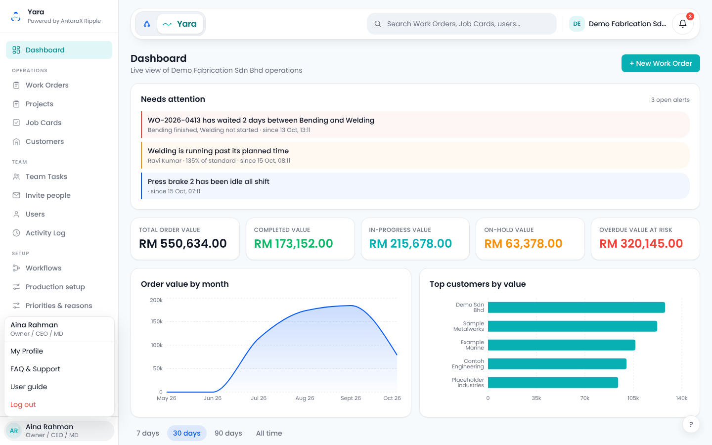

### Responsive behaviour

- `lg` (1024px) and up: fixed sidebar. At exactly 1024 the sidebar still shows ([tablet shot](screenshots/02-customer-dashboard-tablet.png)).
- Below `lg`: a 44px round hamburger appears at the left of the top bar and opens the same sidebar as a left drawer over a 30% black scrim, with a focus trap and Escape to close.
- Below `sm` (640px): search becomes an icon, the tenant chip disappears, the top bar drops to 58px.
- No bottom bar.

| Phone dashboard | Phone drawer open |
|---|---|
| 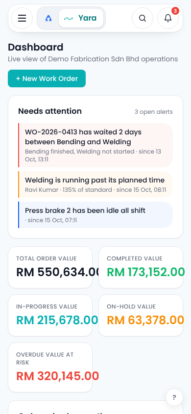 | 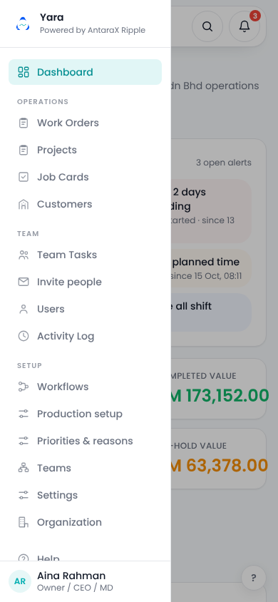 |

### Active state, colour, type, accessibility

- Active item: teal tint `#E1F6F6` background, teal-dark `#078F92` text and icon, 8px radius. Inactive: grey `#6B7280`, hover `gray-50`. The longest matching route wins, so nested pages highlight the right item.
- Colours: Ripple teal `#08B0B3` (buttons), AntaraX blue `#0459F7` (focus ring on top bar controls, range picker active state, links), page `#F7FAFC`, borders `#E5E7EB`, text `#111827`, status `#12B76A` / `#F79009` / `#F04438`.
- Type: Poppins throughout. KPI numbers are Poppins, not mono.
- Accessibility: skip link, drawer is a proper modal dialog, icon buttons labelled, bell label includes the count, 44px targets in the top bar. The blue focus ring is only on top bar controls; sidebar links, chips and range buttons have none. Reduced motion is honoured only in the guided tour.

### Role variants

- Owner and OM: all 17 items.
- Supervisor: Dashboard, Work Orders, Job Cards, Team Tasks, Help, User guide. No money anywhere on the dashboard.
- REKA staff are redirected from `/dashboard` to `/axle`. Workers never reach this shell.

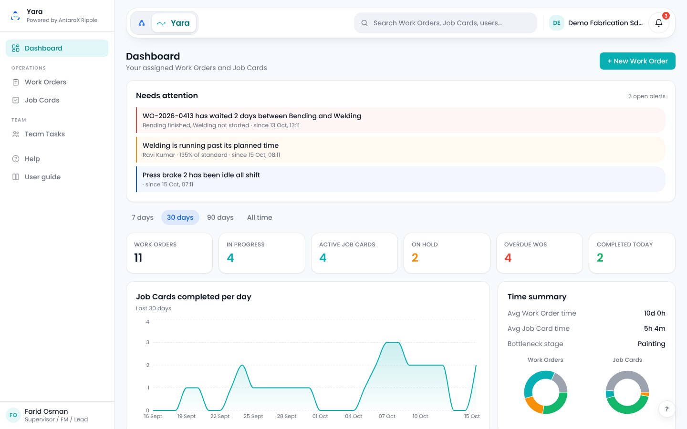

### Dashboard (`/dashboard`, `src/app/(app)/dashboard/page.tsx:22`)

Full page: [01-customer-dashboard-desktop-full.png](screenshots/01-customer-dashboard-desktop-full.png). First visit, with the page guide showing: [01-customer-dashboard-first-visit-desktop.png](screenshots/01-customer-dashboard-first-visit-desktop.png).

| # | Kind | Widget | Detail |
|---|---|---|---|
| 1 | Greeting | Dashboard | Title, "Live view of <company> operations" (supervisor: "Your assigned Work Orders and Job Cards"), "+ New Work Order" button |
| 2 | Other | Page guide | "Your operations at a glance", 3 tips, "Take the tour"; a 7-step tour on first visit |
| 3 | Alert | Needs attention | Live alerts (stalled between stages, worker running late, idle resource, forecast miss, step overridden), colour by severity, each links to the record. Hidden when there are none |
| 4 | KPI | Money tiles (owner, OM) | Total order value, Completed, In progress, On hold, Overdue value at risk |
| 5 | Chart | Order value by month (owner, OM) | Area chart, blue |
| 6 | Chart | Top customers by value (owner, OM) | Horizontal bars, top 5, teal |
| 7 | Filter | Range picker | 7 days, 30 days (default), 90 days, All time. Only affects the section below it, not the money panel above |
| 8 | KPI | Operational tiles | Work Orders, In progress, Active Job Cards, On hold, Overdue WOs, Completed today |
| 9 | Chart | Job Cards completed per day | Area chart, teal, two thirds width |
| 10 | Other | Time summary | Avg Work Order time, Avg Job Card time, Bottleneck stage, plus two status donuts |
| 11 | Chart | Avg hours per stage | Vertical bars, blue |
| 12 | Chart | Jobs completed per worker | Vertical bars, teal |
| 13 | Other | Module slot | Add-on module panels when enabled |

Charts load lazily (`DashboardViewLazy`, `MoneyPanelLazy`) behind skeletons.

---

## 2. AXLE console (REKA staff)

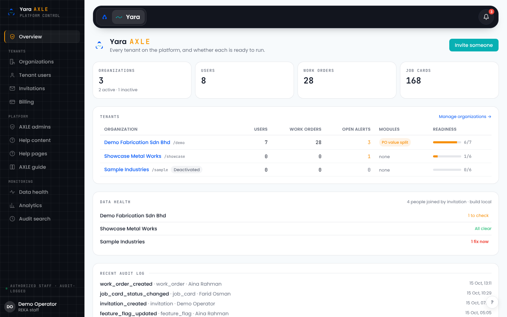

### Files

- Same layout and shell as section 1; `AppShell.tsx:30` switches to the dark nav for `reka_admin`
- `src/components/shared/Sidebar.tsx:99` nav config `AXLE_SECTIONS`, `:183` wordmark, `:250` authorised-staff footer
- `src/components/shared/Topbar.tsx:94` search hidden for AXLE
- `src/app/(app)/axle/page.tsx:20` overview
- `src/app/axle/login/page.tsx` staff sign-in
- `src/middleware.ts:17` AXLE host routing
- `src/app/globals.css:101` `.ink-grid`, `.panel-axle`, `.axle-authorized-dot`; `design-system/tokens.css:92` `--axle-*`

### Layout and brand

- Same 240px sidebar and floating top bar, but dark: ink `#0B0E14` sidebar with a faint 24px blueprint grid, top bar `#12151E`. Page content stays light with white panels.
- Wordmark: "Yara" in Poppins plus "AXLE" in JetBrains Mono, orange `#FB9800`, letter-spaced. Eyebrow "platform control" in mono uppercase.
- Footer above the profile: pulsing green dot and "authorized staff · audit-logged".
- Build sha appears only on the overview (Data health card).

### Nav items

| Group | Label | Route | Icon | Roles | Notes |
|---|---|---|---|---|---|
| (none) | Overview | `/axle` | admin | reka_admin | |
| Tenants | Organizations | `/axle/companies` | organization | reka_admin | drill-down `/axle/companies/[id]` with tabs |
| Tenants | Tenant users | `/axle/users` | users | reka_admin | never lists REKA staff |
| Tenants | Invitations | `/axle/invitations` | invite | reka_admin | |
| Tenants | Billing | `/axle/billing` | billing | reka_admin | packages, invoices; payments are off |
| Platform | AXLE admins | `/axle/admins` | shield | reka_admin | REKA staff only, no create button |
| Platform | Help content | `/axle/faqs` | faq | reka_admin | help answer editor |
| Platform | Help pages | `/help` | faq | reka_admin | leaves the shell |
| Platform | AXLE guide | `/axle/guide` | guide | reka_admin | leaves the shell |
| Monitoring | Data health | `/axle/health` | pulse | reka_admin | |
| Monitoring | Analytics | `/axle/analytics` | analytics | reka_admin | |
| Monitoring | Audit search | `/axle/audit` | activity | reka_admin | |

Matches the grouping described in the repo's CLAUDE.md (Tenants / Platform / Monitoring), plus "Help pages" and "AXLE guide" that CLAUDE.md does not list.

### Global controls

- Search: none. Command palette: none.
- Notifications: bell in the dark top bar, links to `/notifications`.
- Help and guide: in the Platform group and the user menu.
- Create: "Invite someone" button on the overview (teal, not orange).
- User menu: name and "REKA staff", My Profile, FAQ & Support, AXLE guide, Log out. Log out goes to `/login` (hard-coded in `Sidebar.tsx:260`), which the AXLE host rewrites to the AXLE sign-in.
- No organisation switcher, no impersonation: tenant data is reached through the Organizations drill-down.

### Responsive, active state

- Same breakpoints as section 1; dark drawer below 1024px. The tenants table scrolls sideways on phones.
- Active item: 2px orange left border, white 6% background, white text, orange icon. Inactive: 60% white text, 40% white icons.

| Phone overview | Phone drawer open |
|---|---|
| 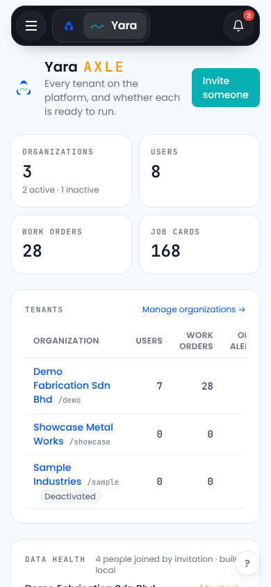 | 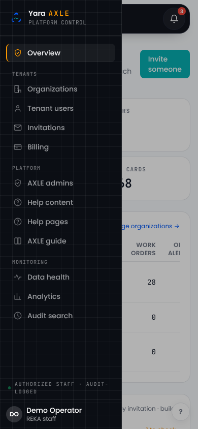 |

### Dashboard (`/axle`)

Full page: [03-axle-dashboard-desktop-full.png](screenshots/03-axle-dashboard-desktop-full.png).

| # | Kind | Widget | Detail |
|---|---|---|---|
| 1 | Greeting | Yara AXLE | Mark, title, "Every tenant on the platform, and whether each is ready to run.", "Invite someone" |
| 2 | Other | Page guide | 3 tips, 3-step tour |
| 3 | KPI | Platform counts | Organizations (with active/inactive hint), Users, Work Orders, Job Cards. Mono eyebrows and values |
| 4 | Table | Tenants | Organisation + slug + Deactivated badge, Users, Work Orders, Open alerts, Modules, Readiness bar (done/total) |
| 5 | Alert | Data health | Per tenant: "N fix now", "N to check", "N notes" or "All clear"; header shows invitation joins and build |
| 6 | Feed | Recent audit log | Last 15 actions: action, entity, actor, time |

---

## 3. Worker PWA

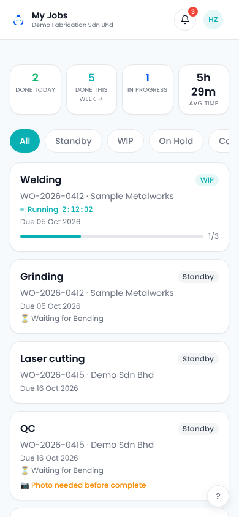

### Files

- `src/app/worker/layout.tsx:10`, `src/components/worker/WorkerShell.tsx:8`
- Worker-only menu items: `src/components/shared/ProfileMenu.tsx:156`
- Strings: `src/lib/i18n/dictionaries/en.ts:21`, `ms.ts:27` (English and Bahasa Malaysia)
- Home: `src/app/worker/page.tsx:19`

### Layout and brand

- One centred column, max 512px. Sticky white header with a bottom border. No sidebar and no bottom tabs.
- Left: tenant logo (or the AX Ripple mark), "My Jobs" ("Kerja Saya") and the company name. "Yara" does not appear once signed in, and there is no AntaraX credit.
- Right: square bell (36px) and the avatar menu.

### Navigation (header and avatar menu)

| Where | Label (EN / MS) | Route |
|---|---|---|
| Header | My Jobs (brand link) | `/worker` |
| Header | Notifications bell, unread badge | `/worker/notifications` |
| Menu | My Profile / Profil Saya | `/profile` |
| Menu | Job History / Sejarah Kerja | `/worker/history` |
| Menu | Language / Bahasa | `/worker/settings` |
| Menu | FAQ & Support / Soal Jawab & Bantuan | `/help` |
| Menu | User guide / Panduan pengguna | `/guide` |
| Menu | Log out / Log keluar | confirm, then `/worker-login` |

| Avatar menu | Wide screen |
|---|---|
| 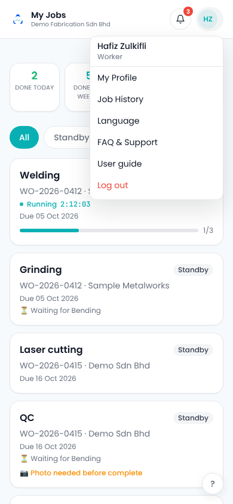 | 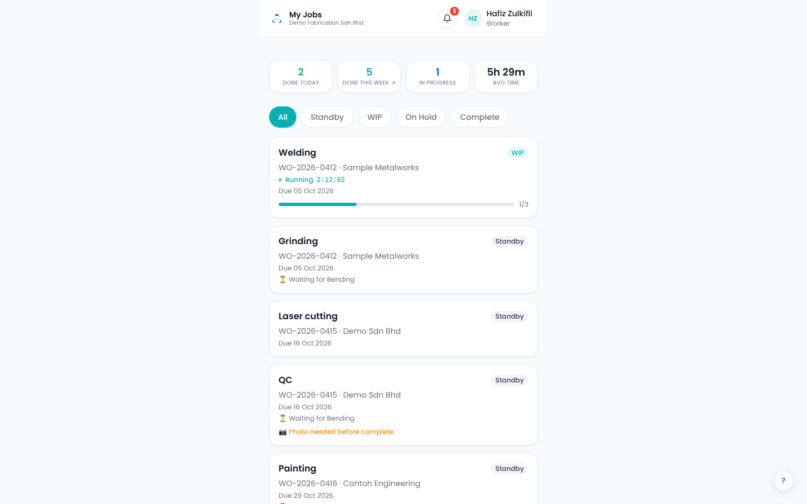 |

### Home (`/worker`)

| # | Kind | Widget | Detail |
|---|---|---|---|
| 1 | Other | Page guide | "Welcome to My Jobs", 3 tips, 3-step tour (translated) |
| 2 | KPI | Stats strip | Done today, Done this week (links to history), In progress, Avg time. Counts only, never money |
| 3 | Filter | Status chips | All, Standby, WIP, On Hold, Complete |
| 4 | Table | Job list | Cards in queue order: operation, status, WO number and customer, running timer (mono), due date, "Waiting for <stage>", task progress, "Photo needed before complete" |
| 5 | Other | Module slot | `worker.currentTask` |
| 6 | Quick action | Password request | Ask the office for a password change |

Full list: [04-worker-home-mobile-full.png](screenshots/04-worker-home-mobile-full.png).

---

## 4. Sign-in screens

| Management `/login` | AXLE `/axle/login` |
|---|---|
| 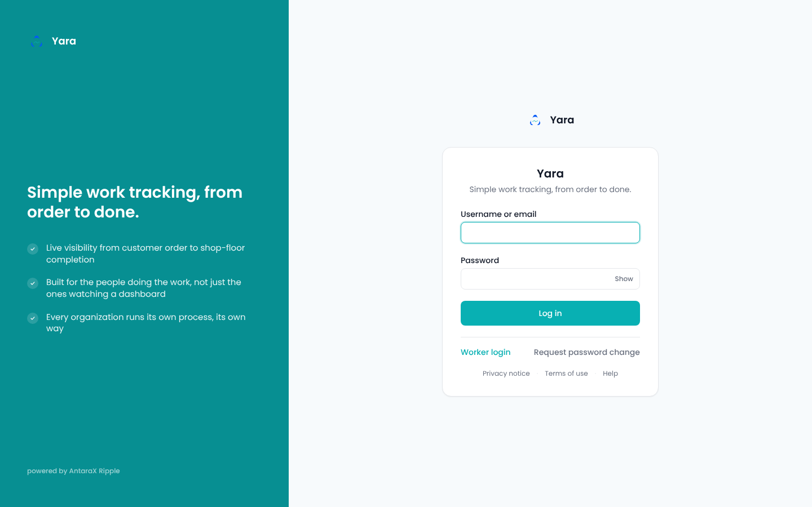 | 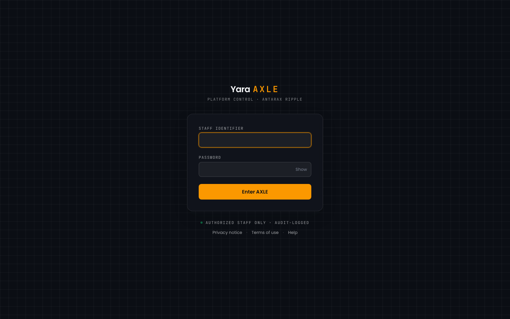 |

| Management on a phone | Worker `/worker-login` |
|---|---|
| 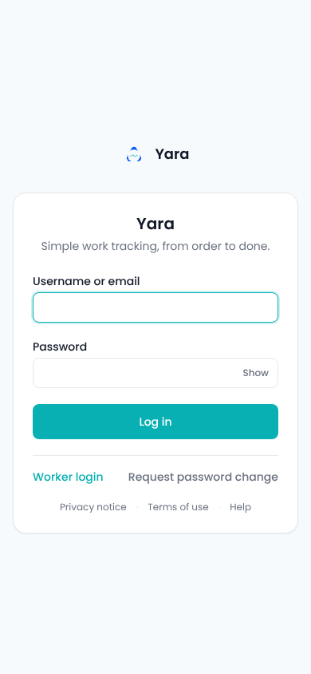 | 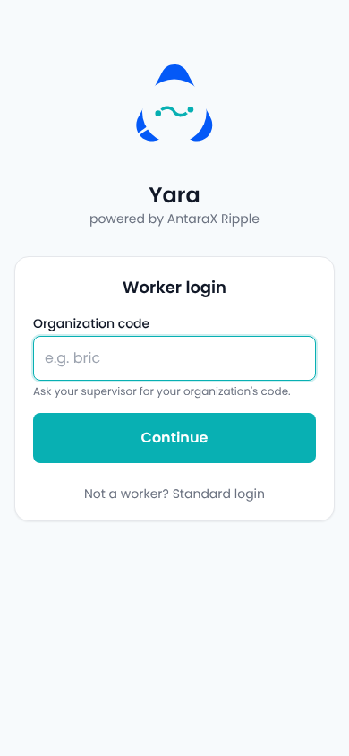 |

The tenant-branded sign-in (`/login/<org>`) shows the organisation name as the heading: see [repo-guide-signin-showcase-1366.jpg](screenshots/repo-guide-signin-showcase-1366.jpg).

---

## How the screenshots were made

- Files `01` to `05`: the repo's own dev server (port 3101) with a dummy, gitignored `.env.local` pointing Supabase at a small mock server (port 3201) that answered the auth and PostgREST calls with fictional data. Sign-in pages needed no data. The Next.js dev badge was hidden with injected CSS, and the guide cards were pre-dismissed except in the "first visit" shot.
- Files `repo-*`: copied from the repo.
  - `public/guide/*.jpg` were retaken on 15 Oct 2026 on the fictional Showcase tenant and **match the current nav code**. They are a reliable fallback.
  - `docs/screenshots/<role>/` (the per-role crawler output) is gitignored and **not in the clone**; only `docs/screenshots/report.json` and `docs/screenshots/tours/` are committed.
  - `docs/screenshots/tours/` is **out of date**: the old plain top bar without the brand pill, and a nav without Invite people, Help or User guide. See [repo-tour-management-dashboard-step1-OUTDATED.png](screenshots/repo-tour-management-dashboard-step1-OUTDATED.png).
  - `public/guide/axl-overview.jpg` is current but shows the first client's name and live counts, so it was not copied.
- The live sign-in page could not be captured: the session's network proxy refused `yara.antarax.ai`.

---

## What to keep

- One shell component for tenant and AXLE, switched by role. The dark AXLE nav with an orange accent and the "authorized staff · audit-logged" footer makes the staff session unmistakable.
- The floating top bar with the AntaraX "A" and the product chip: it is already the family pattern.
- Nav grouped by job (Operations, Team, Setup) and AXLE grouped by whose it is (Tenants, Platform, Monitoring).
- Role filtering that hides, rather than disables, what a role cannot use. Money is shown only to owner and OM.
- An alerts panel that disappears when there is nothing wrong.
- The AXLE overview as a tenant roll-up (readiness, health, audit) rather than a grid of links.
- The worker shell: one column, counts only, big targets, translated, the tenant's own logo.
- Mono for AXLE numbers and eyebrows.

## What conflicts with the brand kit

- Credit line "Powered by AntaraX Ripple" in the sidebar, sign-in, worker sign-in, splash and AXLE sign-in. The kit wants "Yara · by AntaraX" in chrome and "Yara by AntaraX, from REKA." on sign-in.
- "Yara AXLE" naming. The kit wants "AXLE · Yara", at `axle.antarax.ai` in time.
- AXLE ground `#0B0E14` / `#12151E` instead of the kit's `#071233` / `#0C1B47`. The AXLE primary button is teal, not orange.
- US spelling: "Organization", "Organizations", "Organization code", "Every organization runs its own process".
- Words: "Log in" / "Log out" instead of Sign in / Sign out; "Users" and "Tenant users" instead of members; role labels "Owner / CEO / MD", "Operation Manager", "REKA staff" instead of Owner, Admin, REKA support.
- Primary action is Ripple teal `#08B0B3`. The Yara sheet sets primary `#098284` (hover `#05686A`), accent dark `#0B6E72`, tint `#D9F3F2`.
- Money written "RM 550,634.00" with a space and in Poppins; the kit wants "RM550,634.00" in JetBrains Mono tabular figures. On phones the money tiles overflow their cards.
- Focus ring only on top bar controls; reduced motion honoured only in the tour (the AXLE pulse and the worker running dot animate regardless).
- Help is split across "Help", "User guide", "FAQ & Support", "Help content", "Help pages" and "AXLE guide". The kit asks for one Help item per menu.
- No AI sparkle (correct for now: Yara has no AI), no app tile, no "from REKA" trust line, no Ripple Rings on sign-in, no awan larat in empty states.
- The worker shell shows no product name or credit once signed in.
- The worker sign-in placeholder "e.g. bric" names the first client's organisation code.
